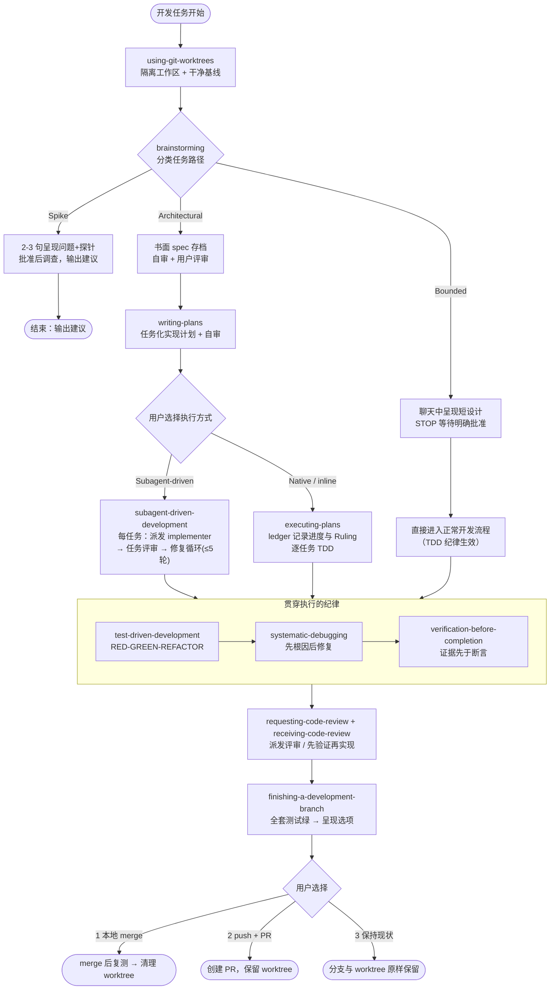

# Superpowers 技能中文导读手册

## 文档定位

本手册是 `bigscreenweb/.trae/skills/superpowers/` 下 11 个开发纪律技能的**中文导读**，用于帮助团队成员快速理解每个技能的职责边界、核心纪律与协作衔接。

**技能的完整规则以 `.trae/skills/superpowers/` 各目录下的英文原文 `SKILL.md` 为准**。为避免翻译损失，技能实际触发与执行时，AI 读取并遵循的是英文原文；本手册仅作人读参考，不作为执行依据。

**来源**：[obra/superpowers](https://github.com/obra/superpowers)（MIT License）。

**阅读约定**：技能名、命令、代码、专有术语（RED-GREEN-REFACTOR、YAGNI、DRY、worktree、spec、ledger、HARD-GATE 等）保留英文原文；"人类伙伴"（your human partner）指与 AI 协作的开发者。

---

## 技能目录里都有什么（文件结构说明）

每个技能目录**只有 `SKILL.md` 是入口**。AI 的加载机制是渐进披露：

1. **触发时**只读 `SKILL.md` 顶部的 name + description，判断是否触发
2. **执行时**读入 `SKILL.md` 全文作为流程指令
3. **按需加载**：当 `SKILL.md` 正文写明"读 xxx.md"或"运行 scripts/xxx"时，AI 才去读取/执行对应文件

因此附属文件不是冗余，而是按阶段取用的"附录和工具箱"：

| 附属文件类型 | 示例 | AI 何时使用 |
| ------------ | ---- | ----------- |
| 提示词模板 | `requesting-code-review/code-reviewer.md`、`subagent-driven-development/*-prompt.md` | 派发评审/实现子代理时，按模板构造子代理的提示词 |
| 技术深度文档 | `test-driven-development/writing-good-tests.md`、`systematic-debugging/root-cause-tracing.md` 等 | 进入相应环节（写测试、根因追踪）时展开阅读 |
| 可执行脚本 | `executing-plans/scripts/task-start、task-done`、`subagent-driven-development/scripts/*` | 通过 Bash 执行，记录任务进度、提取任务摘要、打包评审材料 |
| 可选功能 | `brainstorming/scripts/` + `visual-companion.md` | 可视化伴侣（本地预览服务器），不启用不影响主流程 |
| 上游测试遗留 | `systematic-debugging/test-pressure-*.md`、`test-academic.md`、`CREATION-LOG.md` | 不参与运行——上游作者测试技能质量的用例与开发日志，保留以与上游保持一致 |

> 团队维护约定：`superpowers/` 目录与上游 obra/superpowers 保持一致，更新时从上游整体拷贝覆盖对应技能目录即可，无需甄别单个文件。

---

## 技能总览

| # | 技能名 | 触发时机 | 一句话作用 |
|---|--------|----------|-----------|
| 1 | brainstorming | 任何创造性工作（新功能/组件/行为修改）**开始之前** | 通过提问与共识把想法变成设计，人类伙伴批准后才许动手 |
| 2 | writing-plans | 已有 spec/需求的多步任务，**动代码之前** | 把 spec 拆成零上下文工程师也能照做的任务化实现计划 |
| 3 | executing-plans | 用户选择 inline 执行计划，或无 subagent 工具时 | 本会话逐任务执行计划，用 ledger 记录进度与裁决 |
| 4 | subagent-driven-development | 执行任务彼此独立的计划（有 subagent 工具） | 每任务派发全新 implementer + 任务评审 + 终审全分支评审 |
| 5 | test-driven-development | 实现任何功能或修 bug，**写实现代码之前** | RED-GREEN-REFACTOR：没有先失败的测试就没有生产代码 |
| 6 | systematic-debugging | 遇到任何 bug/测试失败/意外行为，**提出修复之前** | 四阶段根因调查，禁止在未理解根因前打症状补丁 |
| 7 | verification-before-completion | 即将声称"完成/已修复/通过"或提交/PR 之前 | 先跑验证命令并读输出，证据先于任何成功断言 |
| 8 | requesting-code-review | 完成任务、完成大功能、merge 之前 | 用 code-reviewer.md 模板派发评审 subagent 拦截问题 |
| 9 | receiving-code-review | 收到评审反馈、实现建议之前 | 先验证再实现，技术正确高于社交舒适，禁表演性认同 |
| 10 | using-git-worktrees | 开始需隔离的功能开发，或执行实现计划之前 | 检测/创建隔离工作区（原生工具优先，git worktree 兜底） |
| 11 | finishing-a-development-branch | 实现完成、测试全绿、需要决定如何集成时 | 绿套件 → 呈现选项（merge/PR/保留）→ 执行 → 清理 |

---

## 1. brainstorming — 把想法变成设计

**触发时机**：任何创造性工作之前——创建功能、构建组件、添加功能或修改行为。原文描述为 MUST 级别：在实现动作（写产品代码、脚手架、装产品依赖、调用实现类技能）之前必须完成本技能。详见 `brainstorming/SKILL.md`。

**核心纪律与流程**：

- **建立共识三步**：① 发现意图（目的、受众、成功标准，缺什么就一次问一个聚焦问题）；② 写回理解（简短总结意图/约束/成功标准，区分"用户说的"与"假设的"，邀请纠正）；③ 把共识带入设计产物，逐一核对提出的功能与技术选型。
- **三条路径**（动手前先分类并**说出来**让用户可纠正）：
  - **Spike**（可行性探索）：输出是**答案不是代码**。2-3 句话呈现问题+探针方案，点头后调查，报告为建议；产出的代码一律标记为 throwaway。
  - **Bounded**（有界修改）：改的是本仓库**已存在可读的流程**。在聊天中呈现短设计（几句到几段：方案、涉及文件、测试），然后 **STOP**，等待明确的"yes"才实现。批准门与架构级同样硬。
  - **Architectural**（架构级）：新项目、新子系统、改变接口/组件关系的改动。完整流程：提问 → 提出 2-3 个方案带权衡 → 分节呈现设计逐节确认 → 书面 spec 存到 `docs/superpowers/specs/YYYY-MM-DD-<topic>-design.md` 并提交 → spec 自审（占位符/一致性/范围/歧义）→ 用户评审 spec → 转入 writing-plans。
- **HARD-GATE**：每条路径都以人类伙伴批准该路径要求的设计产物为前提。批准只对"当前呈现的阶段"有效——批准想法不等于批准还不存在的产物，一个批准不能兑换跳过其余阶段。
- **棘轮单向**：中途发现隐藏复杂度，路径只能**升级**不能降级；停下来、说出来、升级路径。拿不准两条路径之间选哪条时，选重的那条。
- **反模式："太简单不需要批准"**——拒绝"我叫它 bounded 所以跳过 spec"这类自我豁免；bounded 只衡量仓库现状，不衡量你对这类应用的熟悉度。
- 设计与提问遵守 YAGNI（无情砍掉不必要功能）、一次只问一个问题、优先选择题。

**与其他技能的衔接**：Architectural 路径的**唯一**下游技能是 writing-plans（不许直接跳到其他实现技能）；Bounded 批准后直接进入正常开发流程（TDD 适用），不产出计划文档；Spike 的终点就是一份建议报告。

---

## 2. writing-plans — 写实现计划

**触发时机**：已拿到 spec 或需求的多步任务，在动任何代码之前。开写时声明"I'm using the writing-plans skill"。

**核心纪律与流程**：

- **零上下文假设**：计划要假设执行者是技术好手，但对本项目代码库、工具链、领域几乎一无所知，且不擅长测试设计。把每件事文档化：改哪些文件、代码长什么样、跑什么命令验证、预期输出是什么。
- **四原则贯穿**：DRY、YAGNI、TDD、频繁提交。
- **范围检查**：spec 若覆盖多个独立子系统，应拆成多个 plan，每个 plan 独立产出可运行可测试的软件。
- **文件结构先行**：定义任务前先映射新建/修改哪些文件、各自职责。单元边界清晰、文件小而聚焦（一起变的文件放一起，按职责切分不按技术分层）；既有代码库沿用既有模式，不擅自重构。
- **任务粒度**：每步是一个 2-5 分钟的动作（写失败测试 → 跑确认失败 → 写最小实现 → 跑确认通过 → commit）；任务是"携带自己测试循环、值得一个新鲜评审者把关"的最小单元，任务间按"评审者可能拒掉这个任务但通过相邻任务"来切分。
- **计划文档必须以规定 header 开头**：Goal / Architecture / Tech Stack / Spec 指针（spec 随计划一起走）/ **Global Constraints**（从 spec 逐字复制全局约束）/ **Review Focus**（spec 暗示但任务测试覆盖不到、最可能坑到真实用户的 5 类输入或失败模式，逐行补进对应任务的测试）。
- **No Placeholders（计划失败项）**：禁止 TBD/TODO/"以后补细节"、"添加适当的错误处理"这类空话、"为上面写测试"（必须给真实测试代码）、"类似 Task N"（必须重复代码）、引用任何任务都未定义的函数/类型。代码步骤必须有代码块。
- **自审**：spec 覆盖（每条需求能指到任务）、占位符扫描、类型一致性（Task 3 的 `clearLayers()` 与 Task 7 必须同名）、Review Focus 落实；发现问题就地修复。
- **保存与交接**：存到 `docs/superpowers/plans/YYYY-MM-DD-<feature-name>.md`，请用户评审计划，并选择执行方式——**Subagent-driven**（每任务新鲜 implementer+评审，最彻底）或 **Native/inline**（本会话自己执行+最后一次新鲜评审，最省）。

**与其他技能的衔接**：上游是 brainstorming 的 spec；下游二选一——Subagent-driven → subagent-driven-development，Native → executing-plans。

---

## 3. executing-plans — 本会话 inline 执行计划

**触发时机**：用户在计划交接时选择了 inline 执行，或当前环境没有 subagent 工具。由本会话自己当 implementer，逐任务执行，最后做一次全分支新鲜评审。

**核心纪律与流程**：

- **核心原则**：计划已经完成了思考——严格执行它，每一步用"亲眼看着失败→再看通过"的测试证明，并留下能扛住上下文遗忘的记录（ledger）。
- **连续执行**：任务之间不停下来问"要不要继续"；用户选 inline 是为了省成本。
- **Rulings, not stalls**：冲突/歧义/计划缺陷由自己裁决而不是停摆。spec 是约束权威，plan 是其论证，两者都没答的由判断裁定；每条裁决记入 ledger：`Ruling: <决定> — <理由> — <错了的代价>`。**只有四类事停下来问**：不可逆/破坏性操作、安全敏感操作、worktree 之外按惯例要先打招呼的副作用（merge、push 共享分支、发布）、计划坏到每条路都是猜。
- **Setup**：用 using-git-worktrees 确保 worktree 隔离（未经明确同意绝不在 main/master 上动手）；运行 `sdd-workspace` 解析本计划的 workspace；检查 `<workspace>/progress.md` ledger 实现断点续传（已有 `Task <N>: complete` 的任务不重做，压缩后**信 ledger 和 git log 而非自己的记忆**）；读 plan + spec 一次；**开工前 pre-flight 扫描**任务间接口冲突并写入 ledger；加载 test-driven-development 技能。
- **任务循环**：`task-start` 取 brief 和 BASE → 严格按步骤走 TDD，每个 `Expected:` 与真实输出对照 → 三种结果：匹配继续；**代码错**→ 走 systematic-debugging（绝不打补丁凑输出）；**计划错**→ 以 spec 为准做最小裁决并记 ledger → 按计划 commit → 过**完成契约**（brief 点名的测试都跑过且读过输出、最终跑全测试通过、每条 Expected 对照过、每处偏差有 Ruling）→ `task-done` 通过才写完成行。
- **终审**：`review-package` 打包后，有 subagent 工具就用 requesting-code-review 的 code-reviewer.md 在**最强模型**上派发评审（这是全流程唯一一次新鲜上下文，不可省略）；没有则自己按 code-reviewer.md 自审并在 ledger 声明。按"合理人使用该软件的实际所得"**重新定级**：Critical/Important 进**一轮**修复（每项 RED→GREEN + 套件全绿，不二刷评审）；Minor 进 ledger 作为 Deferred minors；不修的发现记成 Ruling。
- **收尾**：最终消息列出全部 Rulings 和 Deferred minors（这是替用户做的决策唯一能被看见的地方）；删除本计划 workspace（git 历史即记录）；转 finishing-a-development-branch。

**与其他技能的衔接**：writing-plans 的下游之一；执行中必加载 test-driven-development，代码错走 systematic-debugging，完成契约引用 verification-before-completion，终审复用 requesting-code-review 的模板，终点是 finishing-a-development-branch。与 subagent-driven-development 共享 workspace 与 ledger 格式，中途可换执行方式。

---

## 4. subagent-driven-development — 派发 subagent 执行计划

**触发时机**：在当前会话执行**任务彼此独立**的实现计划，且用户未选 inline、有 subagent 工具。决策树：有计划？任务独立？未选 inline 且有 subagent 工具？→ 本技能；否则手动执行/先 brainstorm，或走 executing-plans。

**核心纪律与流程**：

- **核心公式**：每任务全新 implementer subagent + 任务评审（spec 符合 + 代码质量双重裁决）+ 末尾全分支大评审 = 高质量快迭代。subagent 不继承会话历史，由控制者精确构造其所需上下文。
- **与 executing-plans 相同的底座**：连续执行不请示；Rulings not stalls（同样的四类停止条件与 ledger 格式）；worktree 隔离、ledger 断点续传、pre-flight 扫描。
- **模型选择**：机械实现用便宜模型、多文件集成用标准模型、架构与**终审用最强模型**；派发时**必须显式指定模型**（省略则继承会话模型，悄悄烧钱）。Turn 数比 token 单价更决定成本，多步任务以中端模型为底线；计划里含完整代码的纯转录任务可用最便宜档。
- **派发纪律**：用 `task-brief` 生成任务简报文件，subagent 只读 brief 不读整个 plan；报告写到与 brief 同名的 report 文件，只回传状态+commit+一行测试摘要+顾虑；dispatch prompt 描述任务本身，**绝不粘贴历史上下文**；implementer 内部**禁止再派 subagent**（含评审）；实现类 subagent 不并行；小而同形的批量修改可合并为一次派发。
- **报告四态**：DONE → 生成 review-package 派发评审；DONE_WITH_CONCERNS → 先读顾虑；NEEDS_CONTEXT → 补上下文重派；BLOCKED → 分诊（补上下文/换更强模型/拆任务/裁决计划错误），**绝不**不改任何东西硬重试。
- **任务评审**：评审者输入 = brief + report + review-package 三个文件路径 + 逐字复制的 Global Constraints；不许预判 findings（"别报这个"是禁语）；评审者报的"⚠️ 无法从 diff 验证"项必须由控制者亲自裁决。
- **修复循环（每任务最多 5 轮）**：触发条件为 spec ❌ 或任何 Critical/Important；Minor 永不进循环（记 ledger 延后）。第 1-3 轮 resume 原 implementer；第 4-5 轮换更强模型的新 implementer；每轮 = 一次修复 + 一次**限定范围**的 re-review（只判 ADDRESSED/NOT ADDRESSED，只查修复 diff 的新破坏）。第 5 轮仍有遗留 → **断路器**：控制者逐项裁决——评审者错了/可争议 → park 并记 Ruling；真实但不承重 → park 延后；真实且承重 → 裁决最小修复并带入下个任务。静默丢弃 finding 是禁止的。
- **终审与收尾**：全分支评审用最强模型 + **一个** fix subagent 处理全部 findings + **一次** scoped re-review（没有第二波）；清理 workspace；最终消息给出完整 Rulings 清单；转 finishing-a-development-branch。

**与其他技能的衔接**：writing-plans 的下游之一；终审复用 requesting-code-review 的 code-reviewer.md；workspace/ledger 与 executing-plans 互通；终点是 finishing-a-development-branch。

---

## 5. test-driven-development — 测试驱动开发

**触发时机**：实现任何功能或修 bug 时，**在写实现代码之前**。新功能、bug 修复、重构、行为变更一律适用；例外（一次性原型、生成代码、配置文件）需征得人类伙伴同意。"就这一次跳过 TDD"的想法本身就是合理化。

**核心纪律与流程**：

- **铁律**：`NO PRODUCTION CODE WITHOUT A FAILING TEST FIRST`。先写了代码？**删掉**，从测试重写——不留作"参考"、不"改编"、不看它，删就是删。
- **RED-GREEN-REFACTOR 循环**：
  - **RED**：写一个最小失败测试，只测一个行为、名字清晰、测真实代码（mock 仅在不可避免时用）。
  - **验证 RED（强制，不可跳过）**：跑测试，确认它**失败而非报错**，失败原因是"功能缺失"而非拼写错误。测试直接通过 = 在测已有行为，修测试。
  - **GREEN**：写**刚好通过测试**的最小实现，不加功能不顺手重构。
  - **验证 GREEN（强制）**：测试通过，且**项目整套测试**都通过（跑仓库的标准命令，不只跑自己写的文件；"其他测试"红了视而不见 = 报告造假）；输出干净（无报错无警告）。
  - **REFACTOR**：绿了再去重、改命名、提 helper，保持绿，不加行为。然后进入下一个失败测试。
- **好测试标准**：最小（名字里有"and"就拆）、清晰（名字描述行为）、展示意图；写或改任何测试前先读 `writing-good-tests.md`（点名能让测试失败的生产行为、断言真实行为而非 mock 行为、测试专用代码不进生产类、先懂依赖副作用再 mock）。
- **卡住即信号**：不知道怎么测→先写期望的 API/先写断言；测试太复杂→设计太复杂；什么都得 mock→耦合过重，用依赖注入；setup 巨大→提 helper，仍复杂就简化设计。
- **与 debug 的接口**：发现 bug 先写复现它的失败测试再修——测试既证明修复又防回归，**没有测试不修 bug**。
- **收尾清单**：每个新函数有测试、亲眼看它失败过、失败原因正确、最小实现、全部通过、输出干净、mock 最小化、边界与错误覆盖。勾不全 = 没做 TDD，推倒重来。

**与其他技能的衔接**：被 executing-plans / subagent-driven-development 在开工前强制加载；systematic-debugging Phase 4 用它写失败测试；verification-before-completion 的回归测试验证依赖其 red-green 流程。

---

## 6. systematic-debugging — 系统化调试

**触发时机**：遇到**任何** bug、测试失败或意外行为时，在提出修复之前。越是时间紧、"一眼看出修法"、已经试过多次修复、上一个修复没用、还没搞懂问题时，越要用它；简单问题不豁免（简单 bug 也有根因）。

**核心纪律与流程**：

- **铁律**：`NO FIXES WITHOUT ROOT CAUSE INVESTIGATION FIRST`——Phase 1 没完成不得提出修复；**修症状 = 失败**。
- **四阶段**（逐阶段完成才能进下一阶段）：
  - **Phase 1 根因调查**：仔细读错误信息与完整堆栈（别跳过警告）；稳定复现（不能复现就收集更多数据，不猜）；检查最近变更（git diff、新依赖、配置差异）；多组件系统在**每个组件边界**埋点（记录进/出数据、验证环境传播），跑一次拿到"断在哪一层"的证据；深层调用栈时反向追踪坏值来源（反向追踪完整技巧详见技能目录下 `root-cause-tracing.md`），**在源头修，不在症状处修**。
  - **Phase 2 模式分析**：找同库中能工作的相似代码；参考实现要**完整读**（不略读、不"改编着用"）；列出工作的与坏的之间**每一个**差异（别假设"这个不可能有影响"）；搞清依赖与环境。
  - **Phase 3 假设与测试**：一次只立一个明确假设（"我认为 X 是根因因为 Y"）；用**最小**改动验证，一次只动一个变量；无效就形成新假设，**绝不在失败修复上继续叠加**；不懂就说不懂，求助或再研究。
  - **Phase 4 实现**：先建最简失败复现（能用 test-driven-development 写自动化测试最好）；**单一修复**（一次一处，不夹带"顺手改进"）；验证通过且不破坏其他测试（用 verification-before-completion 确认后才算成功）。
- **三次失败规则**：修复尝试 ≥3 次仍未好 → **停下质疑架构**（每次修复都在别处暴露新问题、需要"大重构"才能落地、每次修复制造新症状——这不是假设失败，是架构错了），与人类伙伴讨论后再动，不许盲试第 4 次。
- **红灯信号**："先快速修一下回头再查""试试改 X 看行不行""多个改动一起上跑个测试""跳过测试我手动验证""大概是 X，先修了"——出现即 STOP 回 Phase 1。
- **确无根因时**（环境/时序/外部依赖）：完成流程、记录调查过程、实现恰当处理（重试/超时/报错）并加监控——但记住：95% 的"无根因"是调查不完整。
- **支撑技术**（同目录）：`defense-in-depth.md`（根因确认后逐层加校验）、`condition-based-waiting.md`（用条件轮询替代任意超时）。

**与其他技能的衔接**：executing-plans 中"代码错了"分支的直接去向；Phase 4 调用 test-driven-development 与 verification-before-completion；与 finishing 前的最终验证呼应。

---

## 7. verification-before-completion — 完成前先验证

**触发时机**：即将声称工作完成/已修复/通过时，以及提交、创建 PR 之前。任何成功断言（含同义词、转述、暗示）之前都必须有**新鲜的**验证证据。

**核心纪律与流程**：

- **铁律**：`NO COMPLETION CLAIMS WITHOUT FRESH VERIFICATION EVIDENCE`——本条消息里没跑过验证命令，就不能声称通过。核心原则：**证据先于断言，永远**。
- **门函数**（声称任何状态前走完）：① IDENTIFY 什么命令能证明这个断言；② RUN 完整地跑（新鲜、完整）；③ READ 完整输出、查退出码、数失败数；④ VERIFY 输出是否证实断言（否则陈述带证据的真实状态）；⑤ 然后才能声称。**跳过任何一步都是在说谎，不是在验证**。
- **断言与证据对照表**：
  - "测试通过"需要测试命令输出 0 failures——上次跑过、"应该会过"都不算。
  - "构建成功"需要构建命令 exit 0——linter 通过不等于编译通过。
  - "bug 修好"需要原症状测试通过——改了代码≠修好了。
  - "回归测试有效"需要 red-green 验证——只跑过一次绿不算。
  - "agent 完成了"需要看 VCS diff——agent 报"成功"要独立核实。
  - "需求满足"需要逐行对照清单——测试通过不覆盖需求。
- **红灯**：使用 should/probably/seems to；验证前表达满意（"Great!"/"Perfect!"/"Done!"）；未验证就 commit/push/PR；信任 agent 的成功报告；依赖部分验证；"就这一次"；累了想收工。规则适用于精确短语、同义改写与一切成功暗示。
- **理由对照**："我现在有信心"→ 信心≠证据；"linter 过了"→ linter≠编译器；"agent 说成功"→ 独立验证；"部分检查够了"→ 部分证明不了任何事。

**与其他技能的衔接**：全流程通用的完成关卡——executing-plans 的完成契约由它把关；systematic-debugging Phase 4 的验证步骤引用它；test-driven-development 的收尾清单与它同构；finishing-a-development-branch 的 Step 1 是它在大分支层面的应用。

---

## 8. requesting-code-review — 发起代码评审

**触发时机**：完成任务、实现重大功能、或 merge 到 main 之前，派评审拦截问题。**强制场景**：subagent-driven 每个任务之后、重大功能完成时、merge 前；**可选但有价值**：卡住时（新鲜视角）、重构前（基线检查）、修完复杂 bug 后。

**核心纪律与流程**：

- **核心原则**：早评审、常评审；评审者拿到的是精心构造的上下文，**绝不是会话历史**。
- **做法三步**：
  1. 取 SHA：`BASE_SHA`（用 `git merge-base origin/main HEAD` 或任务起点）、`HEAD_SHA`。
  2. 用本技能目录下 `code-reviewer.md` 模板派发评审 subagent，填四个占位符：`{DESCRIPTION}` 做了什么、`{PLAN_OR_REQUIREMENTS}` 应该做什么、`{BASE_SHA}`、`{HEAD_SHA}`。
  3. 按反馈行动：Critical 立即修；Important 修完再继续；Minor 记下以后处理；评审者错了就**用技术理由推回**（展示代码/测试证明），或请求澄清。
- **为什么派 subagent 而不是自己看 diff**：评审的 diff 和评估过程留在 reviewer 的上下文里，只有结论回到控制者——自己看 diff 会烧掉继续驱动工作所需的上下文。
- **红线**：绝不因为"很简单"跳过评审；绝不忽略 Critical；绝不带着未修的 Important 继续；绝不与有效的技术反馈争吵。

**与其他技能的衔接**：subagent-driven-development 的任务评审与两个执行技能的**终审**都复用其 `code-reviewer.md` 模板；收到反馈后的应对纪律见 receiving-code-review（两者是一对）。

---

## 9. receiving-code-review — 接收代码评审

**触发时机**：收到代码评审反馈时、实现建议之前——尤其当反馈不清楚或技术上有疑问时。核心：需要的是技术评估，不是情绪表演。

**核心纪律与流程**：

- **响应六步**：READ 完整读不先反应 → UNDERSTAND 用自己的话复述需求（或不明白就问）→ VERIFY 对照代码库现实 → EVALUATE 对这个代码库技术上是否成立 → RESPOND 技术性确认或有理推回 → IMPLEMENT 一次一项、每项测试。
- **禁语与替代**：禁 "You're absolutely right!"、"Great point!"、未验证就说"我现在实现"；替代做法是复述技术需求、提问澄清、有理推回或直接开始干。**反馈正确时也不说谢谢**——"Thanks" 一律删掉，直接陈述修了什么；代码本身就说明你听进去了。
- **推回错了就利落认账**：事实性说明"我查了 X，确实如你所说，因为 Y 我最初理解错了，现在修"，不长道歉不辩解。
- **含糊反馈全停**：任何一条不清楚就 STOP，先全部澄清再实现（条目之间可能相关，部分理解 = 错误实现）。示例：明白 1、2、3、6，含糊 4、5 → 正确做法是先澄清 4 和 5，而不是先做 1、2、3、6。
- **区分来源**：来自人类伙伴——理解后实现，范围不清仍要问；来自外部评审——五项检查（对本代码库正确？破坏现有功能？当前实现是否有理由？在所有平台/版本上成立？评审者是否了解完整上下文？），无法验证就直说"没有 X 我验证不了"；与人类伙伴既往决策冲突就**先停下与人类伙伴讨论**。
- **YAGNI 检查**：评审者建议"把某功能做正规"→ 先 grep 代码库是否真的有人用；没人用就提议"删掉它（YAGNI）？"而不是照单全收。
- **实现顺序**：先澄清 → Blocking（崩溃/安全）→ 简单修复（错字/导入）→ 复杂修复（重构/逻辑）；每项单独测试，最后验证无回归。
- **推回时机**：破坏现有功能、评审者缺上下文、违反 YAGNI、对本技术栈不成立、有兼容性原因、与人类伙伴架构决策冲突。方式：技术论证、具体提问、引用可工作的测试/代码，架构层面的请人类伙伴介入。

**与其他技能的衔接**：与 requesting-code-review 成对使用；每项修复的"单独测试"由 test-driven-development 支撑，最终声明仍过 verification-before-completion。

---

## 10. using-git-worktrees — 建立隔离工作区

**触发时机**：开始需要与当前工作区隔离的功能开发时，或执行实现计划之前。开跑时声明"I'm using the using-git-worktrees skill"。

**核心纪律与流程**：

- **核心原则**：先检测已有隔离 → 优先原生工具 → 最后退回手动 git worktree；**永不与 harness 对着干**。
- **Step 0 检测已有隔离**：比较 `GIT_DIR` 与 `GIT_COMMON`（`git rev-parse`）；两者不同且**非 submodule**（用 `--show-superproject-working-tree` 排除子模块）→ 已在隔离 worktree，跳过创建，绝不重复建。普通仓库 → 先征求人类伙伴同意再建（已有声明偏好的除外；拒绝就原地工作）。
- **Step 1 创建**：
  - **1a 原生工具优先**：有 `EnterWorktree`/`WorktreeCreate`/`/worktree`/`--worktree` 之类原生工具就用它——绕过原生工具直接 `git worktree add` 是**头号错误**，会制造 harness 看不见也管不了的幻影状态。
  - **1b 手动兜底**：目录选择优先级为 指令声明 > 项目内既有 `.worktrees/` > `worktrees/` > 默认项目根 `.worktrees/`；**必须先 `git check-ignore` 验证目录被忽略**（没忽略就先加 .gitignore 并提交，否则整棵树会被提交进仓库）；`git worktree add` 遇沙盒权限错误则说明情况、原地工作。
- **Step 2 项目 setup**：按 package.json / Cargo.toml / requirements.txt / pyproject.toml / go.mod 自动安装依赖。
- **Step 3 验证干净基线**：跑项目测试；失败就报告并询问是否继续（脏基线会让之后每个失败都说不清）；通过则报告就绪。
- **红灯**："我显然不在 worktree 里不用查"（肉眼看不出来，命令说了算）；"目录肯定已经忽略了"；"工作区是新的，基线测试以后再说"。

**与其他技能的衔接**：executing-plans / subagent-driven-development 的 Setup 第一步都要求用它创建或验证隔离工作区；finishing-a-development-branch 的清理步骤（只清理 `.worktrees/` 与 `worktrees/` 之下、由本技能创建的 worktree）是它的对称收尾。

---

## 11. finishing-a-development-branch — 收尾开发分支

**触发时机**：实现完成、全部测试通过、需要决定如何集成工作时。开跑时声明"I'm using the finishing-a-development-branch skill"。

**核心纪律与流程**：

- **核心流程**：验证测试 → 检测环境 → 呈现选项 → 执行选择 → 清理。
- **Step 1 验证测试**：跑项目**全套**测试；失败就停下展示失败清单——**菜单只在绿套件之后出现**（"本会话早些时候测试过"不算，绿套件只证明它跑过的那棵树）。
- **Step 2 检测环境**：比较 `GIT_DIR`/`GIT_COMMON` 并记录 `WORKTREE_PATH`（趁还在 worktree 里时抓取）。普通仓库 → 标准 3 选项、无 worktree 清理；named-branch worktree → 3 选项 + 按来源清理；detached HEAD（外部管理）→ 2 选项（无 merge）、workspace 原地保留。
- **Step 3 确定基分支**：从计划/对话/上游找分叉点，不确定就问"这个分支是从 X 分出来的，对吗？"——合错基分支代价很大。
- **Step 4 呈现选项**：**原样**呈现菜单——① 本地 merge 回基分支；② push 并创建 PR；③ 分支保持现状稍后处理。detached HEAD 只给 ②③。**丢弃工作只在对方案确要求时存在**，且必须等用户键入 `discard` 一词才执行。
- **Step 5 执行**：merge 前先 checkout 基分支并 pull，**merge 后在合并结果上再跑测试**——失败就停、worktree 与分支原地保留（merge 是本地的、可恢复的，此时什么都还没 push）；PR 路线保留 worktree 供 PR 反馈迭代；保持现状则报告分支与 worktree 路径。
- **Step 6 清理**：只清理**自己创建的** worktree（位于 `.worktrees/` 或 `worktrees/` 之下，`git worktree remove` + `prune`）；宿主环境管理的 workspace 一律不动。删除被拒（有未提交文件）→ **绝不擅自 `--force`**——展示文件清单，让人类伙伴选：提交到分支 / 移回主仓库根 / 删除（不可恢复）。
- **红灯**："他们显然想 merge"（集成是人的决定，呈现菜单并等待）、"'扔了吧'算确认"（只有键入的 `discard` 算数）、"顺手把旁边那个旧 worktree 也清了"（不是自己的不碰）、"push 被拒了 force-push 就行"（远程动了，先调查；force-push 仅限人类伙伴明确要求）。

**与其他技能的衔接**：executing-plans 与 subagent-driven-development 的终点动作；与 using-git-worktrees 一头一尾呼应；Step 1 的绿套件要求是 verification-before-completion 在集成层面的落点。

---

## 12. 11 个技能如何串成完整开发工作流

### 文字流程

1. **隔离准备**：`using-git-worktrees` 检测/创建隔离工作区，装依赖、验证干净基线（执行类技能的 Setup 也会再校验一次）。
2. **设计共识**：`brainstorming` 将任务分类为 Spike / Bounded / Architectural——Spike 产出建议；Bounded 在聊天中短设计获批准后直接进入第 4 步的纪律执行；Architectural 产出书面 spec（自审 + 用户评审）。
3. **任务化计划**：`writing-plans` 把 spec 拆成零占位符、每步可验证的任务化计划（含 Global Constraints 与 Review Focus），自审后请用户选择执行方式。
4. **执行（二选一）**：`subagent-driven-development`（每任务独立 implementer + 任务评审 + 修复循环 + 终审）或 `executing-plans`（本会话 inline + ledger 记录 + 终审）。两者共享 workspace/ledger，执行中都强制 `test-driven-development` 的 RED-GREEN-REFACTOR 循环；出现 bug/测试失败随时进入 `systematic-debugging` 的四阶段根因调查；任何"完成/通过"声明前都过 `verification-before-completion` 的门函数。
5. **评审应对**：终审通过 `requesting-code-review`（code-reviewer.md 模板）发起；对每条反馈按 `receiving-code-review` 的纪律先验证、按 YAGNI 评估、有理推回或一次一项修复。
6. **集成收尾**：`finishing-a-development-branch` 在绿套件之上呈现 merge / PR / 保留三选项，按用户选择执行并清理工作区，分支生命周期闭环。

### 流程图

---

*本手册生成于 2026-09-23，基于 `.trae/skills/superpowers/` 当前版本英文原文提炼；技能原文更新后请以原文为准修订本手册。*
