# 新疆公司数据管理平台项目 详细设计

- 甲方单位：中煤鄂尔多斯能源化工有限公司
- 乙方单位：中煤信息技术（北京）有限公司
- 归属公司：中煤新疆能源有限公司
- 时间：2026 年

# 第1章 项目概述

## 1.1 项目背景

新疆公司作为中煤集团在新疆区域的重要能源企业，下辖哈密能源、伊犁公司、条湖公司等多个生产主体，涵盖井工开采、露天开采、洗选加工、煤炭储运销、煤电联营等完整产业链。随着企业规模扩大和业务复杂度提升，现有各业务系统独立运行、数据分散，缺乏统一的数据管理和可视化展示平台，难以满足公司层面对全域生产运营态势的实时掌控和精细化管理需求。

为贯彻落实集团公司关于智能化矿山建设和数字化转型的总体部署，新疆公司拟建设数据管理平台（煤炭板块），通过整合各业务系统数据，构建统一的数据汇聚、治理、分析和可视化展示体系，实现公司-矿井-工作面三级穿透式监管，为公司领导决策、调度指挥、业务管理提供全面、及时、准确的数据支撑。

## 1.2 建设目标

本项目的总体建设目标是：构建覆盖新疆公司全域煤炭业务的数据管理平台，实现生产、安全、储运销、基建等全业务域数据的统一汇聚、治理和可视化展示，具体目标包括：

（1）数据统一汇聚：整合生产监测、安全监测、运储销、机电设备、人员定位、环保监测等20余类业务系统数据，构建统一的数据资源池。

（2）三级穿透监管：建立公司级-矿井级-工作面/核心设备级三级穿透式管控架构，支持从全域总览到单矿详情再到工作面/设备实时数据的逐级下钻。

（3）智能预警联动：构建生产过程三级预警和安全监测四级预警体系，实现预警自动识别、分级推送、联动处置和闭环管理。

（4）运营分析决策：开发采煤工效、吨煤成本、单进效率、区队排名等运营分析模型，自动生成日/周/月运营简报，为管理决策提供数据支撑。

（5）多端协同展示：支持PC端、大屏端、移动端三端协同，满足领导驾驶舱、调度中心、移动办公等不同场景需求。

## 1.3 建设范围

本项目建设范围覆盖新疆公司本部及下属哈密能源、伊犁公司、条湖公司三大生产主体，涉及大七矿、皮里青矿、条湖一矿等生产矿井，以及配套洗煤厂、电厂等关联企业。平台功能规划共9大一级模块、67项功能，具体模块统计如下：

|  |  |  |  |  |  |  |  |
| --- | --- | --- | --- | --- | --- | --- | --- |
| **序号** | **一级模块** | **功能项数** | **拓展开发** | **定制开发** | **高难度** | **中难度** | **低难度** |
| 1 | 生产运营管理 | 11 | 0 | 11 | 2 | 2 | 7 |
| 2 | 煤炭生产管理 | 17 | 5 | 12 | 5 | 3 | 9 |
| 3 | 储运销管理 | 7 | 0 | 7 | 2 | 3 | 2 |
| 4 | 安全管理 | 17 | 14 | 3 | 2 | 8 | 7 |
| 5 | 基建管理 | 2 | 2 | 0 | 0 | 2 | 0 |
| 6 | 统一分级报警 | 4 | 0 | 4 | 0 | 3 | 1 |
| 7 | 生产调度报表 | 4 | 2 | 2 | 0 | 1 | 3 |
| 8 | 生产运营简报 | 3 | 2 | 1 | 3 | 0 | 0 |
| 9 | 移动端应用 | 2 | 0 | 2 | 0 | 1 | 1 |
| 合计 |  | 67 | 25 | 42 | 14 | 23 | 30 |

## 1.4 设计依据

（1）《新疆公司数据管理平台项目-煤炭板块功能规划清单》

（2）《新疆公司数据管理平台项目-应用规划概要》

（3）中煤集团智能化矿山建设相关标准和规范

（4）《煤矿安全生产信息化建设规范》

（5）国家及行业关于煤矿安全监控、人员定位、紧急避险等系统的技术标准

（6）新疆公司现有各业务系统接口规范和数据字典

# 第2章 总体架构设计

## 2.1 系统总体架构

新疆公司数据管理平台采用分层架构设计，自下而上分为数据采集层、数据治理层、数据服务层、应用展示层和用户接入层，各层之间通过标准化接口进行数据交互和服务调用。

### 2.1.1 数据采集层

数据采集层负责从各业务子系统采集原始数据，涵盖煤炭生产数据、运储销数据、基建项目数据、安全环保数据、设备运行数据、人员数据、调度值班数据等七大类数据。采集方式包括数据库直连、API接口调用、文件交换、消息队列订阅等多种方式，支持实时采集和定时批量采集两种模式。

### 2.1.2 数据治理层

数据治理层对采集的原始数据进行清洗、转换、标准化、关联整合，构建统一的数据资源池。主要功能包括：数据质量校验（完整性、准确性、一致性检查）、数据标准化处理（统一编码、单位、口径）、数据关联整合（跨系统数据关联、主数据管理）、数据存储管理（实时数据存储、历史数据归档）、数据安全管理（数据脱敏、访问控制、审计日志）。

### 2.1.3 数据服务层

数据服务层将治理后的数据封装为标准化的数据服务，向上层应用提供数据支撑。主要包括：指标计算服务（生产指标、安全指标、运营指标的实时计算）、预警规则引擎（可配置的分级预警规则执行引擎）、分析算法服务（工效分析、成本分析、对标分析等算法模型）、数据查询服务（多维度数据查询、聚合统计、趋势分析）、数据推送服务（消息推送、报表推送、告警推送）。

### 2.1.4 应用展示层

应用展示层基于数据服务层提供的能力，构建9大业务功能模块的可视化应用，包括生产运营管理、煤炭生产管理、储运销管理、安全管理、基建管理、统一分级报警、生产调度报表、生产运营简报、移动端应用。展示形式包括数字卡片、环形图、柱状图、折线图、饼图、进度条、地图、表格、状态标识等多种可视化组件。

### 2.1.5 用户接入层

用户接入层支持PC端Web浏览器、大屏端展示终端、移动端APP/H5三种接入方式，满足公司领导、调度人员、业务管理人员、系统管理员等不同角色在不同场景下的使用需求。

## 2.2 三级穿透管控架构

平台采用公司级-矿井级-工作面/核心设备级三级穿透式管控架构，实现从全域总览到具体测点的逐级下钻和数据穿透。

### 2.2.1 公司级（顶层）

公司级作为顶层总览，汇总展示全公司产能资源、采掘剥存销总量、产销存平衡、全域安全环保态势、三级预警汇总、六大产业基地布局；提供各矿井产量、成本、外运、隐患等横向对标数据；集成带班领导、设备总览、经营台账、全局告警、全域产业地图等总览信息。

下钻交互方式：（1）点击全域地图矿井点位弹窗；（2）点击图表、台账内对应矿井名称；（3）点击告警明细归属矿井字段。输出数据粒度为全公司汇总数据和分矿井聚合统计数据。

### 2.2.2 矿井级（中间层）

矿井级展示单矿产销、掘进剥离、库存煤质、吨煤成本等核心生产数据；呈现各工作面进度、巷道接续状态；汇总本矿隐患违章、灾害监测、环保排放数据；展示全矿大型设备工况、故障预警及运储销履约明细。

下钻交互方式：（1）点击工作面名称、进度图表；（2）点击设备图标、设备统计卡片；（3）点击生产、监测图表分项指标；（4）点击灾害预警对应工作面测点。输出数据粒度为单矿汇总数据、分工作面聚合数据和矿内设备分组统计数据。

### 2.2.3 工作面/核心设备级（底层）

工作面维度：展示工作面设计及剩余推进长度、当班进尺、割煤刀数、掘进欠量、巷道接续达标率、产销计划完成率；实时呈现瓦斯、CO、顶板压力、冲击地压、井下涌水等灾害监测数据及超限记录；展示作业人员在岗情况、现场隐患违章、危大工程管控实况、工作面煤质指标及产出溯源数据。

核心设备维度：展示采煤机、运输机、通风机等主要大型设备实时运行温度、负荷、启停状态；统计设备开机率、作业率、故障停机时长及维保台账。

下钻交互方式：（1）点击矿井页面工作面卡片、监测点位；（2）点击设备列表、设备编号及故障预警条目；（3）直接在告警弹窗定位底层测点、设备。输出数据粒度为单工作面实时明细、单台设备秒级采集数据和单监测测点原始数据。

## 2.3 技术架构设计

平台技术架构采用前后端分离的微服务架构，前端采用Vue.js+ECharts可视化技术栈，后端采用Spring Cloud微服务框架，数据存储采用关系型数据库+时序数据库+分布式文件存储的混合存储方案。

功能实现方式分为七类：大屏可视化定制开发、智控平台拓展开发、业务系统数据集成、预警规则引擎开发、分析算法模型开发、移动端嵌入开发、系统配置与运维开发。各类实现方式的技术特点和典型应用如下：

|  |  |  |  |
| --- | --- | --- | --- |
| **实现方式** | **说明** | **技术特点** | **典型功能示例** |
| 大屏可视化定制开发 | 面向大屏端的全新可视化开发，含图表、地图、卡片等组件开发 | 前端可视化技术栈，定制化UI/UX，适配大屏分辨率 | 全域地图、指标看板、各类图表组件 |
| 智控平台拓展开发 | 基于现有智控平台功能模块进行复用和拓展 | 复用已有功能，减少重复开发，快速迭代 | 报表管理、任务督办、知识共享、菜单管理 |
| 业务系统数据集成 | 对接现有业务系统数据，做集成展示和统一呈现 | 数据接口对接，数据清洗转换，统一展示 | 生产监测、安全监测、运储销等系统数据接入 |
| 预警规则引擎开发 | 基于规则引擎的分级预警、联动告警功能开发 | 可配置规则，分级预警，多渠道推送，闭环管理 | 三级预警、设备运行时间预警、储运销联动预警 |
| 分析算法模型开发 | 运营分析、对标分析、排名等需要算法支撑的功能 | 数据建模，指标计算，对标分析，自动生成 | 采煤工效分析、吨煤成本计算、区队排名、运营简报自动生成 |
| 移动端嵌入开发 | 面向移动端的功能开发，嵌入现有移动平台 | 响应式设计，轻量化展示，消息推送 | 移动端看板、业务详情、简报阅读 |
| 系统配置与运维开发 | 后台管理、配置管理、权限管理等基础功能开发 | 基础架构支撑，运维监控，安全审计 | 用户权限、指标配置、操作日志、运行监控 |

## 2.4 数据架构设计

数据架构设计遵循"统一采集、集中存储、分层治理、服务共享"的原则，构建从数据源到数据应用的完整数据链路。数据存储采用分层设计：

（1）ODS层（操作数据存储）：存储从各业务系统采集的原始数据，保留数据原貌，支持数据溯源和重算。

（2）DWD层（明细数据层）：对原始数据进行清洗、标准化、去重、关联，形成统一的明细数据模型。

（3）DWS层（汇总数据层）：按业务主题对明细数据进行聚合统计，形成面向分析的汇总数据模型。

（4）ADS层（应用数据层）：面向具体应用场景，封装为可直接使用的指标数据、报表数据、看板数据。

# 第3章 功能模块详细设计

本章对9大一级模块、67项功能进行详细设计，每项功能包含功能描述、实现方式、数据来源、端侧形态、建设难度、优先级、界面设计、交互设计、数据处理逻辑等内容。

## 3.1 生产运营管理

生产运营管理模块共规划11项功能，以下逐项进行详细设计。

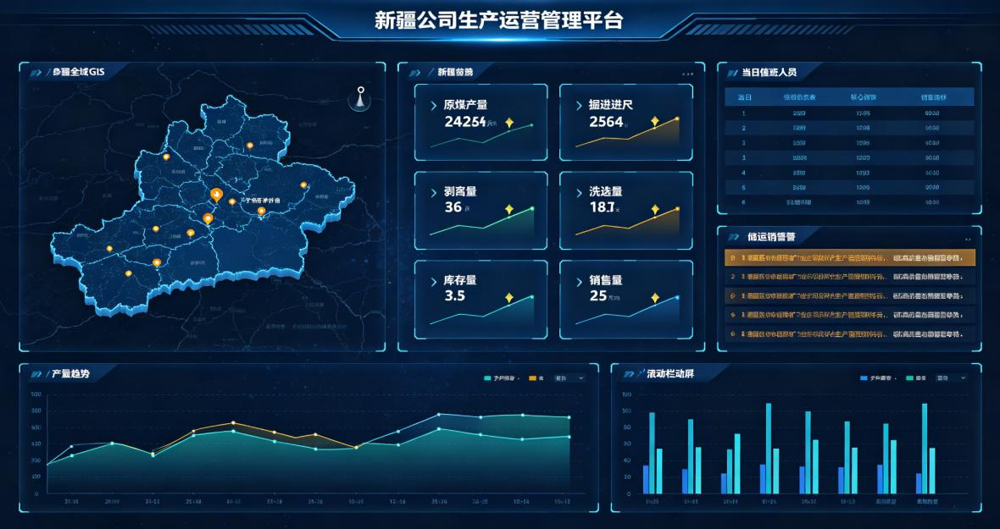

**图3-1 生产运营管理模块界面示意图**

### 3.1.1 当日值班

|  |  |
| --- | --- |
| **属性** | **内容** |
| 功能编号 | F001 |
| 所属模块 | 生产运营管理 |
| 功能名称 | 当日值班 |
| 功能概要 | 分四大主体（新疆公司本部、哈密能源、伊犁公司、条湖公司），区分白班/夜班/早班/中班，展示姓名、职务、联系电话 |
| 实现方式 | 定制开发+业务系统数据集成 |
| 数据来源 | 值排班信息 |
| 端侧形态 | PC端/大屏端 |
| 建设难度 | 低 |
| 建设优先级 | 高 |
| 备注说明 | 大屏展示为主，集成排班系统数据 |

**功能设计说明**

本功能（编号F001）是生产运营管理模块的重要组成部分，分四大主体（新疆公司本部、哈密能源、伊犁公司、条湖公司），区分白班/夜班/早班/中班，展示姓名、职务、联系电话

实现方式方面，本功能采用定制开发与业务系统数据集成相结合的方式。前端基于可视化技术栈定制开发展示界面，后端通过数据接口对接值排班信息，完成数据的采集、清洗、转换和统一展示。数据集成过程中需确保数据口径统一、更新及时，满足平台数据质量要求。

界面设计方面，本功能综合运用数字卡片、柱状图、折线图、环形图、数据表格等多种可视化组件，根据数据特点选择最合适的展示形式。图表支持悬停显示详细数据、点击下钻、多维度切换等交互操作。整体布局遵循大屏设计规范，采用深色主题配色，确保数据醒目、视觉舒适。

数据处理逻辑方面，系统从值排班信息采集相关数据，经过数据清洗、格式转换、口径统一等处理后，存储于平台数据资源池。前端展示时通过数据服务接口获取所需数据，支持实时刷新和定时更新两种模式。数据查询支持多维度筛选、聚合统计和趋势分析，满足不同场景下的数据展示需求。

### 3.1.2 采煤

|  |  |
| --- | --- |
| **属性** | **内容** |
| 功能编号 | F002 |
| 所属模块 | 生产运营管理 |
| 功能名称 | 采煤 |
| 功能概要 | 原煤开采产量统计（年/月/日累计），细化大七矿、皮里青矿、条湖一矿分年/月/日产量 |
| 实现方式 | 定制开发+业务系统数据集成 |
| 数据来源 | 数据湖 |
| 端侧形态 | PC端/大屏端 |
| 建设难度 | 低 |
| 建设优先级 | 高 |
| 备注说明 | 核心生产指标，卡片+明细表展示 |

**功能设计说明**

本功能（编号F002）是生产运营管理模块的重要组成部分，原煤开采产量统计（年/月/日累计），细化大七矿、皮里青矿、条湖一矿分年/月/日产量

实现方式方面，本功能采用定制开发与业务系统数据集成相结合的方式。前端基于可视化技术栈定制开发展示界面，后端通过数据接口对接数据湖，完成数据的采集、清洗、转换和统一展示。数据集成过程中需确保数据口径统一、更新及时，满足平台数据质量要求。

界面设计方面，本功能综合运用数字卡片、柱状图、折线图、环形图、数据表格等多种可视化组件，根据数据特点选择最合适的展示形式。图表支持悬停显示详细数据、点击下钻、多维度切换等交互操作。整体布局遵循大屏设计规范，采用深色主题配色，确保数据醒目、视觉舒适。

数据处理逻辑方面，系统从数据湖采集相关数据，经过数据清洗、格式转换、口径统一等处理后，存储于平台数据资源池。前端展示时通过数据服务接口获取所需数据，支持实时刷新和定时更新两种模式。数据查询支持多维度筛选、聚合统计和趋势分析，满足不同场景下的数据展示需求。

### 3.1.3 掘进

|  |  |
| --- | --- |
| **属性** | **内容** |
| 功能编号 | F003 |
| 所属模块 | 生产运营管理 |
| 功能名称 | 掘进 |
| 功能概要 | 矿井巷道累计掘进进尺（年/月/日累计），细化大七矿、条湖一矿分年/月/日进尺量 |
| 实现方式 | 定制开发+业务系统数据集成 |
| 数据来源 | 数据湖 |
| 端侧形态 | PC端/大屏端 |
| 建设难度 | 低 |
| 建设优先级 | 高 |
| 备注说明 | 核心生产指标，卡片+滚动明细 |

**功能设计说明**

本功能（编号F003）是生产运营管理模块的重要组成部分，矿井巷道累计掘进进尺（年/月/日累计），细化大七矿、条湖一矿分年/月/日进尺量

实现方式方面，本功能采用定制开发与业务系统数据集成相结合的方式。前端基于可视化技术栈定制开发展示界面，后端通过数据接口对接数据湖，完成数据的采集、清洗、转换和统一展示。数据集成过程中需确保数据口径统一、更新及时，满足平台数据质量要求。

界面设计方面，本功能综合运用数字卡片、柱状图、折线图、环形图、数据表格等多种可视化组件，根据数据特点选择最合适的展示形式。图表支持悬停显示详细数据、点击下钻、多维度切换等交互操作。整体布局遵循大屏设计规范，采用深色主题配色，确保数据醒目、视觉舒适。

数据处理逻辑方面，系统从数据湖采集相关数据，经过数据清洗、格式转换、口径统一等处理后，存储于平台数据资源池。前端展示时通过数据服务接口获取所需数据，支持实时刷新和定时更新两种模式。数据查询支持多维度筛选、聚合统计和趋势分析，满足不同场景下的数据展示需求。

### 3.1.4 剥离

|  |  |
| --- | --- |
| **属性** | **内容** |
| 功能编号 | F004 |
| 所属模块 | 生产运营管理 |
| 功能名称 | 剥离 |
| 功能概要 | 露天矿土石方剥离量（月/年累计），可切换年/月维度，查看各矿剥离量明细及剥离欠量详情 |
| 实现方式 | 定制开发+业务系统数据集成 |
| 数据来源 | 数据湖 |
| 端侧形态 | PC端/大屏端 |
| 建设难度 | 低 |
| 建设优先级 | 高 |
| 备注说明 | 露天矿核心指标，卡片+滚动明细 |

**功能设计说明**

本功能（编号F004）是生产运营管理模块的重要组成部分，露天矿土石方剥离量（月/年累计），可切换年/月维度，查看各矿剥离量明细及剥离欠量详情

实现方式方面，本功能采用定制开发与业务系统数据集成相结合的方式。前端基于可视化技术栈定制开发展示界面，后端通过数据接口对接数据湖，完成数据的采集、清洗、转换和统一展示。数据集成过程中需确保数据口径统一、更新及时，满足平台数据质量要求。

界面设计方面，本功能综合运用数字卡片、柱状图、折线图、环形图、数据表格等多种可视化组件，根据数据特点选择最合适的展示形式。图表支持悬停显示详细数据、点击下钻、多维度切换等交互操作。整体布局遵循大屏设计规范，采用深色主题配色，确保数据醒目、视觉舒适。

数据处理逻辑方面，系统从数据湖采集相关数据，经过数据清洗、格式转换、口径统一等处理后，存储于平台数据资源池。前端展示时通过数据服务接口获取所需数据，支持实时刷新和定时更新两种模式。数据查询支持多维度筛选、聚合统计和趋势分析，满足不同场景下的数据展示需求。

### 3.1.5 洗选

|  |  |
| --- | --- |
| **属性** | **内容** |
| 功能编号 | F005 |
| 所属模块 | 生产运营管理 |
| 功能名称 | 洗选 |
| 功能概要 | 干选效能监控（人员配置、水耗、电耗、产出量、入洗量、运行时间）；水洗效能监控（人员配置、水耗、电介消耗、入洗量、精煤产量、发出量） |
| 实现方式 | 定制开发+业务系统数据集成 |
| 数据来源 | 选煤厂自动化系统+洗煤厂能源系统 |
| 端侧形态 | PC端/大屏端 |
| 建设难度 | 高 |
| 建设优先级 | 中 |
| 备注说明 | 趋势图+柱状图+表格多维展示 |

**功能设计说明**

本功能（编号F005）是生产运营管理模块的重要组成部分，干选效能监控（人员配置、水耗、电耗、产出量、入洗量、运行时间）；水洗效能监控（人员配置、水耗、电介消耗、入洗量、精煤产量、发出量）

实现方式方面，本功能采用定制开发与业务系统数据集成相结合的方式。前端基于可视化技术栈定制开发展示界面，后端通过数据接口对接选煤厂自动化系统+洗煤厂能源系统，完成数据的采集、清洗、转换和统一展示。数据集成过程中需确保数据口径统一、更新及时，满足平台数据质量要求。

界面设计方面，本功能综合运用数字卡片、柱状图、折线图、环形图、数据表格等多种可视化组件，根据数据特点选择最合适的展示形式。图表支持悬停显示详细数据、点击下钻、多维度切换等交互操作。整体布局遵循大屏设计规范，采用深色主题配色，确保数据醒目、视觉舒适。

数据处理逻辑方面，系统从选煤厂自动化系统+洗煤厂能源系统采集相关数据，经过数据清洗、格式转换、口径统一等处理后，存储于平台数据资源池。前端展示时通过数据服务接口获取所需数据，支持实时刷新和定时更新两种模式。数据查询支持多维度筛选、聚合统计和趋势分析，满足不同场景下的数据展示需求。

### 3.1.6 库存

|  |  |
| --- | --- |
| **属性** | **内容** |
| 功能编号 | F006 |
| 所属模块 | 生产运营管理 |
| 功能名称 | 库存 |
| 功能概要 | 全矿区原煤场、筒仓、站台库存盘点量（年/月累计周转），可跳转各矿当前储量及料位计数据，设高低预警线 |
| 实现方式 | 定制开发+业务系统数据集成+预警规则引擎开发 |
| 数据来源 | 仓存系统 |
| 端侧形态 | PC端/大屏端 |
| 建设难度 | 低 |
| 建设优先级 | 高 |
| 备注说明 | 含库存高低预警逻辑 |

**功能设计说明**

本功能（编号F006）是生产运营管理模块的重要组成部分，全矿区原煤场、筒仓、站台库存盘点量（年/月累计周转），可跳转各矿当前储量及料位计数据，设高低预警线

实现方式方面，本功能采用定制开发与业务系统数据集成相结合的方式。前端基于可视化技术栈定制开发展示界面，后端通过数据接口对接仓存系统，完成数据的采集、清洗、转换和统一展示。数据集成过程中需确保数据口径统一、更新及时，满足平台数据质量要求。

界面设计方面，本功能综合运用数字卡片、柱状图、折线图、环形图、数据表格等多种可视化组件，根据数据特点选择最合适的展示形式。图表支持悬停显示详细数据、点击下钻、多维度切换等交互操作。整体布局遵循大屏设计规范，采用深色主题配色，确保数据醒目、视觉舒适。

数据处理逻辑方面，系统从仓存系统采集相关数据，经过数据清洗、格式转换、口径统一等处理后，存储于平台数据资源池。前端展示时通过数据服务接口获取所需数据，支持实时刷新和定时更新两种模式。数据查询支持多维度筛选、聚合统计和趋势分析，满足不同场景下的数据展示需求。

### 3.1.7 销售

|  |  |
| --- | --- |
| **属性** | **内容** |
| 功能编号 | F007 |
| 所属模块 | 生产运营管理 |
| 功能名称 | 销售 |
| 功能概要 | 煤炭外销发运量（年/月累计），联动储运销模块，可切换年/月，查看各矿销售明细，自动计算产销差 |
| 实现方式 | 定制开发+业务系统数据集成 |
| 数据来源 | 运输系统、装车系统、储运销系统 |
| 端侧形态 | PC端/大屏端 |
| 建设难度 | 中 |
| 建设优先级 | 高 |
| 备注说明 | 卡片+联动展示，含产销差计算 |

**功能设计说明**

本功能（编号F007）是生产运营管理模块的重要组成部分，煤炭外销发运量（年/月累计），联动储运销模块，可切换年/月，查看各矿销售明细，自动计算产销差

实现方式方面，本功能采用定制开发与业务系统数据集成相结合的方式。前端基于可视化技术栈定制开发展示界面，后端通过数据接口对接运输系统、装车系统、储运销系统，完成数据的采集、清洗、转换和统一展示。数据集成过程中需确保数据口径统一、更新及时，满足平台数据质量要求。

界面设计方面，本功能综合运用数字卡片、柱状图、折线图、环形图、数据表格等多种可视化组件，根据数据特点选择最合适的展示形式。图表支持悬停显示详细数据、点击下钻、多维度切换等交互操作。整体布局遵循大屏设计规范，采用深色主题配色，确保数据醒目、视觉舒适。

数据处理逻辑方面，系统从运输系统、装车系统、储运销系统采集相关数据，经过数据清洗、格式转换、口径统一等处理后，存储于平台数据资源池。前端展示时通过数据服务接口获取所需数据，支持实时刷新和定时更新两种模式。数据查询支持多维度筛选、聚合统计和趋势分析，满足不同场景下的数据展示需求。

### 3.1.8 新疆全域地理可视化地图

|  |  |
| --- | --- |
| **属性** | **内容** |
| 功能编号 | F008 |
| 所属模块 | 生产运营管理 |
| 功能名称 | 新疆全域地理可视化地图 |
| 功能概要 | 新疆全疆行政区划+地形底图，标注矿井/电厂/化工/新能源点位，支持点位点击和图层切换 |
| 实现方式 | 定制开发+地图开发 |
| 数据来源 | 全景底图+业务数据 |
| 端侧形态 | PC端/大屏端 |
| 建设难度 | 中 |
| 建设优先级 | 高 |
| 备注说明 | 地图开发，核心可视化组件 |

**功能设计说明**

本功能（编号F008）是生产运营管理模块的重要组成部分，新疆全疆行政区划+地形底图，标注矿井/电厂/化工/新能源点位，支持点位点击和图层切换

实现方式方面，本功能采用定制开发+地图开发的方式进行建设，数据来源于全景底图+业务数据，确保功能实现与业务需求紧密匹配。

界面设计方面，本功能以新疆全域地理地图为核心展示组件，采用三维地形底图叠加行政区划图层，在地图上标注各类业务点位。点位采用不同图标和颜色区分业务类型和运行状态，支持点位点击弹出详情信息窗口。地图支持缩放、平移、图层切换等交互操作，可按业务类型筛选显示对应点位。

数据处理逻辑方面，系统从全景底图+业务数据采集相关数据，经过数据清洗、格式转换、口径统一等处理后，存储于平台数据资源池。前端展示时通过数据服务接口获取所需数据，支持实时刷新和定时更新两种模式。数据查询支持多维度筛选、聚合统计和趋势分析，满足不同场景下的数据展示需求。

### 3.1.9 资源与产能指标看板

|  |  |
| --- | --- |
| **属性** | **内容** |
| 功能编号 | F009 |
| 所属模块 | 生产运营管理 |
| 功能名称 | 资源与产能指标看板 |
| 功能概要 | 汇总煤炭资源储量、生产/建设煤矿数量、总产能、电厂及新能源装机、下属企业、职能部门等基准台账数据 |
| 实现方式 | 定制开发+业务系统数据集成 |
| 数据来源 | 台账+其他 |
| 端侧形态 | PC端/大屏端 |
| 建设难度 | 低 |
| 建设优先级 | 中 |
| 备注说明 | 数字卡片展示基础信息 |

**功能设计说明**

本功能（编号F009）是生产运营管理模块的重要组成部分，汇总煤炭资源储量、生产/建设煤矿数量、总产能、电厂及新能源装机、下属企业、职能部门等基准台账数据

实现方式方面，本功能采用定制开发与业务系统数据集成相结合的方式。前端基于可视化技术栈定制开发展示界面，后端通过数据接口对接台账+其他，完成数据的采集、清洗、转换和统一展示。数据集成过程中需确保数据口径统一、更新及时，满足平台数据质量要求。

界面设计方面，本功能以数字卡片为主要展示形式，核心指标采用大字体数字配合单位和趋势箭头展示，背景色根据指标状态区分（正常为绿色/蓝色、预警为黄色/红色）。卡片布局采用网格化排列，信息层次清晰、重点突出。支持点击卡片下钻查看详细数据和趋势分析。

数据处理逻辑方面，系统从台账+其他采集相关数据，经过数据清洗、格式转换、口径统一等处理后，存储于平台数据资源池。前端展示时通过数据服务接口获取所需数据，支持实时刷新和定时更新两种模式。数据查询支持多维度筛选、聚合统计和趋势分析，满足不同场景下的数据展示需求。

资源与产能指标看板汇总展示公司基础资源和产能信息，具体指标体系如下：

|  |  |  |  |
| --- | --- | --- | --- |
| **指标类别** | **指标名称** | **计量单位** | **说明** |
| 资源储量 | 现有煤炭资源储量 | 万吨 | 公司所属煤矿已探明煤炭资源总量 |
| 煤矿产能 | 生产煤矿数量 | 座 | 正常生产的煤矿数量 |
| 煤矿产能 | 建设煤矿数量 | 座 | 在建煤矿项目数量 |
| 煤矿产能 | 总产能 | 万吨/年 | 所有生产煤矿核定产能之和 |
| 电力装机 | 参股电厂数量 | 座 | 参股控股的火力发电厂数量 |
| 电力装机 | 总装机容量 | MW | 所有电厂装机容量之和 |
| 新能源 | 新能源装机容量 | MW | 光伏、风电等新能源装机容量 |
| 企业管理 | 所属及管理企业 | 家 | 公司所属及管理的下属企业数量 |
| 企业管理 | 参股企业 | 家 | 公司参股的企业数量 |
| 组织架构 | 公司部门（中心） | 个 | 公司总部职能部门数量 |

### 3.1.10 企业台账与经营概况

|  |  |
| --- | --- |
| **属性** | **内容** |
| 功能编号 | F010 |
| 所属模块 | 生产运营管理 |
| 功能名称 | 企业台账与经营概况 |
| 功能概要 | 权属企业清单（名称/性质/主营/属地），企业经营概况，利润/产量/销量趋势图，支持计划/实际对比 |
| 实现方式 | 定制开发+业务系统数据集成 |
| 数据来源 | 台账+其他 |
| 端侧形态 | PC端/大屏端 |
| 建设难度 | 高 |
| 建设优先级 | 中 |
| 备注说明 | 表格+图表联动展示 |

**功能设计说明**

本功能（编号F010）是生产运营管理模块的重要组成部分，权属企业清单（名称/性质/主营/属地），企业经营概况，利润/产量/销量趋势图，支持计划/实际对比

实现方式方面，本功能采用定制开发与业务系统数据集成相结合的方式。前端基于可视化技术栈定制开发展示界面，后端通过数据接口对接台账+其他，完成数据的采集、清洗、转换和统一展示。数据集成过程中需确保数据口径统一、更新及时，满足平台数据质量要求。

界面设计方面，本功能综合运用数字卡片、柱状图、折线图、环形图、数据表格等多种可视化组件，根据数据特点选择最合适的展示形式。图表支持悬停显示详细数据、点击下钻、多维度切换等交互操作。整体布局遵循大屏设计规范，采用深色主题配色，确保数据醒目、视觉舒适。

数据处理逻辑方面，系统从台账+其他采集相关数据，经过数据清洗、格式转换、口径统一等处理后，存储于平台数据资源池。前端展示时通过数据服务接口获取所需数据，支持实时刷新和定时更新两种模式。数据查询支持多维度筛选、聚合统计和趋势分析，满足不同场景下的数据展示需求。

### 3.1.11 储运销告警滚动栏

|  |  |
| --- | --- |
| **属性** | **内容** |
| 功能编号 | F011 |
| 所属模块 | 生产运营管理 |
| 功能名称 | 储运销告警滚动栏 |
| 功能概要 | 实时滚动展示生产异常、库存异常、运输状态异常等告警，支持点击查看详情弹窗 |
| 实现方式 | 定制开发+预警规则引擎开发 |
| 数据来源 | 全维度告警 |
| 端侧形态 | PC端/大屏端 |
| 建设难度 | 低 |
| 建设优先级 | 高 |
| 备注说明 | 告警汇总滚动展示，含详情弹窗 |

**功能设计说明**

本功能（编号F011）是生产运营管理模块的重要组成部分，实时滚动展示生产异常、库存异常、运输状态异常等告警，支持点击查看详情弹窗

实现方式方面，本功能基于预警规则引擎进行开发。通过配置化的预警规则定义触发条件、预警级别、响应要求和推送方式，预警规则引擎实时监测相关数据，当满足触发条件时自动生成预警事件并联动推送。支持预警规则的可视化配置和动态调整，无需修改代码即可新增或修改预警规则。

界面设计方面，本功能综合运用数字卡片、柱状图、折线图、环形图、数据表格等多种可视化组件，根据数据特点选择最合适的展示形式。图表支持悬停显示详细数据、点击下钻、多维度切换等交互操作。整体布局遵循大屏设计规范，采用深色主题配色，确保数据醒目、视觉舒适。

数据处理逻辑方面，系统实时采集相关监测数据，预警规则引擎根据预设的触发条件进行实时判断。当数据满足预警条件时，自动生成预警事件，记录预警级别、触发时间、关联指标、异常数值、所属单位等信息，并通过多渠道推送至相关责任人员。预警处置完成后，系统记录处置措施和结果，形成完整的预警处置闭环。

## 3.2 煤炭生产管理

煤炭生产管理模块共规划17项功能，以下逐项进行详细设计。

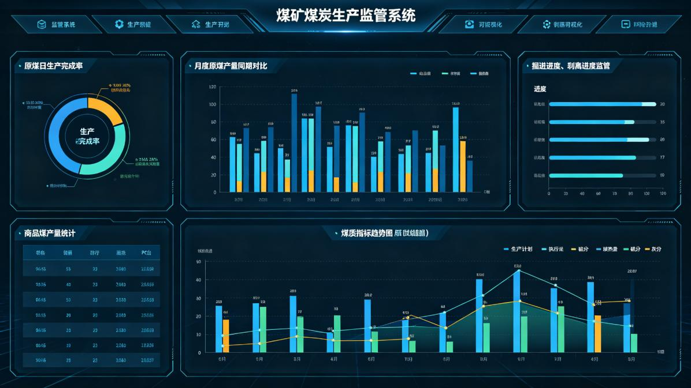

**图3-2 煤炭生产管理模块界面示意图**

### 3.2.1 原煤生产进度

|  |  |
| --- | --- |
| **属性** | **内容** |
| 功能编号 | F012 |
| 所属模块 | 煤炭生产管理 |
| 功能名称 | 原煤生产进度 |
| 功能概要 | 环形图展示三矿原煤日生产情况（日完成量/日计划量/日超欠量），进度条展示工作面设计长度/剩余长度/昨日进尺/割煤刀数 |
| 实现方式 | 定制开发+业务系统数据集成 |
| 数据来源 | 数据湖 |
| 端侧形态 | PC端/大屏端 |
| 建设难度 | 低 |
| 建设优先级 | 高 |
| 备注说明 | 环形图+进度条组合展示 |

**功能设计说明**

本功能（编号F012）是煤炭生产管理模块的重要组成部分，环形图展示三矿原煤日生产情况（日完成量/日计划量/日超欠量），进度条展示工作面设计长度/剩余长度/昨日进尺/割煤刀数

实现方式方面，本功能采用定制开发与业务系统数据集成相结合的方式。前端基于可视化技术栈定制开发展示界面，后端通过数据接口对接数据湖，完成数据的采集、清洗、转换和统一展示。数据集成过程中需确保数据口径统一、更新及时，满足平台数据质量要求。

界面设计方面，本功能综合运用数字卡片、柱状图、折线图、环形图、数据表格等多种可视化组件，根据数据特点选择最合适的展示形式。图表支持悬停显示详细数据、点击下钻、多维度切换等交互操作。整体布局遵循大屏设计规范，采用深色主题配色，确保数据醒目、视觉舒适。

数据处理逻辑方面，系统从数据湖采集相关数据，经过数据清洗、格式转换、口径统一等处理后，存储于平台数据资源池。前端展示时通过数据服务接口获取所需数据，支持实时刷新和定时更新两种模式。数据查询支持多维度筛选、聚合统计和趋势分析，满足不同场景下的数据展示需求。

### 3.2.2 原煤月产量

|  |  |
| --- | --- |
| **属性** | **内容** |
| 功能编号 | F013 |
| 所属模块 | 煤炭生产管理 |
| 功能名称 | 原煤月产量 |
| 功能概要 | 柱状图展示月度原煤产量，支持同期对比，可切换日/月/年维度，展示月完成/月计划/月超欠及完成率 |
| 实现方式 | 定制开发+业务系统数据集成 |
| 数据来源 | 数据湖 |
| 端侧形态 | PC端/大屏端 |
| 建设难度 | 低 |
| 建设优先级 | 高 |
| 备注说明 | 柱状图+悬停交互，多维度切换 |

**功能设计说明**

本功能（编号F013）是煤炭生产管理模块的重要组成部分，柱状图展示月度原煤产量，支持同期对比，可切换日/月/年维度，展示月完成/月计划/月超欠及完成率

实现方式方面，本功能采用定制开发与业务系统数据集成相结合的方式。前端基于可视化技术栈定制开发展示界面，后端通过数据接口对接数据湖，完成数据的采集、清洗、转换和统一展示。数据集成过程中需确保数据口径统一、更新及时，满足平台数据质量要求。

界面设计方面，本功能综合运用数字卡片、柱状图、折线图、环形图、数据表格等多种可视化组件，根据数据特点选择最合适的展示形式。图表支持悬停显示详细数据、点击下钻、多维度切换等交互操作。整体布局遵循大屏设计规范，采用深色主题配色，确保数据醒目、视觉舒适。

数据处理逻辑方面，系统从数据湖采集相关数据，经过数据清洗、格式转换、口径统一等处理后，存储于平台数据资源池。前端展示时通过数据服务接口获取所需数据，支持实时刷新和定时更新两种模式。数据查询支持多维度筛选、聚合统计和趋势分析，满足不同场景下的数据展示需求。

### 3.2.3 掘进进度监管

|  |  |
| --- | --- |
| **属性** | **内容** |
| 功能编号 | F014 |
| 所属模块 | 煤炭生产管理 |
| 功能名称 | 掘进进度监管 |
| 功能概要 | 柱状图展示井工矿月度掘进进度，展示实际/计划进尺/超欠量，支持日/月切换，监控掘进接续达标率 |
| 实现方式 | 定制开发+业务系统数据集成+预警规则引擎开发 |
| 数据来源 | 数据湖 |
| 端侧形态 | PC端/大屏端 |
| 建设难度 | 低 |
| 建设优先级 | 高 |
| 备注说明 | 柱状图+滚动明细，含达标率监控 |

**功能设计说明**

本功能（编号F014）是煤炭生产管理模块的重要组成部分，柱状图展示井工矿月度掘进进度，展示实际/计划进尺/超欠量，支持日/月切换，监控掘进接续达标率

实现方式方面，本功能采用定制开发与业务系统数据集成相结合的方式。前端基于可视化技术栈定制开发展示界面，后端通过数据接口对接数据湖，完成数据的采集、清洗、转换和统一展示。数据集成过程中需确保数据口径统一、更新及时，满足平台数据质量要求。

界面设计方面，本功能综合运用数字卡片、柱状图、折线图、环形图、数据表格等多种可视化组件，根据数据特点选择最合适的展示形式。图表支持悬停显示详细数据、点击下钻、多维度切换等交互操作。整体布局遵循大屏设计规范，采用深色主题配色，确保数据醒目、视觉舒适。

数据处理逻辑方面，系统从数据湖采集相关数据，经过数据清洗、格式转换、口径统一等处理后，存储于平台数据资源池。前端展示时通过数据服务接口获取所需数据，支持实时刷新和定时更新两种模式。数据查询支持多维度筛选、聚合统计和趋势分析，满足不同场景下的数据展示需求。

### 3.2.4 剥离进度监管

|  |  |
| --- | --- |
| **属性** | **内容** |
| 功能编号 | F015 |
| 所属模块 | 煤炭生产管理 |
| 功能名称 | 剥离进度监管 |
| 功能概要 | 柱状图展示露天矿月度剥离进度，展示实际/计划/超欠量，支持日/月切换，信息滚动展示剥离欠量详情 |
| 实现方式 | 定制开发+业务系统数据集成+预警规则引擎开发 |
| 数据来源 | 数据湖 |
| 端侧形态 | PC端/大屏端 |
| 建设难度 | 低 |
| 建设优先级 | 高 |
| 备注说明 | 柱状图+滚动明细，含欠量预警 |

**功能设计说明**

本功能（编号F015）是煤炭生产管理模块的重要组成部分，柱状图展示露天矿月度剥离进度，展示实际/计划/超欠量，支持日/月切换，信息滚动展示剥离欠量详情

实现方式方面，本功能采用定制开发与业务系统数据集成相结合的方式。前端基于可视化技术栈定制开发展示界面，后端通过数据接口对接数据湖，完成数据的采集、清洗、转换和统一展示。数据集成过程中需确保数据口径统一、更新及时，满足平台数据质量要求。

界面设计方面，本功能综合运用数字卡片、柱状图、折线图、环形图、数据表格等多种可视化组件，根据数据特点选择最合适的展示形式。图表支持悬停显示详细数据、点击下钻、多维度切换等交互操作。整体布局遵循大屏设计规范，采用深色主题配色，确保数据醒目、视觉舒适。

数据处理逻辑方面，系统从数据湖采集相关数据，经过数据清洗、格式转换、口径统一等处理后，存储于平台数据资源池。前端展示时通过数据服务接口获取所需数据，支持实时刷新和定时更新两种模式。数据查询支持多维度筛选、聚合统计和趋势分析，满足不同场景下的数据展示需求。

### 3.2.5 商品煤生产进度

|  |  |
| --- | --- |
| **属性** | **内容** |
| 功能编号 | F016 |
| 所属模块 | 煤炭生产管理 |
| 功能名称 | 商品煤生产进度 |
| 功能概要 | 环形图展示三矿商品煤多维度统计，按产量展示占比分布并涵盖煤种/煤质信息 |
| 实现方式 | 定制开发+业务系统数据集成 |
| 数据来源 | 数据湖 |
| 端侧形态 | PC端/大屏端 |
| 建设难度 | 低 |
| 建设优先级 | 中 |
| 备注说明 | 环形图多维度统计 |

**功能设计说明**

本功能（编号F016）是煤炭生产管理模块的重要组成部分，环形图展示三矿商品煤多维度统计，按产量展示占比分布并涵盖煤种/煤质信息

实现方式方面，本功能采用定制开发与业务系统数据集成相结合的方式。前端基于可视化技术栈定制开发展示界面，后端通过数据接口对接数据湖，完成数据的采集、清洗、转换和统一展示。数据集成过程中需确保数据口径统一、更新及时，满足平台数据质量要求。

界面设计方面，本功能综合运用数字卡片、柱状图、折线图、环形图、数据表格等多种可视化组件，根据数据特点选择最合适的展示形式。图表支持悬停显示详细数据、点击下钻、多维度切换等交互操作。整体布局遵循大屏设计规范，采用深色主题配色，确保数据醒目、视觉舒适。

数据处理逻辑方面，系统从数据湖采集相关数据，经过数据清洗、格式转换、口径统一等处理后，存储于平台数据资源池。前端展示时通过数据服务接口获取所需数据，支持实时刷新和定时更新两种模式。数据查询支持多维度筛选、聚合统计和趋势分析，满足不同场景下的数据展示需求。

### 3.2.6 商品煤月产量

|  |  |
| --- | --- |
| **属性** | **内容** |
| 功能编号 | F017 |
| 所属模块 | 煤炭生产管理 |
| 功能名称 | 商品煤月产量 |
| 功能概要 | 柱状图展示多维度商品煤产量，支持同期对比，可切换日/月/年维度 |
| 实现方式 | 定制开发+业务系统数据集成 |
| 数据来源 | 数据湖 |
| 端侧形态 | PC端/大屏端 |
| 建设难度 | 低 |
| 建设优先级 | 中 |
| 备注说明 | 柱状图多维度切换 |

**功能设计说明**

本功能（编号F017）是煤炭生产管理模块的重要组成部分，柱状图展示多维度商品煤产量，支持同期对比，可切换日/月/年维度

实现方式方面，本功能采用定制开发与业务系统数据集成相结合的方式。前端基于可视化技术栈定制开发展示界面，后端通过数据接口对接数据湖，完成数据的采集、清洗、转换和统一展示。数据集成过程中需确保数据口径统一、更新及时，满足平台数据质量要求。

界面设计方面，本功能综合运用数字卡片、柱状图、折线图、环形图、数据表格等多种可视化组件，根据数据特点选择最合适的展示形式。图表支持悬停显示详细数据、点击下钻、多维度切换等交互操作。整体布局遵循大屏设计规范，采用深色主题配色，确保数据醒目、视觉舒适。

数据处理逻辑方面，系统从数据湖采集相关数据，经过数据清洗、格式转换、口径统一等处理后，存储于平台数据资源池。前端展示时通过数据服务接口获取所需数据，支持实时刷新和定时更新两种模式。数据查询支持多维度筛选、聚合统计和趋势分析，满足不同场景下的数据展示需求。

### 3.2.7 商品煤外运

|  |  |
| --- | --- |
| **属性** | **内容** |
| 功能编号 | F018 |
| 所属模块 | 煤炭生产管理 |
| 功能名称 | 商品煤外运 |
| 功能概要 | 展示商品煤外运量完成情况，支持日/月/年切换，柱状图/曲线图动态展示，核心指标包括外运总量/计划量/完成率 |
| 实现方式 | 定制开发+业务系统数据集成 |
| 数据来源 | 数据湖 |
| 端侧形态 | PC端/大屏端 |
| 建设难度 | 低 |
| 建设优先级 | 中 |
| 备注说明 | 图表+维度切换 |

**功能设计说明**

本功能（编号F018）是煤炭生产管理模块的重要组成部分，展示商品煤外运量完成情况，支持日/月/年切换，柱状图/曲线图动态展示，核心指标包括外运总量/计划量/完成率

实现方式方面，本功能采用定制开发与业务系统数据集成相结合的方式。前端基于可视化技术栈定制开发展示界面，后端通过数据接口对接数据湖，完成数据的采集、清洗、转换和统一展示。数据集成过程中需确保数据口径统一、更新及时，满足平台数据质量要求。

界面设计方面，本功能综合运用数字卡片、柱状图、折线图、环形图、数据表格等多种可视化组件，根据数据特点选择最合适的展示形式。图表支持悬停显示详细数据、点击下钻、多维度切换等交互操作。整体布局遵循大屏设计规范，采用深色主题配色，确保数据醒目、视觉舒适。

数据处理逻辑方面，系统从数据湖采集相关数据，经过数据清洗、格式转换、口径统一等处理后，存储于平台数据资源池。前端展示时通过数据服务接口获取所需数据，支持实时刷新和定时更新两种模式。数据查询支持多维度筛选、聚合统计和趋势分析，满足不同场景下的数据展示需求。

### 3.2.8 毛煤质量（煤质）

|  |  |
| --- | --- |
| **属性** | **内容** |
| 功能编号 | F019 |
| 所属模块 | 煤炭生产管理 |
| 功能名称 | 毛煤质量（煤质） |
| 功能概要 | 展示年度发热量、硫分、灰分、水分等煤质核心指标，点击标签切换趋势图，默认展示年度发热量，支持日/月/年切换 |
| 实现方式 | 定制开发+业务系统数据集成 |
| 数据来源 | 集团统建-煤质管理系统 |
| 端侧形态 | PC端/大屏端 |
| 建设难度 | 中 |
| 建设优先级 | 中 |
| 备注说明 | 趋势曲线+标签切换，对接集团统建系统 |

**功能设计说明**

本功能（编号F019）是煤炭生产管理模块的重要组成部分，展示年度发热量、硫分、灰分、水分等煤质核心指标，点击标签切换趋势图，默认展示年度发热量，支持日/月/年切换

实现方式方面，本功能采用定制开发与业务系统数据集成相结合的方式。前端基于可视化技术栈定制开发展示界面，后端通过数据接口对接集团统建-煤质管理系统，完成数据的采集、清洗、转换和统一展示。数据集成过程中需确保数据口径统一、更新及时，满足平台数据质量要求。

界面设计方面，本功能综合运用数字卡片、柱状图、折线图、环形图、数据表格等多种可视化组件，根据数据特点选择最合适的展示形式。图表支持悬停显示详细数据、点击下钻、多维度切换等交互操作。整体布局遵循大屏设计规范，采用深色主题配色，确保数据醒目、视觉舒适。

数据处理逻辑方面，系统从集团统建-煤质管理系统采集相关数据，经过数据清洗、格式转换、口径统一等处理后，存储于平台数据资源池。前端展示时通过数据服务接口获取所需数据，支持实时刷新和定时更新两种模式。数据查询支持多维度筛选、聚合统计和趋势分析，满足不同场景下的数据展示需求。

### 3.2.9 商品煤质量（煤质）

|  |  |
| --- | --- |
| **属性** | **内容** |
| 功能编号 | F020 |
| 所属模块 | 煤炭生产管理 |
| 功能名称 | 商品煤质量（煤质） |
| 功能概要 | 展示商品煤灰分/发热量/硫分/水分，按煤种分类展示质量分布，设煤质达标率指标，低于标准自动预警 |
| 实现方式 | 定制开发+业务系统数据集成+预警规则引擎开发 |
| 数据来源 | 集团统建-煤质管理系统 |
| 端侧形态 | PC端/大屏端 |
| 建设难度 | 中 |
| 建设优先级 | 中 |
| 备注说明 | 分布图+预警，含达标率计算 |

**功能设计说明**

本功能（编号F020）是煤炭生产管理模块的重要组成部分，展示商品煤灰分/发热量/硫分/水分，按煤种分类展示质量分布，设煤质达标率指标，低于标准自动预警

实现方式方面，本功能采用定制开发与业务系统数据集成相结合的方式。前端基于可视化技术栈定制开发展示界面，后端通过数据接口对接集团统建-煤质管理系统，完成数据的采集、清洗、转换和统一展示。数据集成过程中需确保数据口径统一、更新及时，满足平台数据质量要求。

界面设计方面，本功能综合运用数字卡片、柱状图、折线图、环形图、数据表格等多种可视化组件，根据数据特点选择最合适的展示形式。图表支持悬停显示详细数据、点击下钻、多维度切换等交互操作。整体布局遵循大屏设计规范，采用深色主题配色，确保数据醒目、视觉舒适。

数据处理逻辑方面，系统从集团统建-煤质管理系统采集相关数据，经过数据清洗、格式转换、口径统一等处理后，存储于平台数据资源池。前端展示时通过数据服务接口获取所需数据，支持实时刷新和定时更新两种模式。数据查询支持多维度筛选、聚合统计和趋势分析，满足不同场景下的数据展示需求。

### 3.2.10 生产计划执行跟踪

|  |  |
| --- | --- |
| **属性** | **内容** |
| 功能编号 | F021 |
| 所属模块 | 煤炭生产管理 |
| 功能名称 | 生产计划执行跟踪 |
| 功能概要 | 全域各专业单位生产计划/实际产量柱状图/叠加完成率折线 |
| 实现方式 | 定制开发+业务系统数据集成 |
| 数据来源 | 数据湖 |
| 端侧形态 | PC端/大屏端 |
| 建设难度 | 低 |
| 建设优先级 | 高 |
| 备注说明 | 柱状图+折线图组合，计划vs实际 |

**功能设计说明**

本功能（编号F021）是煤炭生产管理模块的重要组成部分，全域各专业单位生产计划/实际产量柱状图/叠加完成率折线

实现方式方面，本功能采用定制开发与业务系统数据集成相结合的方式。前端基于可视化技术栈定制开发展示界面，后端通过数据接口对接数据湖，完成数据的采集、清洗、转换和统一展示。数据集成过程中需确保数据口径统一、更新及时，满足平台数据质量要求。

界面设计方面，本功能综合运用数字卡片、柱状图、折线图、环形图、数据表格等多种可视化组件，根据数据特点选择最合适的展示形式。图表支持悬停显示详细数据、点击下钻、多维度切换等交互操作。整体布局遵循大屏设计规范，采用深色主题配色，确保数据醒目、视觉舒适。

数据处理逻辑方面，系统从数据湖采集相关数据，经过数据清洗、格式转换、口径统一等处理后，存储于平台数据资源池。前端展示时通过数据服务接口获取所需数据，支持实时刷新和定时更新两种模式。数据查询支持多维度筛选、聚合统计和趋势分析，满足不同场景下的数据展示需求。

### 3.2.11 生产异常预警联动

|  |  |
| --- | --- |
| **属性** | **内容** |
| 功能编号 | F022 |
| 所属模块 | 煤炭生产管理 |
| 功能名称 | 生产异常预警联动 |
| 功能概要 | 自动识别生产异常指标，分红/黄/蓝三级预警、消息推送及声光报警联动 |
| 实现方式 | 预警场景与规则引擎开发+定制开发 |
| 数据来源 | 生产数据+预警规则 |
| 端侧形态 | PC端/大屏端 |
| 建设难度 | 高 |
| 建设优先级 | 高 |
| 备注说明 | 三级预警规则引擎，含声光联动 |

**功能设计说明**

本功能（编号F022）是煤炭生产管理模块的重要组成部分，自动识别生产异常指标，分红/黄/蓝三级预警、消息推送及声光报警联动

实现方式方面，本功能采用预警场景与规则引擎开发+定制开发的方式进行建设，数据来源于生产数据+预警规则，确保功能实现与业务需求紧密匹配。

界面设计方面，本功能综合运用数字卡片、柱状图、折线图、环形图、数据表格等多种可视化组件，根据数据特点选择最合适的展示形式。图表支持悬停显示详细数据、点击下钻、多维度切换等交互操作。整体布局遵循大屏设计规范，采用深色主题配色，确保数据醒目、视觉舒适。

数据处理逻辑方面，系统实时采集相关监测数据，预警规则引擎根据预设的触发条件进行实时判断。当数据满足预警条件时，自动生成预警事件，记录预警级别、触发时间、关联指标、异常数值、所属单位等信息，并通过多渠道推送至相关责任人员。预警处置完成后，系统记录处置措施和结果，形成完整的预警处置闭环。

### 3.2.12 采煤运营分析

|  |  |
| --- | --- |
| **属性** | **内容** |
| 功能编号 | F023 |
| 所属模块 | 煤炭生产管理 |
| 功能名称 | 采煤运营分析 |
| 功能概要 | 根据工作面人数、产量等算采煤工效；根据产量、设备成本、材料使用及回收，人工成本，用电成本等数据算直接吨煤成本；对标企业月、年目标工效做管理分析 |
| 实现方式 | 分析算法规则开发+定制开发 |
| 数据来源 | 人力资源+生产监测+物资系统 |
| 端侧形态 | PC端/大屏端 |
| 建设难度 | 高 |
| 建设优先级 | 中 |
| 备注说明 | 需开发工效和吨煤成本计算模型 |

**功能设计说明**

本功能（编号F023）是煤炭生产管理模块的重要组成部分，根据工作面人数、产量等算采煤工效；根据产量、设备成本、材料使用及回收，人工成本，用电成本等数据算直接吨煤成本；对标企业月、年目标工效做管理分析

实现方式方面，本功能需要开发专门的分析算法模型。基于人力资源+生产监测+物资系统提供的基础数据，通过数据建模和指标计算，实现相关分析功能。算法模型需支持参数配置和版本管理，确保计算逻辑可追溯、可调整。分析结果以可视化图表和数据表格形式展示，支持多维度对比和趋势分析。

界面设计方面，本功能综合运用数字卡片、柱状图、折线图、环形图、数据表格等多种可视化组件，根据数据特点选择最合适的展示形式。图表支持悬停显示详细数据、点击下钻、多维度切换等交互操作。整体布局遵循大屏设计规范，采用深色主题配色，确保数据醒目、视觉舒适。

数据处理逻辑方面，系统从相关业务系统采集基础数据，经过数据清洗和标准化处理后，按照预设的算法模型进行指标计算。计算过程支持参数配置和公式调整，确保计算逻辑可追溯、可验证。计算结果存储于数据服务层，支持多维度查询和对比分析，并以可视化图表形式展示分析结论。

### 3.2.13 掘进运营分析

|  |  |
| --- | --- |
| **属性** | **内容** |
| 功能编号 | F024 |
| 所属模块 | 煤炭生产管理 |
| 功能名称 | 掘进运营分析 |
| 功能概要 | 根据出勤人员、进尺，算单进效率；根据出勤人员+使用物资，算标准成本；分析存在问题，积累经验定措施、提效 |
| 实现方式 | 分析算法规则开发+定制开发 |
| 数据来源 | 人力资源+生产监测+物资系统 |
| 端侧形态 | PC端/大屏端 |
| 建设难度 | 高 |
| 建设优先级 | 中 |
| 备注说明 | 需开发单进效率和标准成本模型 |

**功能设计说明**

本功能（编号F024）是煤炭生产管理模块的重要组成部分，根据出勤人员、进尺，算单进效率；根据出勤人员+使用物资，算标准成本；分析存在问题，积累经验定措施、提效

实现方式方面，本功能需要开发专门的分析算法模型。基于人力资源+生产监测+物资系统提供的基础数据，通过数据建模和指标计算，实现相关分析功能。算法模型需支持参数配置和版本管理，确保计算逻辑可追溯、可调整。分析结果以可视化图表和数据表格形式展示，支持多维度对比和趋势分析。

界面设计方面，本功能综合运用数字卡片、柱状图、折线图、环形图、数据表格等多种可视化组件，根据数据特点选择最合适的展示形式。图表支持悬停显示详细数据、点击下钻、多维度切换等交互操作。整体布局遵循大屏设计规范，采用深色主题配色，确保数据醒目、视觉舒适。

数据处理逻辑方面，系统从相关业务系统采集基础数据，经过数据清洗和标准化处理后，按照预设的算法模型进行指标计算。计算过程支持参数配置和公式调整，确保计算逻辑可追溯、可验证。计算结果存储于数据服务层，支持多维度查询和对比分析，并以可视化图表形式展示分析结论。

### 3.2.14 区队分类排名

|  |  |
| --- | --- |
| **属性** | **内容** |
| 功能编号 | F025 |
| 所属模块 | 煤炭生产管理 |
| 功能名称 | 区队分类排名 |
| 功能概要 | 同条件下采掘队进行排名，便于奖罚、鼓励（进度、成本、质量），综合各方面因素对标标准成本 |
| 实现方式 | 分析算法规则开发+定制开发 |
| 数据来源 | 生产监测+成本系统 |
| 端侧形态 | PC端/大屏端 |
| 建设难度 | 高 |
| 建设优先级 | 中 |
| 备注说明 | 综合排名算法，含奖罚标识 |

**功能设计说明**

本功能（编号F025）是煤炭生产管理模块的重要组成部分，同条件下采掘队进行排名，便于奖罚、鼓励（进度、成本、质量），综合各方面因素对标标准成本

实现方式方面，本功能需要开发专门的分析算法模型。基于生产监测+成本系统提供的基础数据，通过数据建模和指标计算，实现相关分析功能。算法模型需支持参数配置和版本管理，确保计算逻辑可追溯、可调整。分析结果以可视化图表和数据表格形式展示，支持多维度对比和趋势分析。

界面设计方面，本功能综合运用数字卡片、柱状图、折线图、环形图、数据表格等多种可视化组件，根据数据特点选择最合适的展示形式。图表支持悬停显示详细数据、点击下钻、多维度切换等交互操作。整体布局遵循大屏设计规范，采用深色主题配色，确保数据醒目、视觉舒适。

数据处理逻辑方面，系统从生产监测+成本系统采集相关数据，经过数据清洗、格式转换、口径统一等处理后，存储于平台数据资源池。前端展示时通过数据服务接口获取所需数据，支持实时刷新和定时更新两种模式。数据查询支持多维度筛选、聚合统计和趋势分析，满足不同场景下的数据展示需求。

### 3.2.15 主要大型设备管理

|  |  |
| --- | --- |
| **属性** | **内容** |
| 功能编号 | F026 |
| 所属模块 | 煤炭生产管理 |
| 功能名称 | 主要大型设备管理 |
| 功能概要 | 汇总采煤系统/掘进系统/皮带机/提升机/通风机/压风机/供电/排水/胶轮车（车联网），露天矿卡/破碎/连续化运输，巡检机器人，故障诊断系统（皮里青）等主要大型设备系统信息接入，实现基础信息、运行状态、开机率/故障率/故障时长、异常报警 |
| 实现方式 | 定制开发+业务系统数据集成 |
| 数据来源 | 集团统建-智控机电自动化系统+矿端自动化系统 |
| 端侧形态 | PC端/大屏端 |
| 建设难度 | 高 |
| 建设优先级 | 高 |
| 备注说明 | 图标+统计卡片，对接集团统建系统 |

**功能设计说明**

本功能（编号F026）是煤炭生产管理模块的重要组成部分，汇总采煤系统/掘进系统/皮带机/提升机/通风机/压风机/供电/排水/胶轮车（车联网），露天矿卡/破碎/连续化运输，巡检机器人，故障诊断系统（皮里青）等主要大型设备系统信息接入，实现基础信息、运行状态、开机率/故障率/故障时长、异常报警

实现方式方面，本功能采用定制开发与业务系统数据集成相结合的方式。前端基于可视化技术栈定制开发展示界面，后端通过数据接口对接集团统建-智控机电自动化系统+矿端自动化系统，完成数据的采集、清洗、转换和统一展示。数据集成过程中需确保数据口径统一、更新及时，满足平台数据质量要求。

界面设计方面，本功能综合运用数字卡片、柱状图、折线图、环形图、数据表格等多种可视化组件，根据数据特点选择最合适的展示形式。图表支持悬停显示详细数据、点击下钻、多维度切换等交互操作。整体布局遵循大屏设计规范，采用深色主题配色，确保数据醒目、视觉舒适。

数据处理逻辑方面，系统从集团统建-智控机电自动化系统+矿端自动化系统采集相关数据，经过数据清洗、格式转换、口径统一等处理后，存储于平台数据资源池。前端展示时通过数据服务接口获取所需数据，支持实时刷新和定时更新两种模式。数据查询支持多维度筛选、聚合统计和趋势分析，满足不同场景下的数据展示需求。

### 3.2.16 机电设备运行时间管控预警

|  |  |
| --- | --- |
| **属性** | **内容** |
| 功能编号 | F027 |
| 所属模块 | 煤炭生产管理 |
| 功能名称 | 机电设备运行时间管控预警 |
| 功能概要 | 大型机电设备运行时间管控预警，超过管控时长自动弹窗提醒，超时未处置升级告警 |
| 实现方式 | 预警场景与规则引擎开发+定制开发 |
| 数据来源 | 机电自动化系统 |
| 端侧形态 | PC端/大屏端 |
| 建设难度 | 中 |
| 建设优先级 | 高 |
| 备注说明 | 分级升级告警机制 |

**功能设计说明**

本功能（编号F027）是煤炭生产管理模块的重要组成部分，大型机电设备运行时间管控预警，超过管控时长自动弹窗提醒，超时未处置升级告警

实现方式方面，本功能采用预警场景与规则引擎开发+定制开发的方式进行建设，数据来源于机电自动化系统，确保功能实现与业务需求紧密匹配。

界面设计方面，本功能综合运用数字卡片、柱状图、折线图、环形图、数据表格等多种可视化组件，根据数据特点选择最合适的展示形式。图表支持悬停显示详细数据、点击下钻、多维度切换等交互操作。整体布局遵循大屏设计规范，采用深色主题配色，确保数据醒目、视觉舒适。

数据处理逻辑方面，系统实时采集相关监测数据，预警规则引擎根据预设的触发条件进行实时判断。当数据满足预警条件时，自动生成预警事件，记录预警级别、触发时间、关联指标、异常数值、所属单位等信息，并通过多渠道推送至相关责任人员。预警处置完成后，系统记录处置措施和结果，形成完整的预警处置闭环。

### 3.2.17 地测图纸管理

|  |  |
| --- | --- |
| **属性** | **内容** |
| 功能编号 | F028 |
| 所属模块 | 煤炭生产管理 |
| 功能名称 | 地测图纸管理 |
| 功能概要 | 地测类图件类资料管理，包括地质图件、测量成果、储量图等，实现在线查看、版本管理、与生产数据叠加展示 |
| 实现方式 | 应用扩展开发+业务系统数据集成 |
| 数据来源 | 集团统建-图纸云系统 |
| 端侧形态 | PC端 |
| 建设难度 | 低 |
| 建设优先级 | 中 |
| 备注说明 | 复用图纸云平台功能 |

**功能设计说明**

本功能（编号F028）是煤炭生产管理模块的重要组成部分，地测类图件类资料管理，包括地质图件、测量成果、储量图等，实现在线查看、版本管理、与生产数据叠加展示

实现方式方面，本功能基于现有平台进行应用扩展开发。复用集团统建-图纸云系统的已有功能模块和数据接口，在现有功能基础上进行拓展和定制，减少重复开发工作量，加快功能上线速度。扩展开发过程中需保持与原有系统的兼容性，确保数据一致性和功能稳定性。

数据处理逻辑方面，系统从集团统建-图纸云系统采集相关数据，经过数据清洗、格式转换、口径统一等处理后，存储于平台数据资源池。前端展示时通过数据服务接口获取所需数据，支持实时刷新和定时更新两种模式。数据查询支持多维度筛选、聚合统计和趋势分析，满足不同场景下的数据展示需求。

## 3.3 储运销管理

储运销管理模块共规划7项功能，以下逐项进行详细设计。

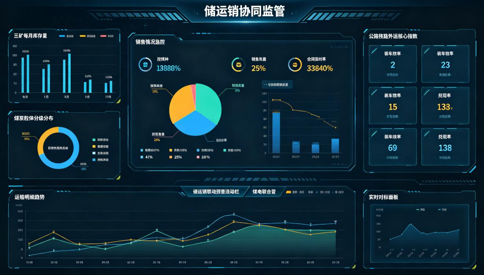

**图3-3 储运销管理模块界面示意图**

### 3.3.1 煤炭仓储监控

|  |  |
| --- | --- |
| **属性** | **内容** |
| 功能编号 | F029 |
| 所属模块 | 储运销管理 |
| 功能名称 | 煤炭仓储监控 |
| 功能概要 | 柱状图展示三矿每月库存量，环形图展示煤炭粒度分级/发热量分布，柱状图展示电厂库存量，展示总周转天数及同环比，设高低预警线 |
| 实现方式 | 定制开发+业务系统数据集成+预警规则引擎开发 |
| 数据来源 | 仓存系统 |
| 端侧形态 | PC端/大屏端 |
| 建设难度 | 低 |
| 建设优先级 | 高 |
| 备注说明 | 多图表组合，含库存预警 |

**功能设计说明**

本功能（编号F029）是储运销管理模块的重要组成部分，柱状图展示三矿每月库存量，环形图展示煤炭粒度分级/发热量分布，柱状图展示电厂库存量，展示总周转天数及同环比，设高低预警线

实现方式方面，本功能采用定制开发与业务系统数据集成相结合的方式。前端基于可视化技术栈定制开发展示界面，后端通过数据接口对接仓存系统，完成数据的采集、清洗、转换和统一展示。数据集成过程中需确保数据口径统一、更新及时，满足平台数据质量要求。

界面设计方面，本功能综合运用数字卡片、柱状图、折线图、环形图、数据表格等多种可视化组件，根据数据特点选择最合适的展示形式。图表支持悬停显示详细数据、点击下钻、多维度切换等交互操作。整体布局遵循大屏设计规范，采用深色主题配色，确保数据醒目、视觉舒适。

数据处理逻辑方面，系统从仓存系统采集相关数据，经过数据清洗、格式转换、口径统一等处理后，存储于平台数据资源池。前端展示时通过数据服务接口获取所需数据，支持实时刷新和定时更新两种模式。数据查询支持多维度筛选、聚合统计和趋势分析，满足不同场景下的数据展示需求。

### 3.3.2 自用煤量监控

|  |  |
| --- | --- |
| **属性** | **内容** |
| 功能编号 | F030 |
| 所属模块 | 储运销管理 |
| 功能名称 | 自用煤量监控 |
| 功能概要 | 折线图监控企业月度自用煤消耗量，展示哈密/红星/伊犁电厂耗煤量及汇总趋势，可按电厂筛选对比，计算自用煤占总产量比例 |
| 实现方式 | 定制开发+业务系统数据集成 |
| 数据来源 | 电厂耗煤计量系统 |
| 端侧形态 | PC端/大屏端 |
| 建设难度 | 低 |
| 建设优先级 | 中 |
| 备注说明 | 折线图+筛选对比 |

**功能设计说明**

本功能（编号F030）是储运销管理模块的重要组成部分，折线图监控企业月度自用煤消耗量，展示哈密/红星/伊犁电厂耗煤量及汇总趋势，可按电厂筛选对比，计算自用煤占总产量比例

实现方式方面，本功能采用定制开发与业务系统数据集成相结合的方式。前端基于可视化技术栈定制开发展示界面，后端通过数据接口对接电厂耗煤计量系统，完成数据的采集、清洗、转换和统一展示。数据集成过程中需确保数据口径统一、更新及时，满足平台数据质量要求。

界面设计方面，本功能综合运用数字卡片、柱状图、折线图、环形图、数据表格等多种可视化组件，根据数据特点选择最合适的展示形式。图表支持悬停显示详细数据、点击下钻、多维度切换等交互操作。整体布局遵循大屏设计规范，采用深色主题配色，确保数据醒目、视觉舒适。

数据处理逻辑方面，系统从电厂耗煤计量系统采集相关数据，经过数据清洗、格式转换、口径统一等处理后，存储于平台数据资源池。前端展示时通过数据服务接口获取所需数据，支持实时刷新和定时更新两种模式。数据查询支持多维度筛选、聚合统计和趋势分析，满足不同场景下的数据展示需求。

### 3.3.3 销售情况监控

|  |  |
| --- | --- |
| **属性** | **内容** |
| 功能编号 | F031 |
| 所属模块 | 储运销管理 |
| 功能名称 | 销售情况监控 |
| 功能概要 | 柱状图/饼图按煤种分级展示累计销售量/销售额/待履约量，合同履约情况，重点客户保供履约率 |
| 实现方式 | 定制开发+业务系统数据集成 |
| 数据来源 | 运储销管理系统 |
| 端侧形态 | PC端/大屏端 |
| 建设难度 | 中 |
| 建设优先级 | 高 |
| 备注说明 | 柱状图+饼图组合，含履约率 |

**功能设计说明**

本功能（编号F031）是储运销管理模块的重要组成部分，柱状图/饼图按煤种分级展示累计销售量/销售额/待履约量，合同履约情况，重点客户保供履约率

实现方式方面，本功能采用定制开发与业务系统数据集成相结合的方式。前端基于可视化技术栈定制开发展示界面，后端通过数据接口对接运储销管理系统，完成数据的采集、清洗、转换和统一展示。数据集成过程中需确保数据口径统一、更新及时，满足平台数据质量要求。

界面设计方面，本功能综合运用数字卡片、柱状图、折线图、环形图、数据表格等多种可视化组件，根据数据特点选择最合适的展示形式。图表支持悬停显示详细数据、点击下钻、多维度切换等交互操作。整体布局遵循大屏设计规范，采用深色主题配色，确保数据醒目、视觉舒适。

数据处理逻辑方面，系统从运储销管理系统采集相关数据，经过数据清洗、格式转换、口径统一等处理后，存储于平台数据资源池。前端展示时通过数据服务接口获取所需数据，支持实时刷新和定时更新两种模式。数据查询支持多维度筛选、聚合统计和趋势分析，满足不同场景下的数据展示需求。

### 3.3.4 分矿/分客户运输明细

|  |  |
| --- | --- |
| **属性** | **内容** |
| 功能编号 | F032 |
| 所属模块 | 储运销管理 |
| 功能名称 | 分矿/分客户运输明细 |
| 功能概要 | 按矿井维度展示洗选产品/毛煤直销外运量趋势，按重点客户展示月度发运量/履约进度，运输欠量明细表格 |
| 实现方式 | 定制开发+业务系统数据集成 |
| 数据来源 | 运储销管理系统 |
| 端侧形态 | PC端/大屏端 |
| 建设难度 | 中 |
| 建设优先级 | 中 |
| 备注说明 | 趋势图+柱状图+表格 |

**功能设计说明**

本功能（编号F032）是储运销管理模块的重要组成部分，按矿井维度展示洗选产品/毛煤直销外运量趋势，按重点客户展示月度发运量/履约进度，运输欠量明细表格

实现方式方面，本功能采用定制开发与业务系统数据集成相结合的方式。前端基于可视化技术栈定制开发展示界面，后端通过数据接口对接运储销管理系统，完成数据的采集、清洗、转换和统一展示。数据集成过程中需确保数据口径统一、更新及时，满足平台数据质量要求。

界面设计方面，本功能综合运用数字卡片、柱状图、折线图、环形图、数据表格等多种可视化组件，根据数据特点选择最合适的展示形式。图表支持悬停显示详细数据、点击下钻、多维度切换等交互操作。整体布局遵循大屏设计规范，采用深色主题配色，确保数据醒目、视觉舒适。

数据处理逻辑方面，系统从运储销管理系统采集相关数据，经过数据清洗、格式转换、口径统一等处理后，存储于平台数据资源池。前端展示时通过数据服务接口获取所需数据，支持实时刷新和定时更新两种模式。数据查询支持多维度筛选、聚合统计和趋势分析，满足不同场景下的数据展示需求。

### 3.3.5 运输数据统计分析

|  |  |
| --- | --- |
| **属性** | **内容** |
| 功能编号 | F033 |
| 所属模块 | 储运销管理 |
| 功能名称 | 运输数据统计分析 |
| 功能概要 | 商品煤产量联动外运对标分析，外运偏差率纳入三级预警，近30日外运趋势曲线支持同期对比 |
| 实现方式 | 分析算法模型开发+定制开发 |
| 数据来源 | 运储销系统 |
| 端侧形态 | PC端/大屏端 |
| 建设难度 | 高 |
| 建设优先级 | 中 |
| 备注说明 | 对标分析+趋势对比 |

**功能设计说明**

本功能（编号F033）是储运销管理模块的重要组成部分，商品煤产量联动外运对标分析，外运偏差率纳入三级预警，近30日外运趋势曲线支持同期对比

实现方式方面，本功能需要开发专门的分析算法模型。基于运储销系统提供的基础数据，通过数据建模和指标计算，实现相关分析功能。算法模型需支持参数配置和版本管理，确保计算逻辑可追溯、可调整。分析结果以可视化图表和数据表格形式展示，支持多维度对比和趋势分析。

界面设计方面，本功能综合运用数字卡片、柱状图、折线图、环形图、数据表格等多种可视化组件，根据数据特点选择最合适的展示形式。图表支持悬停显示详细数据、点击下钻、多维度切换等交互操作。整体布局遵循大屏设计规范，采用深色主题配色，确保数据醒目、视觉舒适。

数据处理逻辑方面，系统从相关业务系统采集基础数据，经过数据清洗和标准化处理后，按照预设的算法模型进行指标计算。计算过程支持参数配置和公式调整，确保计算逻辑可追溯、可验证。计算结果存储于数据服务层，支持多维度查询和对比分析，并以可视化图表形式展示分析结论。

### 3.3.6 储运销联动预警

|  |  |
| --- | --- |
| **属性** | **内容** |
| 功能编号 | F034 |
| 所属模块 | 储运销管理 |
| 功能名称 | 储运销联动预警 |
| 功能概要 | 运储销三端数据联动，库存过高/过低自动触发销售预警，待履约量与库存对比提示补库，产销存告警滚动展示 |
| 实现方式 | 预警规则引擎开发+定制开发 |
| 数据来源 | 运储销/仓存/生产系统 |
| 端侧形态 | PC端/大屏端 |
| 建设难度 | 高 |
| 建设优先级 | 高 |
| 备注说明 | 三端联动预警机制 |

**功能设计说明**

本功能（编号F034）是储运销管理模块的重要组成部分，运储销三端数据联动，库存过高/过低自动触发销售预警，待履约量与库存对比提示补库，产销存告警滚动展示

实现方式方面，本功能基于预警规则引擎进行开发。通过配置化的预警规则定义触发条件、预警级别、响应要求和推送方式，预警规则引擎实时监测相关数据，当满足触发条件时自动生成预警事件并联动推送。支持预警规则的可视化配置和动态调整，无需修改代码即可新增或修改预警规则。

界面设计方面，本功能综合运用数字卡片、柱状图、折线图、环形图、数据表格等多种可视化组件，根据数据特点选择最合适的展示形式。图表支持悬停显示详细数据、点击下钻、多维度切换等交互操作。整体布局遵循大屏设计规范，采用深色主题配色，确保数据醒目、视觉舒适。

数据处理逻辑方面，系统实时采集相关监测数据，预警规则引擎根据预设的触发条件进行实时判断。当数据满足预警条件时，自动生成预警事件，记录预警级别、触发时间、关联指标、异常数值、所属单位等信息，并通过多渠道推送至相关责任人员。预警处置完成后，系统记录处置措施和结果，形成完整的预警处置闭环。

### 3.3.7 煤电联营实时对标

|  |  |
| --- | --- |
| **属性** | **内容** |
| 功能编号 | F035 |
| 所属模块 | 储运销管理 |
| 功能名称 | 煤电联营实时对标 |
| 功能概要 | 电负荷、库存时时对标，自动推送。公司库存时时对接，为调度指导。实现煤矿-电厂供需实时匹配闭环 |
| 实现方式 | 分析算法模型开发+业务系统数据集成 |
| 数据来源 | 煤矿/电厂仓存系统+电厂需煤计划 |
| 端侧形态 | PC端/大屏端 |
| 建设难度 | 中 |
| 建设优先级 | 中 |
| 备注说明 | 实时对标+自动推送机制 |

**功能设计说明**

本功能（编号F035）是储运销管理模块的重要组成部分，电负荷、库存时时对标，自动推送。公司库存时时对接，为调度指导。实现煤矿-电厂供需实时匹配闭环

实现方式方面，本功能需要开发专门的分析算法模型。基于煤矿/电厂仓存系统+电厂需煤计划提供的基础数据，通过数据建模和指标计算，实现相关分析功能。算法模型需支持参数配置和版本管理，确保计算逻辑可追溯、可调整。分析结果以可视化图表和数据表格形式展示，支持多维度对比和趋势分析。

界面设计方面，本功能综合运用数字卡片、柱状图、折线图、环形图、数据表格等多种可视化组件，根据数据特点选择最合适的展示形式。图表支持悬停显示详细数据、点击下钻、多维度切换等交互操作。整体布局遵循大屏设计规范，采用深色主题配色，确保数据醒目、视觉舒适。

数据处理逻辑方面，系统从煤矿/电厂仓存系统+电厂需煤计划采集相关数据，经过数据清洗、格式转换、口径统一等处理后，存储于平台数据资源池。前端展示时通过数据服务接口获取所需数据，支持实时刷新和定时更新两种模式。数据查询支持多维度筛选、聚合统计和趋势分析，满足不同场景下的数据展示需求。

## 3.4 安全管理

安全管理模块共规划17项功能，以下逐项进行详细设计。

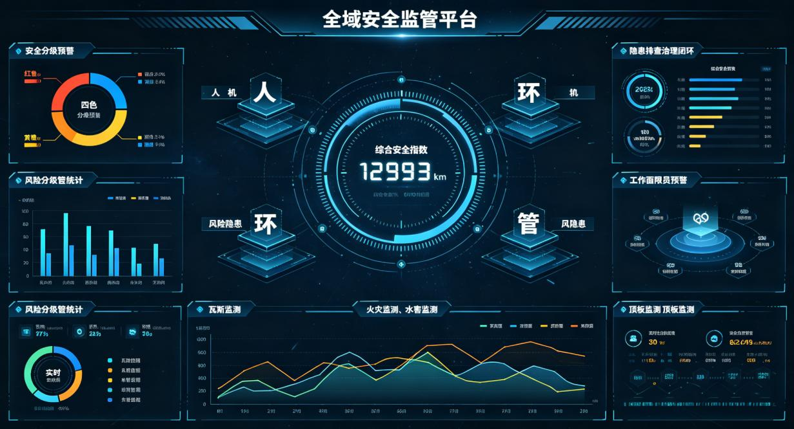

**图3-4 安全管理模块界面示意图**

### 3.4.1 全域安全综合指标看板

|  |  |
| --- | --- |
| **属性** | **内容** |
| 功能编号 | F036 |
| 所属模块 | 安全管理 |
| 功能名称 | 全域安全综合指标看板 |
| 功能概要 | 全域安全看板遵循人、机、环、管、风险隐患、综合安全指数六大维度，含综合安全指数、总告警、总隐患、在矿人数、安全周期等核心指标 |
| 实现方式 | 综合安全指数规则+定制开发+业务系统数据集成 |
| 数据来源 | 各类安全监测子系统+双预控系统 |
| 端侧形态 | PC端/大屏端 |
| 建设难度 | 低 |
| 建设优先级 | 高 |
| 备注说明 | 核心安全看板，多系统数据集成 |

**功能设计说明**

本功能（编号F036）是安全管理模块的重要组成部分，全域安全看板遵循人、机、环、管、风险隐患、综合安全指数六大维度，含综合安全指数、总告警、总隐患、在矿人数、安全周期等核心指标

实现方式方面，本功能采用定制开发与业务系统数据集成相结合的方式。前端基于可视化技术栈定制开发展示界面，后端通过数据接口对接各类安全监测子系统+双预控系统，完成数据的采集、清洗、转换和统一展示。数据集成过程中需确保数据口径统一、更新及时，满足平台数据质量要求。

界面设计方面，本功能以数字卡片为主要展示形式，核心指标采用大字体数字配合单位和趋势箭头展示，背景色根据指标状态区分（正常为绿色/蓝色、预警为黄色/红色）。卡片布局采用网格化排列，信息层次清晰、重点突出。支持点击卡片下钻查看详细数据和趋势分析。

数据处理逻辑方面，系统从各类安全监测子系统+双预控系统采集相关数据，经过数据清洗、格式转换、口径统一等处理后，存储于平台数据资源池。前端展示时通过数据服务接口获取所需数据，支持实时刷新和定时更新两种模式。数据查询支持多维度筛选、聚合统计和趋势分析，满足不同场景下的数据展示需求。

### 3.4.2 安全分级预警总览

|  |  |
| --- | --- |
| **属性** | **内容** |
| 功能编号 | F037 |
| 所属模块 | 安全管理 |
| 功能名称 | 安全分级预警总览 |
| 功能概要 | 安全监测类分级预警：红、橙、黄、蓝四色分级展示 |
| 实现方式 | 定制开发+预警规则引擎开发 |
| 数据来源 | 安全监测系统 |
| 端侧形态 | PC端/大屏端 |
| 建设难度 | 中 |
| 建设优先级 | 高 |
| 备注说明 | 四色分级预警展示 |

**功能设计说明**

本功能（编号F037）是安全管理模块的重要组成部分，安全监测类分级预警：红、橙、黄、蓝四色分级展示

实现方式方面，本功能基于预警规则引擎进行开发。通过配置化的预警规则定义触发条件、预警级别、响应要求和推送方式，预警规则引擎实时监测相关数据，当满足触发条件时自动生成预警事件并联动推送。支持预警规则的可视化配置和动态调整，无需修改代码即可新增或修改预警规则。

界面设计方面，本功能综合运用数字卡片、柱状图、折线图、环形图、数据表格等多种可视化组件，根据数据特点选择最合适的展示形式。图表支持悬停显示详细数据、点击下钻、多维度切换等交互操作。整体布局遵循大屏设计规范，采用深色主题配色，确保数据醒目、视觉舒适。

数据处理逻辑方面，系统实时采集相关监测数据，预警规则引擎根据预设的触发条件进行实时判断。当数据满足预警条件时，自动生成预警事件，记录预警级别、触发时间、关联指标、异常数值、所属单位等信息，并通过多渠道推送至相关责任人员。预警处置完成后，系统记录处置措施和结果，形成完整的预警处置闭环。

### 3.4.3 安全风险分级管控

|  |  |
| --- | --- |
| **属性** | **内容** |
| 功能编号 | F038 |
| 所属模块 | 安全管理 |
| 功能名称 | 安全风险分级管控 |
| 功能概要 | 全域风险点总数与分级统计（重大/较大/一般/低风险点位数量及空间分布），重大风险管控措施落实率、分矿风险分布 |
| 实现方式 | 定制开发+业务系统数据集成 |
| 数据来源 | 双预控系统 |
| 端侧形态 | PC端/大屏端 |
| 建设难度 | 低 |
| 建设优先级 | 高 |
| 备注说明 | 统计+分布图+趋势，对接双预控系统 |

**功能设计说明**

本功能（编号F038）是安全管理模块的重要组成部分，全域风险点总数与分级统计（重大/较大/一般/低风险点位数量及空间分布），重大风险管控措施落实率、分矿风险分布

实现方式方面，本功能采用定制开发与业务系统数据集成相结合的方式。前端基于可视化技术栈定制开发展示界面，后端通过数据接口对接双预控系统，完成数据的采集、清洗、转换和统一展示。数据集成过程中需确保数据口径统一、更新及时，满足平台数据质量要求。

界面设计方面，本功能综合运用数字卡片、柱状图、折线图、环形图、数据表格等多种可视化组件，根据数据特点选择最合适的展示形式。图表支持悬停显示详细数据、点击下钻、多维度切换等交互操作。整体布局遵循大屏设计规范，采用深色主题配色，确保数据醒目、视觉舒适。

数据处理逻辑方面，系统从双预控系统采集相关数据，经过数据清洗、格式转换、口径统一等处理后，存储于平台数据资源池。前端展示时通过数据服务接口获取所需数据，支持实时刷新和定时更新两种模式。数据查询支持多维度筛选、聚合统计和趋势分析，满足不同场景下的数据展示需求。

### 3.4.4 隐患排查治理闭环

|  |  |
| --- | --- |
| **属性** | **内容** |
| 功能编号 | F039 |
| 所属模块 | 安全管理 |
| 功能名称 | 隐患排查治理闭环 |
| 功能概要 | 隐患分级统计【红/橙/黄/蓝存量、新增、已整改】，管理效率指标（隐患平均上报时长、整改闭环周期、逾期隐患数量），专业隐患分类统计 |
| 实现方式 | 定制开发+业务系统数据集成 |
| 数据来源 | 双预控系统 |
| 端侧形态 | PC端/大屏端 |
| 建设难度 | 低 |
| 建设优先级 | 高 |
| 备注说明 | 统计+分布图+趋势，闭环管理 |

**功能设计说明**

本功能（编号F039）是安全管理模块的重要组成部分，隐患分级统计【红/橙/黄/蓝存量、新增、已整改】，管理效率指标（隐患平均上报时长、整改闭环周期、逾期隐患数量），专业隐患分类统计

实现方式方面，本功能采用定制开发与业务系统数据集成相结合的方式。前端基于可视化技术栈定制开发展示界面，后端通过数据接口对接双预控系统，完成数据的采集、清洗、转换和统一展示。数据集成过程中需确保数据口径统一、更新及时，满足平台数据质量要求。

界面设计方面，本功能综合运用数字卡片、柱状图、折线图、环形图、数据表格等多种可视化组件，根据数据特点选择最合适的展示形式。图表支持悬停显示详细数据、点击下钻、多维度切换等交互操作。整体布局遵循大屏设计规范，采用深色主题配色，确保数据醒目、视觉舒适。

数据处理逻辑方面，系统从双预控系统采集相关数据，经过数据清洗、格式转换、口径统一等处理后，存储于平台数据资源池。前端展示时通过数据服务接口获取所需数据，支持实时刷新和定时更新两种模式。数据查询支持多维度筛选、聚合统计和趋势分析，满足不同场景下的数据展示需求。

### 3.4.5 工作面限员超限预警

|  |  |
| --- | --- |
| **属性** | **内容** |
| 功能编号 | F040 |
| 所属模块 | 安全管理 |
| 功能名称 | 工作面限员超限预警 |
| 功能概要 | 工作面限员管理，人员超限即预警，自动弹窗提醒，超限未处置持续升级告警 |
| 实现方式 | 定制开发+业务系统数据集成 |
| 数据来源 | 人员定位系统（含限员信息） |
| 端侧形态 | PC端/大屏端 |
| 建设难度 | 中 |
| 建设优先级 | 高 |
| 备注说明 | 弹窗+广播+短信多渠道推送 |

**功能设计说明**

本功能（编号F040）是安全管理模块的重要组成部分，工作面限员管理，人员超限即预警，自动弹窗提醒，超限未处置持续升级告警

实现方式方面，本功能采用定制开发与业务系统数据集成相结合的方式。前端基于可视化技术栈定制开发展示界面，后端通过数据接口对接人员定位系统（含限员信息），完成数据的采集、清洗、转换和统一展示。数据集成过程中需确保数据口径统一、更新及时，满足平台数据质量要求。

界面设计方面，本功能综合运用数字卡片、柱状图、折线图、环形图、数据表格等多种可视化组件，根据数据特点选择最合适的展示形式。图表支持悬停显示详细数据、点击下钻、多维度切换等交互操作。整体布局遵循大屏设计规范，采用深色主题配色，确保数据醒目、视觉舒适。

数据处理逻辑方面，系统实时采集相关监测数据，预警规则引擎根据预设的触发条件进行实时判断。当数据满足预警条件时，自动生成预警事件，记录预警级别、触发时间、关联指标、异常数值、所属单位等信息，并通过多渠道推送至相关责任人员。预警处置完成后，系统记录处置措施和结果，形成完整的预警处置闭环。

### 3.4.6 危大工程监控（高风险作业）

|  |  |
| --- | --- |
| **属性** | **内容** |
| 功能编号 | F041 |
| 所属模块 | 安全管理 |
| 功能名称 | 危大工程监控（高风险作业） |
| 功能概要 | 危大工程作业点位数、在线监控数、工程分类统计、方案管理与审批信息、人员到岗监控 |
| 实现方式 | 应用扩展开发+业务系统数据集成 |
| 数据来源 | 集团统建-高风险作业系统 |
| 端侧形态 | PC端/大屏端 |
| 建设难度 | 高 |
| 建设优先级 | 中 |
| 备注说明 | 复用智控平台功能 |

**功能设计说明**

本功能（编号F041）是安全管理模块的重要组成部分，危大工程作业点位数、在线监控数、工程分类统计、方案管理与审批信息、人员到岗监控

实现方式方面，本功能基于现有平台进行应用扩展开发。复用集团统建-高风险作业系统的已有功能模块和数据接口，在现有功能基础上进行拓展和定制，减少重复开发工作量，加快功能上线速度。扩展开发过程中需保持与原有系统的兼容性，确保数据一致性和功能稳定性。

界面设计方面，本功能综合运用数字卡片、柱状图、折线图、环形图、数据表格等多种可视化组件，根据数据特点选择最合适的展示形式。图表支持悬停显示详细数据、点击下钻、多维度切换等交互操作。整体布局遵循大屏设计规范，采用深色主题配色，确保数据醒目、视觉舒适。

数据处理逻辑方面，系统从集团统建-高风险作业系统采集相关数据，经过数据清洗、格式转换、口径统一等处理后，存储于平台数据资源池。前端展示时通过数据服务接口获取所需数据，支持实时刷新和定时更新两种模式。数据查询支持多维度筛选、聚合统计和趋势分析，满足不同场景下的数据展示需求。

### 3.4.7 通风系统监测

|  |  |
| --- | --- |
| **属性** | **内容** |
| 功能编号 | F042 |
| 所属模块 | 安全管理 |
| 功能名称 | 通风系统监测 |
| 功能概要 | 实时采集主扇、局扇风压、风量、温度等运行参数，设备启停及故障信息；同步监测井下巷道通风环境指标，管控风门、密闭等通风设施运行状态 |
| 实现方式 | 应用扩展开发+业务系统数据集成 |
| 数据来源 | 智能通风系统 |
| 端侧形态 | PC端/大屏端 |
| 建设难度 | 中 |
| 建设优先级 | 中 |
| 备注说明 | 复用智能通风系统，在线监控+列表 |

**功能设计说明**

本功能（编号F042）是安全管理模块的重要组成部分，实时采集主扇、局扇风压、风量、温度等运行参数，设备启停及故障信息；同步监测井下巷道通风环境指标，管控风门、密闭等通风设施运行状态

实现方式方面，本功能基于现有平台进行应用扩展开发。复用智能通风系统的已有功能模块和数据接口，在现有功能基础上进行拓展和定制，减少重复开发工作量，加快功能上线速度。扩展开发过程中需保持与原有系统的兼容性，确保数据一致性和功能稳定性。

界面设计方面，本功能综合运用数字卡片、柱状图、折线图、环形图、数据表格等多种可视化组件，根据数据特点选择最合适的展示形式。图表支持悬停显示详细数据、点击下钻、多维度切换等交互操作。整体布局遵循大屏设计规范，采用深色主题配色，确保数据醒目、视觉舒适。

数据处理逻辑方面，系统从智能通风系统采集相关数据，经过数据清洗、格式转换、口径统一等处理后，存储于平台数据资源池。前端展示时通过数据服务接口获取所需数据，支持实时刷新和定时更新两种模式。数据查询支持多维度筛选、聚合统计和趋势分析，满足不同场景下的数据展示需求。

### 3.4.8 火灾监测

|  |  |
| --- | --- |
| **属性** | **内容** |
| 功能编号 | F043 |
| 所属模块 | 安全管理 |
| 功能名称 | 火灾监测 |
| 功能概要 | 汇总束管/温度传感器在线离线状态，统计监测点位总数及异常预警点位，实时捕捉温度异常/煤层自燃前兆 |
| 实现方式 | 定制开发+业务系统数据集成 |
| 数据来源 | 火灾监测系统 |
| 端侧形态 | PC端/大屏端 |
| 建设难度 | 中 |
| 建设优先级 | 高 |
| 备注说明 | 在线监控+清单，含自燃预警 |

**功能设计说明**

本功能（编号F043）是安全管理模块的重要组成部分，汇总束管/温度传感器在线离线状态，统计监测点位总数及异常预警点位，实时捕捉温度异常/煤层自燃前兆

实现方式方面，本功能采用定制开发与业务系统数据集成相结合的方式。前端基于可视化技术栈定制开发展示界面，后端通过数据接口对接火灾监测系统，完成数据的采集、清洗、转换和统一展示。数据集成过程中需确保数据口径统一、更新及时，满足平台数据质量要求。

界面设计方面，本功能综合运用数字卡片、柱状图、折线图、环形图、数据表格等多种可视化组件，根据数据特点选择最合适的展示形式。图表支持悬停显示详细数据、点击下钻、多维度切换等交互操作。整体布局遵循大屏设计规范，采用深色主题配色，确保数据醒目、视觉舒适。

数据处理逻辑方面，系统从火灾监测系统采集相关数据，经过数据清洗、格式转换、口径统一等处理后，存储于平台数据资源池。前端展示时通过数据服务接口获取所需数据，支持实时刷新和定时更新两种模式。数据查询支持多维度筛选、聚合统计和趋势分析，满足不同场景下的数据展示需求。

### 3.4.9 瓦斯监测

|  |  |
| --- | --- |
| **属性** | **内容** |
| 功能编号 | F044 |
| 所属模块 | 安全管理 |
| 功能名称 | 瓦斯监测 |
| 功能概要 | 瓦斯CH₄监测（报警测点/总测点/占比），CO有毒气体监测（超限点位/浓度值）等其他安全监测信息 |
| 实现方式 | 定制开发+业务系统数据集成 |
| 数据来源 | 瓦斯监测系统 |
| 端侧形态 | PC端/大屏端 |
| 建设难度 | 低 |
| 建设优先级 | 高 |
| 备注说明 | 统计+联动预警，瓦斯通风一体化 |

**功能设计说明**

本功能（编号F044）是安全管理模块的重要组成部分，瓦斯CH₄监测（报警测点/总测点/占比），CO有毒气体监测（超限点位/浓度值）等其他安全监测信息

实现方式方面，本功能采用定制开发与业务系统数据集成相结合的方式。前端基于可视化技术栈定制开发展示界面，后端通过数据接口对接瓦斯监测系统，完成数据的采集、清洗、转换和统一展示。数据集成过程中需确保数据口径统一、更新及时，满足平台数据质量要求。

界面设计方面，本功能综合运用数字卡片、柱状图、折线图、环形图、数据表格等多种可视化组件，根据数据特点选择最合适的展示形式。图表支持悬停显示详细数据、点击下钻、多维度切换等交互操作。整体布局遵循大屏设计规范，采用深色主题配色，确保数据醒目、视觉舒适。

数据处理逻辑方面，系统从瓦斯监测系统采集相关数据，经过数据清洗、格式转换、口径统一等处理后，存储于平台数据资源池。前端展示时通过数据服务接口获取所需数据，支持实时刷新和定时更新两种模式。数据查询支持多维度筛选、聚合统计和趋势分析，满足不同场景下的数据展示需求。

### 3.4.10 煤尘监测

|  |  |
| --- | --- |
| **属性** | **内容** |
| 功能编号 | F045 |
| 所属模块 | 安全管理 |
| 功能名称 | 煤尘监测 |
| 功能概要 | 煤尘监测点位总数/在线设备/故障离线设备，实时采集浓度对比安全阈值超限预警，关联喷雾降尘/除尘设备运行状态 |
| 实现方式 | 定制开发+业务系统数据集成 |
| 数据来源 | 煤尘监测系统+在线降尘设备系统 |
| 端侧形态 | PC端/大屏端 |
| 建设难度 | 高 |
| 建设优先级 | 中 |
| 备注说明 | 监测+预警+管控联动 |

**功能设计说明**

本功能（编号F045）是安全管理模块的重要组成部分，煤尘监测点位总数/在线设备/故障离线设备，实时采集浓度对比安全阈值超限预警，关联喷雾降尘/除尘设备运行状态

实现方式方面，本功能采用定制开发与业务系统数据集成相结合的方式。前端基于可视化技术栈定制开发展示界面，后端通过数据接口对接煤尘监测系统+在线降尘设备系统，完成数据的采集、清洗、转换和统一展示。数据集成过程中需确保数据口径统一、更新及时，满足平台数据质量要求。

界面设计方面，本功能综合运用数字卡片、柱状图、折线图、环形图、数据表格等多种可视化组件，根据数据特点选择最合适的展示形式。图表支持悬停显示详细数据、点击下钻、多维度切换等交互操作。整体布局遵循大屏设计规范，采用深色主题配色，确保数据醒目、视觉舒适。

数据处理逻辑方面，系统从煤尘监测系统+在线降尘设备系统采集相关数据，经过数据清洗、格式转换、口径统一等处理后，存储于平台数据资源池。前端展示时通过数据服务接口获取所需数据，支持实时刷新和定时更新两种模式。数据查询支持多维度筛选、聚合统计和趋势分析，满足不同场景下的数据展示需求。

### 3.4.11 顶板灾害监测

|  |  |
| --- | --- |
| **属性** | **内容** |
| 功能编号 | F046 |
| 所属模块 | 安全管理 |
| 功能名称 | 顶板灾害监测 |
| 功能概要 | 顶板离层/液压支架压力在线监测数据，异常测点清单滚动展示，工作面支护措施/巡检记录/隐患整改台账 |
| 实现方式 | 定制开发+业务系统数据集成 |
| 数据来源 | 顶板监测系统 |
| 端侧形态 | PC端/大屏端 |
| 建设难度 | 中 |
| 建设优先级 | 中 |
| 备注说明 | 实时数据+滚动清单 |

**功能设计说明**

本功能（编号F046）是安全管理模块的重要组成部分，顶板离层/液压支架压力在线监测数据，异常测点清单滚动展示，工作面支护措施/巡检记录/隐患整改台账

实现方式方面，本功能采用定制开发与业务系统数据集成相结合的方式。前端基于可视化技术栈定制开发展示界面，后端通过数据接口对接顶板监测系统，完成数据的采集、清洗、转换和统一展示。数据集成过程中需确保数据口径统一、更新及时，满足平台数据质量要求。

界面设计方面，本功能综合运用数字卡片、柱状图、折线图、环形图、数据表格等多种可视化组件，根据数据特点选择最合适的展示形式。图表支持悬停显示详细数据、点击下钻、多维度切换等交互操作。整体布局遵循大屏设计规范，采用深色主题配色，确保数据醒目、视觉舒适。

数据处理逻辑方面，系统从顶板监测系统采集相关数据，经过数据清洗、格式转换、口径统一等处理后，存储于平台数据资源池。前端展示时通过数据服务接口获取所需数据，支持实时刷新和定时更新两种模式。数据查询支持多维度筛选、聚合统计和趋势分析，满足不同场景下的数据展示需求。

### 3.4.12 冲击地压监测（预留）

|  |  |
| --- | --- |
| **属性** | **内容** |
| 功能编号 | F047 |
| 所属模块 | 安全管理 |
| 功能名称 | 冲击地压监测（预留） |
| 功能概要 | 接入防冲监测矿井数/在线测点/中断测点/设备在线率，压力高位/能量超标测点清单，防冲专项措施执行状态 |
| 实现方式 | 定制开发+业务系统数据集成 |
| 数据来源 | 防冲监测系统 |
| 端侧形态 | PC端/大屏端 |
| 建设难度 | 中 |
| 建设优先级 | 低 |
| 备注说明 | 预留接口，分期建设 |

**功能设计说明**

本功能（编号F047）是安全管理模块的重要组成部分，接入防冲监测矿井数/在线测点/中断测点/设备在线率，压力高位/能量超标测点清单，防冲专项措施执行状态

实现方式方面，本功能采用定制开发与业务系统数据集成相结合的方式。前端基于可视化技术栈定制开发展示界面，后端通过数据接口对接防冲监测系统，完成数据的采集、清洗、转换和统一展示。数据集成过程中需确保数据口径统一、更新及时，满足平台数据质量要求。

界面设计方面，本功能综合运用数字卡片、柱状图、折线图、环形图、数据表格等多种可视化组件，根据数据特点选择最合适的展示形式。图表支持悬停显示详细数据、点击下钻、多维度切换等交互操作。整体布局遵循大屏设计规范，采用深色主题配色，确保数据醒目、视觉舒适。

数据处理逻辑方面，系统从防冲监测系统采集相关数据，经过数据清洗、格式转换、口径统一等处理后，存储于平台数据资源池。前端展示时通过数据服务接口获取所需数据，支持实时刷新和定时更新两种模式。数据查询支持多维度筛选、聚合统计和趋势分析，满足不同场景下的数据展示需求。

### 3.4.13 露天矿边坡雷达监测

|  |  |
| --- | --- |
| **属性** | **内容** |
| 功能编号 | F048 |
| 所属模块 | 安全管理 |
| 功能名称 | 露天矿边坡雷达监测 |
| 功能概要 | 采集皮里青煤矿边坡雷达监测数据，实时掌握边坡位移状态，实现告警信息汇总 |
| 实现方式 | 定制开发+业务系统数据集成 |
| 数据来源 | 边坡监测雷达 |
| 端侧形态 | PC端/大屏端 |
| 建设难度 | 低 |
| 建设优先级 | 中 |
| 备注说明 | 饼形图+表格，皮里青矿专项 |

**功能设计说明**

本功能（编号F048）是安全管理模块的重要组成部分，采集皮里青煤矿边坡雷达监测数据，实时掌握边坡位移状态，实现告警信息汇总

实现方式方面，本功能采用定制开发与业务系统数据集成相结合的方式。前端基于可视化技术栈定制开发展示界面，后端通过数据接口对接边坡监测雷达，完成数据的采集、清洗、转换和统一展示。数据集成过程中需确保数据口径统一、更新及时，满足平台数据质量要求。

界面设计方面，本功能综合运用数字卡片、柱状图、折线图、环形图、数据表格等多种可视化组件，根据数据特点选择最合适的展示形式。图表支持悬停显示详细数据、点击下钻、多维度切换等交互操作。整体布局遵循大屏设计规范，采用深色主题配色，确保数据醒目、视觉舒适。

数据处理逻辑方面，系统从边坡监测雷达采集相关数据，经过数据清洗、格式转换、口径统一等处理后，存储于平台数据资源池。前端展示时通过数据服务接口获取所需数据，支持实时刷新和定时更新两种模式。数据查询支持多维度筛选、聚合统计和趋势分析，满足不同场景下的数据展示需求。

### 3.4.14 露天矿GNSS定位监测

|  |  |
| --- | --- |
| **属性** | **内容** |
| 功能编号 | F049 |
| 所属模块 | 安全管理 |
| 功能名称 | 露天矿GNSS定位监测 |
| 功能概要 | 实时掌握皮里青矿地表沉降、边坡位移状态，监测位移数据，实现告警信息汇总 |
| 实现方式 | 定制开发+业务系统数据集成 |
| 数据来源 | GNSS监测系统 |
| 端侧形态 | PC端/大屏端 |
| 建设难度 | 低 |
| 建设优先级 | 中 |
| 备注说明 | 饼形图+表格，皮里青矿专项 |

**功能设计说明**

本功能（编号F049）是安全管理模块的重要组成部分，实时掌握皮里青矿地表沉降、边坡位移状态，监测位移数据，实现告警信息汇总

实现方式方面，本功能采用定制开发与业务系统数据集成相结合的方式。前端基于可视化技术栈定制开发展示界面，后端通过数据接口对接GNSS监测系统，完成数据的采集、清洗、转换和统一展示。数据集成过程中需确保数据口径统一、更新及时，满足平台数据质量要求。

界面设计方面，本功能综合运用数字卡片、柱状图、折线图、环形图、数据表格等多种可视化组件，根据数据特点选择最合适的展示形式。图表支持悬停显示详细数据、点击下钻、多维度切换等交互操作。整体布局遵循大屏设计规范，采用深色主题配色，确保数据醒目、视觉舒适。

数据处理逻辑方面，系统从GNSS监测系统采集相关数据，经过数据清洗、格式转换、口径统一等处理后，存储于平台数据资源池。前端展示时通过数据服务接口获取所需数据，支持实时刷新和定时更新两种模式。数据查询支持多维度筛选、聚合统计和趋势分析，满足不同场景下的数据展示需求。

### 3.4.15 水害监测（井工+露天）

|  |  |
| --- | --- |
| **属性** | **内容** |
| 功能编号 | F050 |
| 所属模块 | 安全管理 |
| 功能名称 | 水害监测（井工+露天） |
| 功能概要 | 接入矿井数/在线长观孔数/报警测点/设备在线率，涌水量月度变化曲线，超限自动红警，点击报警点位查看矿井位置/监测值/处置历史 |
| 实现方式 | 定制开发+业务系统数据集成 |
| 数据来源 | 水害监测系统 |
| 端侧形态 | PC端/大屏端 |
| 建设难度 | 中 |
| 建设优先级 | 高 |
| 备注说明 | 曲线+下钻溯源，含红警机制 |

**功能设计说明**

本功能（编号F050）是安全管理模块的重要组成部分，接入矿井数/在线长观孔数/报警测点/设备在线率，涌水量月度变化曲线，超限自动红警，点击报警点位查看矿井位置/监测值/处置历史

实现方式方面，本功能采用定制开发与业务系统数据集成相结合的方式。前端基于可视化技术栈定制开发展示界面，后端通过数据接口对接水害监测系统，完成数据的采集、清洗、转换和统一展示。数据集成过程中需确保数据口径统一、更新及时，满足平台数据质量要求。

界面设计方面，本功能综合运用数字卡片、柱状图、折线图、环形图、数据表格等多种可视化组件，根据数据特点选择最合适的展示形式。图表支持悬停显示详细数据、点击下钻、多维度切换等交互操作。整体布局遵循大屏设计规范，采用深色主题配色，确保数据醒目、视觉舒适。

数据处理逻辑方面，系统从水害监测系统采集相关数据，经过数据清洗、格式转换、口径统一等处理后，存储于平台数据资源池。前端展示时通过数据服务接口获取所需数据，支持实时刷新和定时更新两种模式。数据查询支持多维度筛选、聚合统计和趋势分析，满足不同场景下的数据展示需求。

### 3.4.16 环境监测管理

|  |  |
| --- | --- |
| **属性** | **内容** |
| 功能编号 | F051 |
| 所属模块 | 安全管理 |
| 功能名称 | 环境监测管理 |
| 功能概要 | 环保排放（废水/废气/固废/危废）、扬尘监测、噪声监测、环保达标率、天气预警等相关环保经检测信息，环保安全综合概览 |
| 实现方式 | 应用扩展开发+业务系统数据集成 |
| 数据来源 | 各类环保在线监测系统+集团统建-环保管理系统 |
| 端侧形态 | PC端/大屏端 |
| 建设难度 | 低 |
| 建设优先级 | 中 |
| 备注说明 | 数字卡片+预警标识 |

**功能设计说明**

本功能（编号F051）是安全管理模块的重要组成部分，环保排放（废水/废气/固废/危废）、扬尘监测、噪声监测、环保达标率、天气预警等相关环保经检测信息，环保安全综合概览

实现方式方面，本功能基于现有平台进行应用扩展开发。复用各类环保在线监测系统+集团统建-环保管理系统的已有功能模块和数据接口，在现有功能基础上进行拓展和定制，减少重复开发工作量，加快功能上线速度。扩展开发过程中需保持与原有系统的兼容性，确保数据一致性和功能稳定性。

界面设计方面，本功能综合运用数字卡片、柱状图、折线图、环形图、数据表格等多种可视化组件，根据数据特点选择最合适的展示形式。图表支持悬停显示详细数据、点击下钻、多维度切换等交互操作。整体布局遵循大屏设计规范，采用深色主题配色，确保数据醒目、视觉舒适。

数据处理逻辑方面，系统从各类环保在线监测系统+集团统建-环保管理系统采集相关数据，经过数据清洗、格式转换、口径统一等处理后，存储于平台数据资源池。前端展示时通过数据服务接口获取所需数据，支持实时刷新和定时更新两种模式。数据查询支持多维度筛选、聚合统计和趋势分析，满足不同场景下的数据展示需求。

### 3.4.17 监测系统运维预警（离线监测）

|  |  |
| --- | --- |
| **属性** | **内容** |
| 功能编号 | F052 |
| 所属模块 | 安全管理 |
| 功能名称 | 监测系统运维预警（离线监测） |
| 功能概要 | 统一统计水害/火灾/瓦斯/煤尘/顶板/冲击地压/边坡所有监测设备离线/通讯中断/传感器故障，故障清单滚动，自动推送调度中心 |
| 实现方式 | 数据掉线报警开发+定制开发 |
| 数据来源 | 各类安全监测系统+数据管理平台 |
| 端侧形态 | PC端/大屏端 |
| 建设难度 | 中 |
| 建设优先级 | 中 |
| 备注说明 | 滚动清单+推送，运维统一监控 |

**功能设计说明**

本功能（编号F052）是安全管理模块的重要组成部分，统一统计水害/火灾/瓦斯/煤尘/顶板/冲击地压/边坡所有监测设备离线/通讯中断/传感器故障，故障清单滚动，自动推送调度中心

实现方式方面，本功能采用数据掉线报警开发+定制开发的方式进行建设，数据来源于各类安全监测系统+数据管理平台，确保功能实现与业务需求紧密匹配。

界面设计方面，本功能综合运用数字卡片、柱状图、折线图、环形图、数据表格等多种可视化组件，根据数据特点选择最合适的展示形式。图表支持悬停显示详细数据、点击下钻、多维度切换等交互操作。整体布局遵循大屏设计规范，采用深色主题配色，确保数据醒目、视觉舒适。

数据处理逻辑方面，系统实时采集相关监测数据，预警规则引擎根据预设的触发条件进行实时判断。当数据满足预警条件时，自动生成预警事件，记录预警级别、触发时间、关联指标、异常数值、所属单位等信息，并通过多渠道推送至相关责任人员。预警处置完成后，系统记录处置措施和结果，形成完整的预警处置闭环。

## 3.5 基建管理

基建管理模块共规划2项功能，以下逐项进行详细设计。

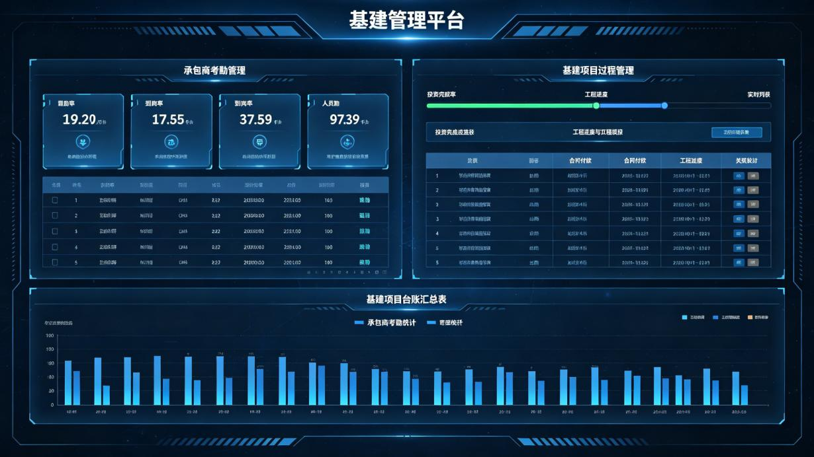

**图3-5 基建管理模块界面示意图**

### 3.5.1 承包商考勤管理

|  |  |
| --- | --- |
| **属性** | **内容** |
| 功能编号 | F053 |
| 所属模块 | 基建管理 |
| 功能名称 | 承包商考勤管理 |
| 功能概要 | 通过集团统建平台实现承包商打卡考勤统计，大屏展示出勤率/到岗率 |
| 实现方式 | 应用扩展开发+业务系统数据集成 |
| 数据来源 | 集团统建-投建转一体化管理平台 |
| 端侧形态 | PC端/大屏端 |
| 建设难度 | 中 |
| 建设优先级 | 中 |
| 备注说明 | 大屏数字卡片+表格，对接集团统建平台 |

**功能设计说明**

本功能（编号F053）是基建管理模块的重要组成部分，通过集团统建平台实现承包商打卡考勤统计，大屏展示出勤率/到岗率

实现方式方面，本功能基于现有平台进行应用扩展开发。复用集团统建-投建转一体化管理平台的已有功能模块和数据接口，在现有功能基础上进行拓展和定制，减少重复开发工作量，加快功能上线速度。扩展开发过程中需保持与原有系统的兼容性，确保数据一致性和功能稳定性。

界面设计方面，本功能综合运用数字卡片、柱状图、折线图、环形图、数据表格等多种可视化组件，根据数据特点选择最合适的展示形式。图表支持悬停显示详细数据、点击下钻、多维度切换等交互操作。整体布局遵循大屏设计规范，采用深色主题配色，确保数据醒目、视觉舒适。

数据处理逻辑方面，系统从集团统建-投建转一体化管理平台采集相关数据，经过数据清洗、格式转换、口径统一等处理后，存储于平台数据资源池。前端展示时通过数据服务接口获取所需数据，支持实时刷新和定时更新两种模式。数据查询支持多维度筛选、聚合统计和趋势分析，满足不同场景下的数据展示需求。

### 3.5.2 基建项目过程管理

|  |  |
| --- | --- |
| **属性** | **内容** |
| 功能编号 | F054 |
| 所属模块 | 基建管理 |
| 功能名称 | 基建项目过程管理 |
| 功能概要 | 基建项目投资完成率、进度实时填报和自动汇总；合同付款与工程进度关联核对；承包商考勤线上统计 |
| 实现方式 | 应用扩展开发+业务逻辑开发 |
| 数据来源 | 集团统建-投建转一体化管理平台 |
| 端侧形态 | PC端/大屏端 |
| 建设难度 | 中 |
| 建设优先级 | 中 |
| 备注说明 | 进度条+台账表格，人工填报为主 |

**功能设计说明**

本功能（编号F054）是基建管理模块的重要组成部分，基建项目投资完成率、进度实时填报和自动汇总；合同付款与工程进度关联核对；承包商考勤线上统计

实现方式方面，本功能基于现有平台进行应用扩展开发。复用集团统建-投建转一体化管理平台的已有功能模块和数据接口，在现有功能基础上进行拓展和定制，减少重复开发工作量，加快功能上线速度。扩展开发过程中需保持与原有系统的兼容性，确保数据一致性和功能稳定性。

界面设计方面，本功能综合运用数字卡片、柱状图、折线图、环形图、数据表格等多种可视化组件，根据数据特点选择最合适的展示形式。图表支持悬停显示详细数据、点击下钻、多维度切换等交互操作。整体布局遵循大屏设计规范，采用深色主题配色，确保数据醒目、视觉舒适。

数据处理逻辑方面，系统从集团统建-投建转一体化管理平台采集相关数据，经过数据清洗、格式转换、口径统一等处理后，存储于平台数据资源池。前端展示时通过数据服务接口获取所需数据，支持实时刷新和定时更新两种模式。数据查询支持多维度筛选、聚合统计和趋势分析，满足不同场景下的数据展示需求。

## 3.6 统一分级报警

统一分级报警模块共规划4项功能，以下逐项进行详细设计。

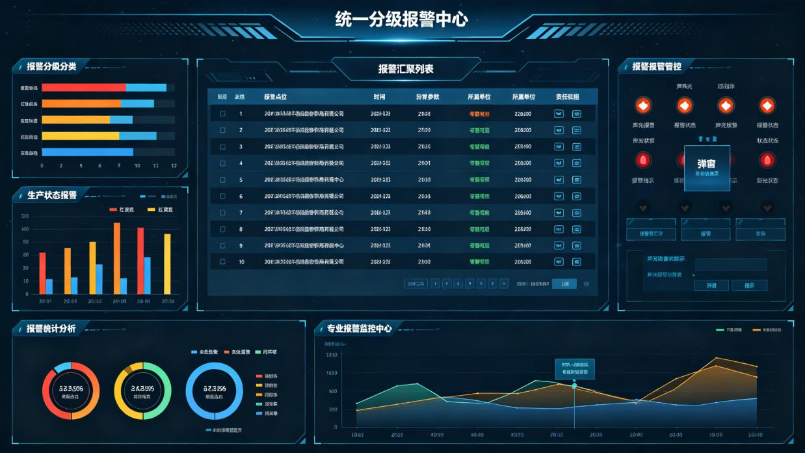

**图3-6 统一分级报警模块界面示意图**

### 3.6.1 报警汇聚展示

|  |  |
| --- | --- |
| **属性** | **内容** |
| 功能编号 | F055 |
| 所属模块 | 统一分级报警 |
| 功能名称 | 报警汇聚展示 |
| 功能概要 | 集中汇总各矿井/工作面/设备实时、安全监测报警信息，统一展示报警点位/时间/异常参数/所属单位/责任班组 |
| 实现方式 | 预警规则引擎开发+定制开发 |
| 数据来源 | 全维度报警 |
| 端侧形态 | PC端/大屏端/移动端 |
| 建设难度 | 中 |
| 建设优先级 | 高 |
| 备注说明 | 汇总列表，全维度报警汇聚 |

**功能设计说明**

本功能（编号F055）是统一分级报警模块的重要组成部分，集中汇总各矿井/工作面/设备实时、安全监测报警信息，统一展示报警点位/时间/异常参数/所属单位/责任班组

实现方式方面，本功能基于预警规则引擎进行开发。通过配置化的预警规则定义触发条件、预警级别、响应要求和推送方式，预警规则引擎实时监测相关数据，当满足触发条件时自动生成预警事件并联动推送。支持预警规则的可视化配置和动态调整，无需修改代码即可新增或修改预警规则。

界面设计方面，本功能综合运用数字卡片、柱状图、折线图、环形图、数据表格等多种可视化组件，根据数据特点选择最合适的展示形式。图表支持悬停显示详细数据、点击下钻、多维度切换等交互操作。整体布局遵循大屏设计规范，采用深色主题配色，确保数据醒目、视觉舒适。

数据处理逻辑方面，系统从全维度报警采集相关数据，经过数据清洗、格式转换、口径统一等处理后，存储于平台数据资源池。前端展示时通过数据服务接口获取所需数据，支持实时刷新和定时更新两种模式。数据查询支持多维度筛选、聚合统计和趋势分析，满足不同场景下的数据展示需求。

### 3.6.2 报警分级分类

|  |  |
| --- | --- |
| **属性** | **内容** |
| 功能编号 | F056 |
| 所属模块 | 统一分级报警 |
| 功能名称 | 报警分级分类 |
| 功能概要 | 区域安全报警红、橙、黄、蓝四色分级（环境超限类型）；生产状态红、黄、蓝三色分级（设备故障/生产超差）。颜色弹窗+闪烁提醒差异化警示 |
| 实现方式 | 分场景预警规则引擎开发+定制开发 |
| 数据来源 | 全维度报警 |
| 端侧形态 | PC端/大屏端 |
| 建设难度 | 中 |
| 建设优先级 | 高 |
| 备注说明 | 颜色标识+弹窗，四色分级体系 |

**功能设计说明**

本功能（编号F056）是统一分级报警模块的重要组成部分，区域安全报警红、橙、黄、蓝四色分级（环境超限类型）；生产状态红、黄、蓝三色分级（设备故障/生产超差）。颜色弹窗+闪烁提醒差异化警示

实现方式方面，本功能基于预警规则引擎进行开发。通过配置化的预警规则定义触发条件、预警级别、响应要求和推送方式，预警规则引擎实时监测相关数据，当满足触发条件时自动生成预警事件并联动推送。支持预警规则的可视化配置和动态调整，无需修改代码即可新增或修改预警规则。

界面设计方面，本功能综合运用数字卡片、柱状图、折线图、环形图、数据表格等多种可视化组件，根据数据特点选择最合适的展示形式。图表支持悬停显示详细数据、点击下钻、多维度切换等交互操作。整体布局遵循大屏设计规范，采用深色主题配色，确保数据醒目、视觉舒适。

数据处理逻辑方面，系统从全维度报警采集相关数据，经过数据清洗、格式转换、口径统一等处理后，存储于平台数据资源池。前端展示时通过数据服务接口获取所需数据，支持实时刷新和定时更新两种模式。数据查询支持多维度筛选、聚合统计和趋势分析，满足不同场景下的数据展示需求。

### 3.6.3 报警联动管控

|  |  |
| --- | --- |
| **属性** | **内容** |
| 功能编号 | F057 |
| 所属模块 | 统一分级报警 |
| 功能名称 | 报警联动管控 |
| 功能概要 | 报警触发联动弹窗、声光报警，辅助调度人员快速掌握现场实况。（移动端消息推送） |
| 实现方式 | 预警规则引擎开发+业务逻辑开发 |
| 数据来源 | 全维度报警 |
| 端侧形态 | 大屏端/PC端/移动端 |
| 建设难度 | 中 |
| 建设优先级 | 高 |
| 备注说明 | 声光+弹窗联动，含移动端推送 |

**功能设计说明**

本功能（编号F057）是统一分级报警模块的重要组成部分，报警触发联动弹窗、声光报警，辅助调度人员快速掌握现场实况。（移动端消息推送）

实现方式方面，本功能基于预警规则引擎进行开发。通过配置化的预警规则定义触发条件、预警级别、响应要求和推送方式，预警规则引擎实时监测相关数据，当满足触发条件时自动生成预警事件并联动推送。支持预警规则的可视化配置和动态调整，无需修改代码即可新增或修改预警规则。

界面设计方面，本功能综合运用数字卡片、柱状图、折线图、环形图、数据表格等多种可视化组件，根据数据特点选择最合适的展示形式。图表支持悬停显示详细数据、点击下钻、多维度切换等交互操作。整体布局遵循大屏设计规范，采用深色主题配色，确保数据醒目、视觉舒适。

数据处理逻辑方面，系统从全维度报警采集相关数据，经过数据清洗、格式转换、口径统一等处理后，存储于平台数据资源池。前端展示时通过数据服务接口获取所需数据，支持实时刷新和定时更新两种模式。数据查询支持多维度筛选、聚合统计和趋势分析，满足不同场景下的数据展示需求。

### 3.6.4 报警统计分析

|  |  |
| --- | --- |
| **属性** | **内容** |
| 功能编号 | F058 |
| 所属模块 | 统一分级报警 |
| 功能名称 | 报警统计分析 |
| 功能概要 | 自动统计周期内报警总数/各级占比/未处置数/逾期处置数/闭环率，形成报警处置分析台账 |
| 实现方式 | 分析算法模型开发+定制开发 |
| 数据来源 | 全维度报警 |
| 端侧形态 | 大屏端/PC端 |
| 建设难度 | 低 |
| 建设优先级 | 中 |
| 备注说明 | 统计图表，处置分析 |

**功能设计说明**

本功能（编号F058）是统一分级报警模块的重要组成部分，自动统计周期内报警总数/各级占比/未处置数/逾期处置数/闭环率，形成报警处置分析台账

实现方式方面，本功能需要开发专门的分析算法模型。基于全维度报警提供的基础数据，通过数据建模和指标计算，实现相关分析功能。算法模型需支持参数配置和版本管理，确保计算逻辑可追溯、可调整。分析结果以可视化图表和数据表格形式展示，支持多维度对比和趋势分析。

界面设计方面，本功能综合运用数字卡片、柱状图、折线图、环形图、数据表格等多种可视化组件，根据数据特点选择最合适的展示形式。图表支持悬停显示详细数据、点击下钻、多维度切换等交互操作。整体布局遵循大屏设计规范，采用深色主题配色，确保数据醒目、视觉舒适。

数据处理逻辑方面，系统从相关业务系统采集基础数据，经过数据清洗和标准化处理后，按照预设的算法模型进行指标计算。计算过程支持参数配置和公式调整，确保计算逻辑可追溯、可验证。计算结果存储于数据服务层，支持多维度查询和对比分析，并以可视化图表形式展示分析结论。

## 3.7 生产调度报表

生产调度报表模块共规划4项功能，以下逐项进行详细设计。

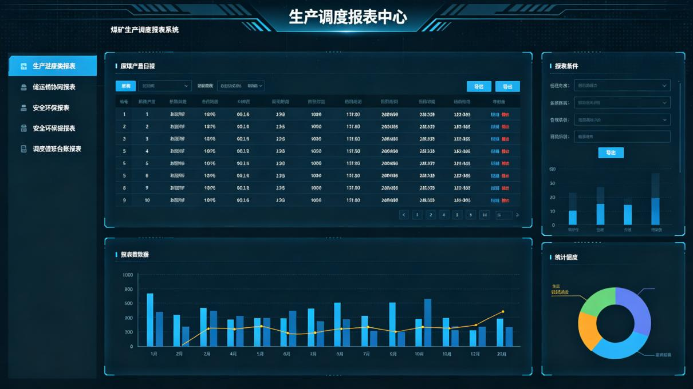

**图3-7 生产调度报表模块界面示意图**

### 3.7.1 生产进度类报表

|  |  |
| --- | --- |
| **属性** | **内容** |
| 功能编号 | F059 |
| 所属模块 | 生产调度报表 |
| 功能名称 | 生产进度类报表 |
| 功能概要 | 原煤产量日报/月报、掘进进尺统计表、剥离量统计表、商品煤产销对比表、洗选加工报表 |
| 实现方式 | 应用扩展开发+业务逻辑开发 |
| 数据来源 | 生产系统 |
| 端侧形态 | PC端 |
| 建设难度 | 低 |
| 建设优先级 | 高 |
| 备注说明 | 表格+导出，标准报表模板 |

**功能设计说明**

本功能（编号F059）是生产调度报表模块的重要组成部分，原煤产量日报/月报、掘进进尺统计表、剥离量统计表、商品煤产销对比表、洗选加工报表

实现方式方面，本功能基于现有平台进行应用扩展开发。复用生产系统的已有功能模块和数据接口，在现有功能基础上进行拓展和定制，减少重复开发工作量，加快功能上线速度。扩展开发过程中需保持与原有系统的兼容性，确保数据一致性和功能稳定性。

数据处理逻辑方面，系统从生产系统采集相关数据，经过数据清洗、格式转换、口径统一等处理后，存储于平台数据资源池。前端展示时通过数据服务接口获取所需数据，支持实时刷新和定时更新两种模式。数据查询支持多维度筛选、聚合统计和趋势分析，满足不同场景下的数据展示需求。

### 3.7.2 储运销协同报表

|  |  |
| --- | --- |
| **属性** | **内容** |
| 功能编号 | F060 |
| 所属模块 | 生产调度报表 |
| 功能名称 | 储运销协同报表 |
| 功能概要 | 库存日报、铁路/公路/皮带连续外运兑现率报表、电厂自用耗煤统计表、客户保供履约统计表 |
| 实现方式 | 应用扩展开发+业务逻辑开发 |
| 数据来源 | 运储销系统 |
| 端侧形态 | PC端 |
| 建设难度 | 低 |
| 建设优先级 | 高 |
| 备注说明 | 表格+导出，标准报表模板 |

**功能设计说明**

本功能（编号F060）是生产调度报表模块的重要组成部分，库存日报、铁路/公路/皮带连续外运兑现率报表、电厂自用耗煤统计表、客户保供履约统计表

实现方式方面，本功能基于现有平台进行应用扩展开发。复用运储销系统的已有功能模块和数据接口，在现有功能基础上进行拓展和定制，减少重复开发工作量，加快功能上线速度。扩展开发过程中需保持与原有系统的兼容性，确保数据一致性和功能稳定性。

数据处理逻辑方面，系统从运储销系统采集相关数据，经过数据清洗、格式转换、口径统一等处理后，存储于平台数据资源池。前端展示时通过数据服务接口获取所需数据，支持实时刷新和定时更新两种模式。数据查询支持多维度筛选、聚合统计和趋势分析，满足不同场景下的数据展示需求。

### 3.7.3 安全环保报表

|  |  |
| --- | --- |
| **属性** | **内容** |
| 功能编号 | F061 |
| 所属模块 | 生产调度报表 |
| 功能名称 | 安全环保报表 |
| 功能概要 | 隐患整改闭环统计表、违章统计报表、人员超限报表、井下设备在线监测日报、环保排放达标台账 |
| 实现方式 | 应用扩展开发+业务逻辑开发 |
| 数据来源 | 安全监测+环保监测系统 |
| 端侧形态 | PC端 |
| 建设难度 | 低 |
| 建设优先级 | 中 |
| 备注说明 | 表格+导出，标准报表模板 |

**功能设计说明**

本功能（编号F061）是生产调度报表模块的重要组成部分，隐患整改闭环统计表、违章统计报表、人员超限报表、井下设备在线监测日报、环保排放达标台账

实现方式方面，本功能基于现有平台进行应用扩展开发。复用安全监测+环保监测系统的已有功能模块和数据接口，在现有功能基础上进行拓展和定制，减少重复开发工作量，加快功能上线速度。扩展开发过程中需保持与原有系统的兼容性，确保数据一致性和功能稳定性。

数据处理逻辑方面，系统从安全监测+环保监测系统采集相关数据，经过数据清洗、格式转换、口径统一等处理后，存储于平台数据资源池。前端展示时通过数据服务接口获取所需数据，支持实时刷新和定时更新两种模式。数据查询支持多维度筛选、聚合统计和趋势分析，满足不同场景下的数据展示需求。

### 3.7.4 调度值班台账报表

|  |  |
| --- | --- |
| **属性** | **内容** |
| 功能编号 | F062 |
| 所属模块 | 生产调度报表 |
| 功能名称 | 调度值班台账报表 |
| 功能概要 | 调度交接班记录汇总、突发事件处置、指令闭环统计表台账 |
| 实现方式 | 应用扩展开发+业务逻辑开发 |
| 数据来源 | 调度管理系统+手工台账 |
| 端侧形态 | PC端 |
| 建设难度 | 中 |
| 建设优先级 | 中 |
| 备注说明 | 表格+导出，台账类报表 |

**功能设计说明**

本功能（编号F062）是生产调度报表模块的重要组成部分，调度交接班记录汇总、突发事件处置、指令闭环统计表台账

实现方式方面，本功能基于现有平台进行应用扩展开发。复用调度管理系统+手工台账的已有功能模块和数据接口，在现有功能基础上进行拓展和定制，减少重复开发工作量，加快功能上线速度。扩展开发过程中需保持与原有系统的兼容性，确保数据一致性和功能稳定性。

数据处理逻辑方面，系统从调度管理系统+手工台账采集相关数据，经过数据清洗、格式转换、口径统一等处理后，存储于平台数据资源池。前端展示时通过数据服务接口获取所需数据，支持实时刷新和定时更新两种模式。数据查询支持多维度筛选、聚合统计和趋势分析，满足不同场景下的数据展示需求。

## 3.8 生产运营简报

生产运营简报模块共规划3项功能，以下逐项进行详细设计。

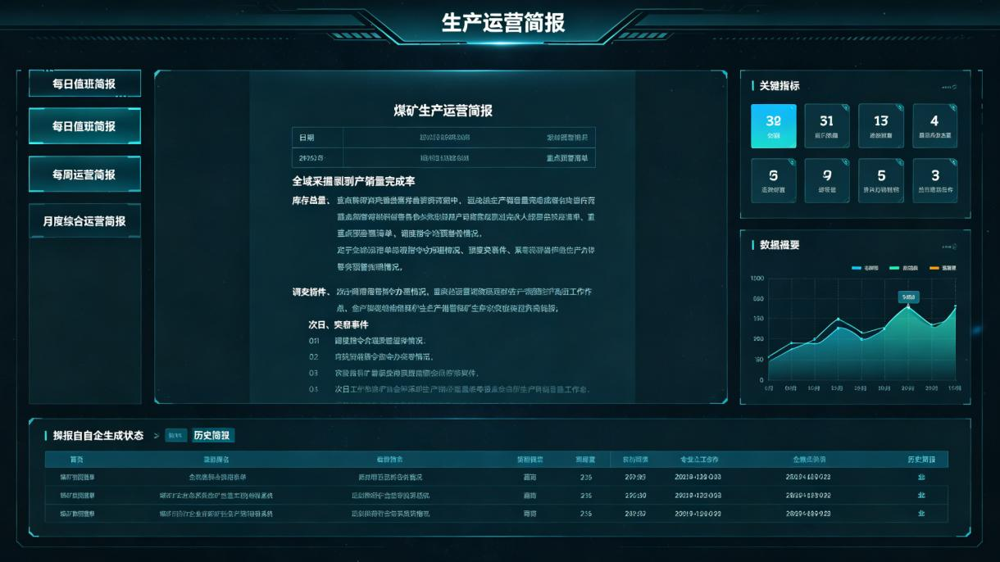

**图3-8 生产运营简报模块界面示意图**

### 3.8.1 每日值班简报

|  |  |
| --- | --- |
| **属性** | **内容** |
| 功能编号 | F063 |
| 所属模块 | 生产运营简报 |
| 功能名称 | 每日值班简报 |
| 功能概要 | 自动抓取全域采掘剥产销量及完成率、库存总量、重点预警清单、调度指令办理情况、突发事件、次日重点工作提示 |
| 实现方式 | 运营分析规则开发+应用扩展开发 |
| 数据来源 | 简报规则模板+全模块数据 |
| 端侧形态 | PC端/移动端 |
| 建设难度 | 高 |
| 建设优先级 | 高 |
| 备注说明 | 自动生成，日级简报 |

**功能设计说明**

本功能（编号F063）是生产运营简报模块的重要组成部分，自动抓取全域采掘剥产销量及完成率、库存总量、重点预警清单、调度指令办理情况、突发事件、次日重点工作提示

实现方式方面，本功能需要开发专门的分析算法模型。基于简报规则模板+全模块数据提供的基础数据，通过数据建模和指标计算，实现相关分析功能。算法模型需支持参数配置和版本管理，确保计算逻辑可追溯、可调整。分析结果以可视化图表和数据表格形式展示，支持多维度对比和趋势分析。

数据处理逻辑方面，系统从简报规则模板+全模块数据采集相关数据，经过数据清洗、格式转换、口径统一等处理后，存储于平台数据资源池。前端展示时通过数据服务接口获取所需数据，支持实时刷新和定时更新两种模式。数据查询支持多维度筛选、聚合统计和趋势分析，满足不同场景下的数据展示需求。

### 3.8.2 每周运营简报

|  |  |
| --- | --- |
| **属性** | **内容** |
| 功能编号 | F064 |
| 所属模块 | 生产运营简报 |
| 功能名称 | 每周运营简报 |
| 功能概要 | 周度产量累计对比、煤质平均指标、外运保供履约、隐患闭环统计、基建周进度、电力发电汇总 |
| 实现方式 | 运营分析规则开发+应用扩展开发 |
| 数据来源 | 简报规则模板+全模块数据 |
| 端侧形态 | PC端/移动端 |
| 建设难度 | 高 |
| 建设优先级 | 中 |
| 备注说明 | 自动生成，周级简报 |

**功能设计说明**

本功能（编号F064）是生产运营简报模块的重要组成部分，周度产量累计对比、煤质平均指标、外运保供履约、隐患闭环统计、基建周进度、电力发电汇总

实现方式方面，本功能需要开发专门的分析算法模型。基于简报规则模板+全模块数据提供的基础数据，通过数据建模和指标计算，实现相关分析功能。算法模型需支持参数配置和版本管理，确保计算逻辑可追溯、可调整。分析结果以可视化图表和数据表格形式展示，支持多维度对比和趋势分析。

数据处理逻辑方面，系统从相关业务系统采集基础数据，经过数据清洗和标准化处理后，按照预设的算法模型进行指标计算。计算过程支持参数配置和公式调整，确保计算逻辑可追溯、可验证。计算结果存储于数据服务层，支持多维度查询和对比分析，并以可视化图表形式展示分析结论。

### 3.8.3 月度综合运营简报

|  |  |
| --- | --- |
| **属性** | **内容** |
| 功能编号 | F065 |
| 所属模块 | 生产运营简报 |
| 功能名称 | 月度综合运营简报 |
| 功能概要 | 全业务域经营分析：产量对标年度计划、产销存平衡分析、吨煤成本、投资完成、安全总体评价、下月重点调度安排 |
| 实现方式 | 运营分析规则开发+应用扩展开发 |
| 数据来源 | 简报规则模板+全模块数据 |
| 端侧形态 | PC端/移动端 |
| 建设难度 | 高 |
| 建设优先级 | 高 |
| 备注说明 | 自动生成，月级综合简报 |

**功能设计说明**

本功能（编号F065）是生产运营简报模块的重要组成部分，全业务域经营分析：产量对标年度计划、产销存平衡分析、吨煤成本、投资完成、安全总体评价、下月重点调度安排

实现方式方面，本功能需要开发专门的分析算法模型。基于简报规则模板+全模块数据提供的基础数据，通过数据建模和指标计算，实现相关分析功能。算法模型需支持参数配置和版本管理，确保计算逻辑可追溯、可调整。分析结果以可视化图表和数据表格形式展示，支持多维度对比和趋势分析。

数据处理逻辑方面，系统从相关业务系统采集基础数据，经过数据清洗和标准化处理后，按照预设的算法模型进行指标计算。计算过程支持参数配置和公式调整，确保计算逻辑可追溯、可验证。计算结果存储于数据服务层，支持多维度查询和对比分析，并以可视化图表形式展示分析结论。

## 3.9 移动端应用

移动端应用模块共规划2项功能，以下逐项进行详细设计。

**图3-9 移动端应用模块界面示意图**

### 3.9.1 轻量化业务信息

|  |  |
| --- | --- |
| **属性** | **内容** |
| 功能编号 | F066 |
| 所属模块 | 移动端应用 |
| 功能名称 | 轻量化业务信息 |
| 功能概要 | 分模块展示生产/安全/运销核心指标信息及主要动态生产运营数据 |
| 实现方式 | 移动端嵌入开发+业务系统数据集成 |
| 数据来源 | 大屏同源数据 |
| 端侧形态 | 移动端 |
| 建设难度 | 低 |
| 建设优先级 | 高 |
| 备注说明 | 卡片+快捷入口，轻量化展示 |

**功能设计说明**

本功能（编号F066）是移动端应用模块的重要组成部分，分模块展示生产/安全/运销核心指标信息及主要动态生产运营数据

实现方式方面，本功能面向移动端进行嵌入开发。采用响应式设计，适配手机等移动终端屏幕尺寸，提供轻量化的业务信息展示和快捷操作入口。数据与PC端/大屏端同源，确保多端数据一致性。支持消息推送功能，将重要信息及时推送到用户移动端。

数据处理逻辑方面，系统从大屏同源数据采集相关数据，经过数据清洗、格式转换、口径统一等处理后，存储于平台数据资源池。前端展示时通过数据服务接口获取所需数据，支持实时刷新和定时更新两种模式。数据查询支持多维度筛选、聚合统计和趋势分析，满足不同场景下的数据展示需求。

### 3.9.2 重点信息推送

|  |  |
| --- | --- |
| **属性** | **内容** |
| 功能编号 | F067 |
| 所属模块 | 移动端应用 |
| 功能名称 | 重点信息推送 |
| 功能概要 | 自动推送报表、简报手机在线阅读，推送报警告警信息 |
| 实现方式 | 移动端嵌入开发+应用扩展开发 |
| 数据来源 | 各业务系统 |
| 端侧形态 | 移动端 |
| 建设难度 | 中 |
| 建设优先级 | 中 |
| 备注说明 | 推送+移动端阅读 |

**功能设计说明**

本功能（编号F067）是移动端应用模块的重要组成部分，自动推送报表、简报手机在线阅读，推送报警告警信息

实现方式方面，本功能基于现有平台进行应用扩展开发。复用各业务系统的已有功能模块和数据接口，在现有功能基础上进行拓展和定制，减少重复开发工作量，加快功能上线速度。扩展开发过程中需保持与原有系统的兼容性，确保数据一致性和功能稳定性。

数据处理逻辑方面，系统从各业务系统采集相关数据，经过数据清洗、格式转换、口径统一等处理后，存储于平台数据资源池。前端展示时通过数据服务接口获取所需数据，支持实时刷新和定时更新两种模式。数据查询支持多维度筛选、聚合统计和趋势分析，满足不同场景下的数据展示需求。

## 3.10 调度指挥中心大屏应用

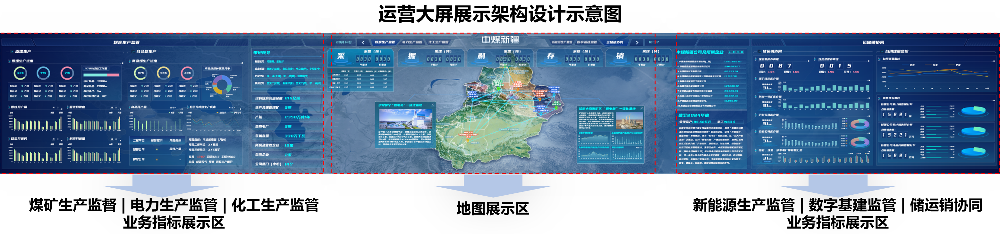

**图 3‑10‑1 调度指挥中心大屏应用界面示意图**

|  |  |
| --- | --- |
| **属性** | **内容** |
| 功能编号 | F068 |
| 所属模块 | 调度指挥中心大屏应用 |
| 功能名称 | 调度指挥中心大屏应用 |
| 功能概要 | 大屏采用顶部通栏‑中部核心‑左右分区‑底部通栏的总体布局；首页概览页设置产销存全局告警、全域地图、带班领导、产能资源、经营台账、采掘剥存销、生产监管、安全环保、运储销监控等区块；支持 6 类专项页面切换（概览首页、煤炭生产、运储销、安全环保、调度报表、统一报警处置）；具备模块全屏、居中悬浮详情弹窗，满足公司‑矿井‑工作面 / 设备三级穿透，穿透过程保留基础区块可见。顶部设置六大业务切换标签：煤矿生产管理、电力生产管理、化工生产管理、新能源生产管理、数字基建管理、储运销协同管理，实现资源统筹、区域调度、布局优化可视化总览，本期落地煤炭生产管理、储运销协同、数字基建监管三大板块。 |
| 实现方式 | 大屏可视化定制开发 + 业务系统数据集成 |
| 数据来源 | 全平台各业务模块同源数据 |
| 端侧形态 | 大屏端 |
| 建设难度 | 高 |
| 建设优先级 | 高 |
| 备注说明 | 调度指挥中心硬件大屏专属应用，支持业务标签切换、地图交互、页面切换、模块全屏、弹窗下钻、数据实时刷新 |

**功能设计说明**

本功能（编号 F068）作为平台调度指挥中心专属大屏应用，是新疆公司全域生产运营态势总览可视化载体。大屏首页概览采用顶部通栏‑中部核心‑左右分区‑底部通栏固定布局结构；同时支持 6 种专项业务页面切换；支持模块全屏放大、详情弹窗悬浮分层，执行三级穿透下钻时，页面基础框架区块保持可见，不丢失全局上下文。顶部设置六大业务切换标签：煤矿生产监督、电力生产监管、化工生产监管、新能源生产监管、数字基建监管、储运销协同，点击标签完成业务视图切换，本期优先落地煤炭生产监督、储运销协同、数字基建监管三大业务板块。

实现方式方面，本功能采用大屏可视化定制开发结合业务系统数据集成方式。前端基于 Vue.js+ECharts 及地图可视化技术栈，严格遵循平台大屏设计规范完成布局、组件、弹窗、动效开发；后端对接平台数据服务层，复用 ODS‑DWD‑DWS‑ADS 分层计算结果，完成多业务域数据汇聚，保证大屏与 PC 端、移动端数据同源一致。数据集成过程严格遵循平台数据质量规范，保障大屏实时数据刷新、统计数据口径统一；预警事件由预警规则引擎实时推送，支撑告警滚动、颜色标识、弹窗提示。

**3.10.1首页概览页面布局**

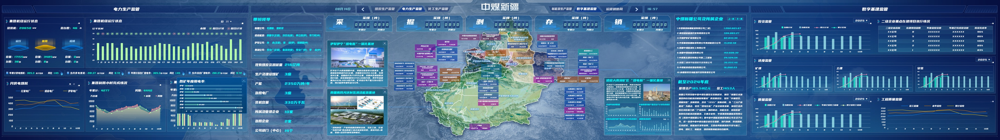

**图 3‑10‑2 调度指挥中心大屏首页概览界面示意图**

**（1）顶部通栏：产销存全局告警滚动区**

实时滚动展示红 / 黄 / 蓝三级告警条目，每条告警包含：异常指标、归属单位、指标偏差数值、预警等级、处置提示信息。告警条目按级别优先级排序，高等级红警优先滚动，红警条目增加闪烁动效。

**（2）中部核心区：新疆全域地理可视化地图**

作为大屏视觉核心，加载新疆全域行政区划 + 地形底图，标注六大产业基地、矿井、电厂、化工、新能源点位；点位使用红 / 黄 / 绿三色状态标识区分运行状态（绿色正常、黄色关注预警、红色异常告警）。
交互能力：支持图层切换（生产图层 / 安全图层 / 基建图层）、缩放、平移、点位聚焦定位；点击点位弹出详情弹窗，展示该单位产量、安全、库存等关键指标，支持点位向下穿透跳转至对应矿井专题页面，落实三级穿透管控逻辑。

**（3）左侧分区**

上层：带班领导看板，展示新疆公司本部、哈密能源、伊犁公司、条湖公司值班人员信息（姓名、职务、联系电话、班次）。

中层：资源与产能指标静态卡片组，采用数字卡片组件展示煤炭资源储量、生产煤矿数量、总产能、电力及新能源装机、下属企业台账等基准指标。

下层：企业台账与经营概况分析，权属企业清单表格，搭配利润、产量、销量趋势图表，支持计划值与实际值对比。

**（4）右侧分区**

上层：采掘剥存销五维卡片组，分别展示原煤产量、掘进进尺、剥离量、库存量、销售量核心指标，附带同比环比、计划完成率、超欠量。

下层：煤炭生产监管多图表组合，包含日进度环形图、月度对比柱状图、煤质监控趋势曲线、主要大型设备总览统计卡片。

**（5）底部通栏**

左侧：安全环保综合看板，汇总隐患统计、灾害监测（瓦斯 / 水害 / 顶板等）、环保排放达标指标，使用统计卡片 + 简易趋势图表展示。

右侧：运储销协同监控，包含仓储库存状态、销售履约情况、铁路 / 公路运输发运数据，支持库存高低阈值预警标识。

**3.10.2专项页面切换适配**

系统支持 6 种专项页面布局一键切换，页面切换保留顶部告警通栏，页面主体区块随业务场景动态加载：

概览首页：上述完整首页布局；

煤炭生产：聚焦采掘剥、煤质、设备、计划执行专题视图；

运储销：仓储‑销售‑运输‑煤电联营协同专题视图；

安全环保：全域安全综合指标、风险隐患、灾害监测、环保监测专题视图；

调度报表：大屏版调度报表可视化视图；

统一报警处置：报警汇聚、分级分类、报警统计分析专题视图。

**3.10.3全屏下钻与弹窗交互设计**

**（1）模块全屏展示**

任意图表、卡片区块支持点击全屏放大，便于调度人员聚焦查看某一类业务数据；全屏模式可一键还原回到首页布局。

**（2）详情弹窗**

点击点位、告警条目、矿井/工作面名称，弹出居中悬浮分层详情弹窗；弹窗层级高于基础页面，弹窗内部展示明细数据、监测曲线、处置操作按钮。

**（3）三级穿透交互约束**

执行公司→矿井→工作面 / 核心设备逐级下钻操作时，大屏页面顶部告警通栏、地图核心区块保持可见，仅业务指标分区刷新为下级粒度数据，保留全局上下文，避免完全脱离总览视图。

界面设计方面，整体严格遵循平台大屏端设计规范，深色主题配色，网格化布局；数字卡片、环形图、柱状图、折线图、表格、地图组件统一使用平台可视化组件规范；预警颜色严格对齐预警规则（红、橙、黄、蓝）；动效包含：数据平滑刷新、高等级告警闪烁、地图点位呼吸灯、弹窗淡入淡出。

1. **交互设计**

1）地图交互：支持缩放、平移、图层切换；点击企业点位弹出详情弹窗，支持三级穿透跳转。

2）页面切换交互：点击专项页面菜单，完成概览首页、煤炭生产、运储销、安全环保、调度报表、统一报警处置页面切换；点击顶部六大业务标签，地图过滤对应业务点位，左右指标区刷新业务数据。

3）图表交互：全部图表支持鼠标悬停查看明细；矿井、工作面、设备名称支持点击下钻；支持模块全屏放大 / 还原。

4）告警交互：顶部通栏告警滚动，点击告警条目，弹出居中悬浮告警详情弹窗，展示异常参数、发生时间、责任单位、处置指引。

**3.10.4 煤炭生产管理分屏**

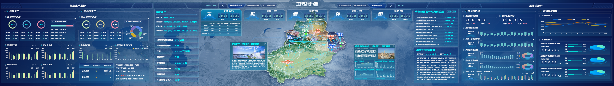

**图 3‑10‑3 调度指挥中心煤炭生产管理分屏示意图**

|  |  |
| --- | --- |
| **属性** | **内容** |
| 功能编号 | F068‑01 |
| 所属模块 | 调度指挥中心大屏应用‑煤炭生产监督子板块 |
| 功能名称 | 煤炭生产管理 |
| 功能概要 | 聚焦煤炭核心生产环节，实时展示采掘进度、剥离工程量、原煤产量、筛分产量、生产计划完成率、采掘效率、生产工时、安全生产时长、生产异常次数；实现计划‑实际差值预警、产能趋势分析。 |
| 实现方式 | 大屏可视化定制开发 + 业务系统数据集成 |
| 数据来源 | 煤炭生产管理、生产运营管理模块同源数据 |
| 端侧形态 | 大屏端 |
| 建设难度 | 中 |
| 建设优先级 | 高 |
| 备注说明 | 本期建设落地子板块 |

**功能设计说明**

本板块聚焦新疆公司煤炭核心生产环节，整合各矿区采掘进度、剥离工程量、原煤产量、筛分产量、生产计划完成率、采掘效率、生产工时、安全生产时长、生产异常次数等全维度生产指标。采用仪表盘、趋势曲线、进度柱状图、同比环比分析图等多元可视化形式，展示各矿区日常生产运行态势。
业务价值：支撑调度人员实时掌握产能动态、研判生产进度、统筹生产任务；当生产指标触发三级预警时，图表指标自动变色高亮提示。

### 3.10.5 煤炭安全管理分屏

**图 3‑10‑4 调度指挥中心煤炭安全管理分屏示意图**

|  |  |
| --- | --- |
| **属性** | **内容** |
| 功能编号 | F068‑02 |
| 所属模块 | 调度指挥中心大屏应用‑煤炭安全管理子板块 |
| 功能名称 | 煤炭安全管理 |
| 功能概要 | 围绕人、机、环、管安全管控维度，集中展示全域安全综合指标、安全分级预警总览、安全风险分级管控、隐患排查治理闭环、工作面限员超限、危大工程监控、各灾害类监测（通风、火灾、瓦斯、煤尘、顶板、冲击地压预留、露天边坡、GNSS 位移、水害）、环保监测、监测系统设备运维离线告警；实现安全指标总览、风险隐患统计、灾害监测实时曲线、安全四色预警高亮展示，支撑安全态势集中研判与调度处置。 |
| 实现方式 | 大屏可视化定制开发 + 业务系统数据集成 |
| 数据来源 | 安全管理模块同源数据 |
| 端侧形态 | 大屏端 |
| 建设难度 | 中 |
| 建设优先级 | 高 |
| 备注说明 | 本期建设落地子板块 |

**功能设计说明**

本分屏依托平台安全管理模块全域数据资源，聚焦调度大屏可视化场景，采用分区可视化展示模式，集中汇聚新疆公司各矿井安全监测、风险管控、隐患治理、人员作业、灾害监测及设备运维等核心安全数据，实现矿区安全态势一体化、可视化监管，适配调度中心集中监控、快速研判、应急处置的业务需求。模块整体按照安全总览、风险隐患管控、人员高风险作业、灾害专题监测、环保设备运维五大分区布局，联动平台预警规则引擎，实现安全数据实时展示、异常智能预警、层级穿透查询。

**3.10.6 储运销协同管理分屏**

**图 3‑10‑4 调度指挥中心储运销管理分屏示意图**

|  |  |
| --- | --- |
| **属性** | **内容** |
| 功能编号 | F068‑03 |
| 所属模块 | 调度指挥中心大屏应用‑储运销协同子板块 |
| 功能名称 | 储运销协同 |
| 功能概要 | 围绕存、运、销全链条协同管控，集成矿区库存余量、发运量、销量核心指标，实现储运销数据实时统计、销售数据动态汇总、储销趋势分析、储运销联动告警展示。 |
| 实现方式 | 大屏可视化定制开发 + 业务系统数据集成 |
| 数据来源 | 储运销管理模块同源数据 |
| 端侧形态 | 大屏端 |
| 建设难度 | 中 |
| 建设优先级 | 高 |
| 备注说明 | 本期建设落地子板块 |

**功能设计说明**

本板块围绕煤炭仓储、运输、销售全链条协同管控需求，打通储、运、销业务数据壁垒。核心展示矿区库存余量、铁路 / 公路发运量、实际销量、合同履约、库存周转等指标；提供储运数据实时统计、销售数据动态汇总、储销趋势分析图表；储运销联动预警事件在本板块进行高亮展示，支撑调度开展产销存平衡调度。

**3.10.7 数字基建管理分屏**

|  |  |
| --- | --- |
| **属性** | **内容** |
| 功能编号 | F068‑04 |
| 所属模块 | 调度指挥中心大屏应用‑数字基建监管子板块 |
| 功能名称 | 数字基建监管 |
| 功能概要 | 实现基建投资项目集中可视化监测，展示投资计划与投资完成、项目进度与里程碑、项目安全风险隐患、手续办理、概算执行、转包违法分包预警。 |
| 实现方式 | 大屏可视化定制开发 + 业务系统数据集成 |
| 数据来源 | 基建管理模块同源数据 |
| 端侧形态 | 大屏端 |
| 建设难度 | 中 |
| 建设优先级 | 高 |
| 备注说明 | 本期建设落地子板块 |

**图 3‑10‑5 调度指挥中心数字基建管理分屏示意图**

**功能设计说明**

本板块聚焦投资项目全流程管控需求，对基建项目数据集中呈现、动态监测。展示内容包含企业 / 项目投资计划与投资完成情况、项目进度 / 里程碑完成情况、项目安全风险管理与隐患情况、项目内外部手续完成情况、项目概算控制与概算执行情况、项目转包、违法分包控制与预警，助力管理人员掌握投资项目建设过程，保障项目高效有序推进。

**3.10.8 电力生产管理分屏（预留）**

|  |  |
| --- | --- |
| **属性** | **内容** |
| 功能编号 | F068‑05 |
| 所属模块 | 调度指挥中心大屏应用‑电力生产监管子板块 |
| 功能名称 | 电力生产监管 |
| 功能概要 | 预留电力生产监管业务视图标签，用于后续接入电厂负荷、发电量、厂用电、煤电联营对标、机组运行状态等指标。 |
| 实现方式 | 大屏可视化定制开发（界面框架预留） |
| 数据来源 | 预留数据源接口 |
| 端侧形态 | 大屏端 |
| 建设难度 | ‑ |
| 建设优先级 | 低 |
| 备注说明 | 仅预留标签与界面框架，后续迭代实施 |

### 3.10.9 化工生产管理分屏（预留）

|  |  |
| --- | --- |
| **属性** | **内容** |
| 功能编号 | F068‑06 |
| 所属模块 | 调度指挥中心大屏应用‑化工生产监管子板块 |
| 功能名称 | 化工生产监管 |
| 功能概要 | 预留化工生产监管业务视图标签，用于后续接入化工板块产能、消耗、安全环保等业务指标。 |
| 实现方式 | 大屏可视化定制开发（界面框架预留） |
| 数据来源 | 预留数据源接口 |
| 端侧形态 | 大屏端 |
| 建设难度 | ‑ |
| 建设优先级 | 低 |
| 备注说明 | 仅预留标签与界面框架，后续迭代实施 |

### 3.10.10 新能源生产管理分屏（预留）

|  |  |
| --- | --- |
| **属性** | **内容** |
| 功能编号 | F068‑07 |
| 所属模块 | 调度指挥中心大屏应用‑新能源生产监管子板块 |
| 功能名称 | 新能源生产监管 |
| 功能概要 | 预留新能源生产监管业务视图标签，用于后续接入光伏、风电装机、发电量、消纳等新能源业务指标。 |
| 实现方式 | 大屏可视化定制开发（界面框架预留） |
| 数据来源 | 预留数据源接口 |
| 端侧形态 | 大屏端 |
| 建设难度 | ‑ |
| 建设优先级 | 低 |
| 备注说明 | 仅预留标签与界面框架，后续迭代实施 |

数据处理逻辑方面，大屏应用统一调用平台数据服务层接口，从 ADS 应用数据层获取已经聚合计算完成的指标数据；地图点位业务属性数据同步由 DWS 汇总层提供。大屏遵循平台性能指标要求，大屏端数据刷新延迟不超过 5 秒。预警规则引擎实时产出告警数据集，推送至大屏接口，驱动顶部通栏告警滚动、点位状态变色、图表高亮闪烁。执行页面切换、全屏、下钻弹窗请求时，后端按请求的数据粒度，返回对应层级（公司级 / 矿井级 / 工作面级）聚合指标；三级穿透下钻时，保持地图、告警通栏基础数据持续刷新，仅业务指标分区替换为下级明细数据；弹窗明细从 DWD 明细层读取测点、原始明细数据。所有下钻、页面切换、全屏操作日志统一记录至系统审计日志，支持操作追溯。

# 第4章 预警规则设计

## 4.1 生产过程控制三级预警

生产过程控制采用红、黄、蓝三级预警机制，基于生产指标偏差率和异常事件触发分级预警，具体规则如下：

|  |  |  |  |
| --- | --- | --- | --- |
| **预警级别** | **触发条件** | **颜色标识** | **响应要求** |
| 红警 | 偏差＞±15%或安全事件/停产；事故上报逾期、掘进接续严重滞后 | 红色 | 立即响应，领导督办，紧急处置 |
| 黄警 | 偏差±10%～±15%或进度滞后；调度通知下发不及时、排班异常 | 黄色 | 当班响应，调度跟踪，限期整改 |
| 蓝警 | 偏差±5%～±10%提醒关注；穿爆、洗选等环节进度轻微滞后 | 蓝色 | 关注提醒，分析原因，预防恶化 |

## 4.2 安全监测数据分级预警

安全监测数据采用红、橙、黄、蓝四色分级预警机制，覆盖瓦斯、CO、温度、水害、顶板、煤尘、边坡等各类安全监测指标。各级预警根据监测数据超限程度、危害等级和紧急程度进行划分，对应不同的响应级别和处置流程。

安全预警分级体系与生产预警三级体系并行运行，在统一分级报警模块中进行汇聚展示和联动管控。安全预警触发后，系统自动记录预警时间、测点位置、监测数值、超限倍数等信息，并推送至相关责任人员。

## 4.3 预警联动与处置机制

预警联动与处置机制包括以下核心环节：

（1）预警自动识别：预警规则引擎实时监测各项指标数据，当指标满足预警触发条件时，自动生成预警事件，记录预警级别、触发时间、关联指标、异常数值等信息。

（2）多渠道推送：预警事件生成后，系统通过PC端弹窗、大屏闪烁、移动端消息推送、短信通知等多渠道向相关责任人员推送预警信息，确保预警及时触达。

（3）声光联动：高等级预警（红警/橙警）触发时，联动调度中心声光报警设备，通过视觉和听觉双重警示提醒调度人员立即处置。

（4）分级升级：预警触发后，若在规定时间内未得到处置，系统自动升级预警级别并向上级管理人员推送，形成逐级升级的压力传导机制。

（5）闭环管理：预警处置完成后，处置人员需在系统中填写处置措施、处置结果、处置时间等信息，系统自动记录完整的预警处置链路，形成预警-推送-处置-闭环的完整管理流程。

（6）统计分析：系统定期对预警数据进行统计分析，包括预警总量、各级占比、处置及时率、闭环率、高频预警点位等，为安全管理和生产优化提供数据支撑。

# 第5章 数据设计

## 5.1 数据来源与分类体系

平台数据来源覆盖新疆公司各业务领域，按数据类别分为以下七大类：

|  |  |  |  |
| --- | --- | --- | --- |
| **数据类别** | **来源系统** | **主要数据内容** | **更新频率** |
| 煤炭生产数据 | 煤矿各类生产监测系统 | 原煤产量、掘进进尺、剥离量、环境数据、设备数据、工作面数据、煤质数据 | 实时/日更新 |
| 运储销数据 | 运储销管理系统、煤矿/洗煤厂各仓存系统 | 库存数据、销售数据、外运数据、合同履约数据 | 实时/日更新 |
| 基建项目数据 | 投建转管理系统 | 投资计划、项目进度、概算执行、安全风险 | 日/周更新 |
| 安全环保数据 | 各类安全环保监测子系统 | 隐患数据、违章数据、环保监测数据、危大工程 | 实时/日更新 |
| 设备运行数据 | 矿端各类机电自动化系统 | 设备状态、开机率、故障率、利用率 | 实时/日更新 |
| 人员数据 | 人员定位系统、人力资源管理系统 | 人员位置信息、人员数量、特种作业人员、考勤数据 | 实时/日更新 |
| 调度值班数据 | 台账、报表、人工填报、调度管理系统 | 调度指令、值班记录、交接班数据 | 实时/日更新 |

## 5.2 数据质量要求

平台数据质量需满足以下五个维度的要求：

|  |  |
| --- | --- |
| **质量维度** | **要求说明** |
| 准确性 | 数据必须真实反映实际生产运行情况，误差率控制在允许范围内。 |
| 及时性 | 实时数据刷新延迟不超过5分钟，日数据在次日7:00前完成更新。 |
| 完整性 | 各业务领域核心指标数据完整，无缺失和遗漏。 |
| 一致性 | 同一指标在不同系统、不同层级的数据口径保持一致。 |
| 可追溯性 | 所有数据均有明确的数据来源和计算逻辑，支持数据溯源和核查。 |

## 5.3 数据集成方案

数据集成采用统一的数据接入平台，支持多种数据接入方式：

（1）数据库直连：对于支持数据库访问的业务系统，通过配置数据库连接信息，采用JDBC/ODBC方式直接读取业务数据，适用于数据量大、实时性要求较高的场景。

（2）API接口调用：对于提供RESTful API接口的业务系统，通过调用API接口获取数据，适用于数据量适中、需要业务逻辑处理的场景。

（3）文件交换：对于不支持直连和API的系统，通过FTP/SFTP等文件传输协议，定时获取系统导出的数据文件（CSV/Excel/JSON等格式），适用于历史数据迁移和批量数据同步场景。

（4）消息队列订阅：对于支持消息推送的实时监测系统，通过订阅Kafka/RabbitMQ等消息队列，实时获取监测数据，适用于秒级实时数据采集场景。

（5）集团统建系统对接：对于煤质管理、高风险作业、投建转一体化、环保管理、智控机电自动化、图纸云等集团统建系统，按照集团统一的接口规范和数据标准进行对接，确保数据口径与集团保持一致。

# 第6章 用户角色与权限设计

## 6.1 用户角色分析

平台用户按角色类型分为以下四类，各类角色的核心功能和数据范围如下：

|  |  |  |  |
| --- | --- | --- | --- |
| **角色类型** | **主要用户** | **核心功能** | **数据范围** |
| 公司领导 | 总经理、副总经理、总工程师等 | 全局态势总览、重大决策支撑、应急指挥调度 | 全公司所有数据 |
| 值班调度人员 | 调度中心值班领导、值班调度员 | 生产监控、预警处置、调度指令、值班管理 | 全公司生产调度相关数据 |
| 业务管理人员 | 生产、安全、运销、基建等部门负责人 | 业务专题分析、指标监控、报表查询 | 对应业务领域数据 |
| 系统管理员 | 信息中心系统管理人员 | 系统配置、用户管理、权限管理、运维监控 | 系统配置及运维数据 |

## 6.2 权限管控设计

平台权限管控采用基于角色的访问控制（RBAC）模型，结合数据权限和功能权限双重管控机制：

（1）功能权限：按角色分配可访问的功能模块和操作权限，不同角色看到的菜单和可执行的操作不同。公司领导可访问全部模块的总览和分析功能；调度人员可访问生产监控、预警处置、调度管理等功能；业务管理人员可访问对应业务领域的专题分析和报表功能；系统管理员可访问系统配置和运维管理功能。

（2）数据权限：按用户所属组织和角色分配可查看的数据范围，支持按公司、矿井、工作面等层级进行数据权限控制。公司级用户可查看全公司数据；矿井级用户仅可查看本矿数据；工作面级用户仅可查看本工作面数据。

（3）操作审计：所有用户的登录、查询、导出、配置修改等操作均记录操作日志，包括操作人、操作时间、操作内容、IP地址等信息，支持操作审计和追溯。

（4）单点登录：平台支持与公司统一身份认证系统对接，实现单点登录（SSO），用户一次登录即可访问所有授权的应用系统，提升用户体验和安全性。

# 第7章 可视化设计规范

## 7.1 可视化组件规范

平台可视化组件遵循统一的设计规范，确保各模块视觉风格一致、数据展示清晰。各类可视化组件的适用场景和设计规范如下：

|  |  |  |
| --- | --- | --- |
| **可视化类型** | **适用场景** | **设计规范** |
| 数字卡片 | 核心指标展示 | 大字体数字+单位+趋势箭头，背景色区分状态 |
| 环形图 | 完成率、占比展示 | 环形进度展示完成比例，中心显示数值 |
| 柱状图 | 对比分析、趋势展示 | 支持多系列对比，悬停显示详细数据 |
| 折线图 | 趋势变化、时间序列 | 平滑曲线，支持多指标对比 |
| 饼图 | 占比分布展示 | 按类别展示占比，支持点击下钻 |
| 进度条 | 进度展示 | 直观展示完成进度，支持多维度对比 |
| 地图 | 地理分布、空间展示 | 三维底图，点位标注，状态色标 |
| 表格 | 明细数据展示 | 斑马纹样式，支持排序和筛选 |
| 状态标识 | 状态展示 | 红黄绿三色标识，直观展示状态 |

## 7.2 大屏端设计规范

大屏端作为平台的重要展示终端，主要部署于公司调度中心和领导驾驶舱，设计规范如下：

（1）分辨率适配：大屏端采用1920×1080及以上分辨率设计，支持4K超高清显示，确保在大屏上文字清晰、图表细腻。

（2）布局规范：大屏采用网格化布局，顶部为标题栏和全局指标区，中部为核心业务看板区，底部为告警滚动栏和辅助信息区，各区域比例协调、信息层次清晰。

（3）配色方案：大屏采用深色主题配色，以深蓝/深灰为背景色，核心数据使用高对比度亮色（白/黄/绿/红），确保在大屏环境下数据醒目、视觉舒适。预警信息使用红/橙/黄/蓝四色标识，与预警级别对应。

（4）字体规范：大屏标题采用黑体加粗，数字指标采用等宽字体，正文字号不小于24px，确保在3-5米观看距离下清晰可读。

（5）动效设计：大屏数据刷新采用平滑过渡动画，告警信息采用闪烁和滚动效果，地图点位采用呼吸灯效果，增强视觉吸引力和信息传达效率。

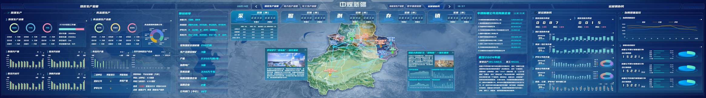

**图7-1 大屏应用界面示意图**

# 第8章 非功能性设计

## 8.1 性能设计

（1）响应时间：PC端页面加载时间不超过3秒，数据查询响应时间不超过2秒，大屏端数据刷新延迟不超过5秒。

（2）并发能力：系统支持不少于200个并发用户同时在线访问，核心查询接口支持每秒50次以上的并发请求。

（3）数据处理：实时数据采集处理延迟不超过10秒，日批量数据处理在次日7:00前完成，历史数据查询支持秒级响应。

（4）可用性：系统年可用率不低于99.9%，计划内停机维护提前通知，非计划停机时间全年累计不超过8.76小时。

（5）扩展性：系统采用微服务架构，支持水平扩展，可根据业务增长需求灵活增加计算和存储资源。

## 8.2 安全设计

（1）网络安全：系统部署于公司内网环境，与互联网物理隔离，通过防火墙和入侵检测系统进行网络边界防护，外部访问需通过VPN接入。

（2）身份认证：支持与公司统一身份认证系统对接，实现单点登录；用户密码采用加盐哈希存储，支持密码复杂度策略和定期更换要求；支持双因素认证（2FA）增强安全性。

（3）访问控制：采用基于角色的访问控制（RBAC）模型，结合功能权限和数据权限双重管控，确保用户只能访问授权范围内的功能和数据。

（4）数据安全：敏感数据（如人员信息、经营数据）采用加密存储，数据传输采用HTTPS/TLS加密协议，支持数据脱敏展示，防止敏感信息泄露。

（5）操作审计：所有用户操作均记录审计日志，包括登录、查询、导出、配置修改等，日志保留期不少于1年，支持审计查询和追溯。

（6）备份恢复：数据库每日全量备份+实时增量备份，备份数据异地存储，支持按时间点恢复（PITR），定期进行恢复演练确保备份有效性。

## 8.3 可扩展性设计

（1）功能扩展：平台采用模块化设计，各功能模块独立部署、松耦合，新增功能模块不影响现有模块运行，支持按需扩展业务功能。

（2）数据源扩展：数据接入平台支持配置化新增数据源，新增业务系统数据接入无需修改核心代码，通过配置数据源连接信息和数据映射规则即可完成接入。

（3）预警规则扩展：预警规则引擎支持可视化配置预警规则，新增预警指标和触发条件无需开发编码，业务人员可通过配置界面自行定义预警规则。

（4）指标扩展：指标计算服务支持配置化新增计算指标，通过定义指标计算公式和数据来源，即可新增业务指标，支持指标的版本管理和灰度发布。

（5）终端扩展：平台采用响应式设计和前后端分离架构，支持PC端、大屏端、移动端等多种终端接入，未来可扩展支持微信小程序、企业微信等更多终端形态。

# 第9章 实施计划

## 9.1 建设优先级分析

根据功能重要性、业务紧迫性和建设难度，将67项功能按建设优先级分为高、中、低三级：

（1）高优先级功能共35项，主要包括核心生产指标监控、安全监测预警、储运销关键业务、统一报警、基础报表等直接支撑日常调度和安全管理的功能，需在项目一期优先建设。

（2）中优先级功能共31项，主要包括运营分析模型、煤质管理、设备管理、部分储运销分析、基建管理、移动端推送等提升管理精细化水平的功能，在项目二期建设。

（3）低优先级功能共1项，主要包括冲击地压监测（预留）、部分辅助展示功能等，根据业务发展需要在项目三期或后续迭代中建设。

## 9.2 实施阶段划分

项目实施分为三个阶段，各阶段的主要工作内容和交付物如下：

|  |  |  |  |
| --- | --- | --- | --- |
| **阶段** | **时间周期** | **主要工作内容** | **交付物** |
| **第一阶段 （基础建设）** | 第1-2月 | 完成平台基础架构搭建、数据采集接入、核心功能模块开发（生产运营管理、煤炭生产管理核心功能、安全管理核心功能、统一分级报警、生产调度报表）、大屏端基础展示 | 平台基础版本、核心功能上线、数据接入完成、大屏基础版 |
| **第二阶段 （深化应用）** | 第2-3月 | 完成运营分析模型开发、储运销管理全功能、安全管理全功能、基建管理、生产运营简报、移动端应用、预警规则引擎完善 | 运营分析功能、全模块功能上线、移动端APP、简报自动生成 |
| **第三阶段 （优化提升）** | 第3-4月 | 完成系统性能优化、用户体验提升、预留功能建设、数据质量治理、系统运维体系建设、项目验收 | 优化版本、运维手册、验收文档、项目终验 |

项目实施过程中，采用敏捷开发模式，每两周进行一次迭代交付，每月进行一次阶段评审，确保项目进度和质量可控。同时，建立用户参与机制，在各阶段邀请业务用户进行试用和反馈，及时调整和优化功能设计，确保平台最终交付物满足业务需求。
