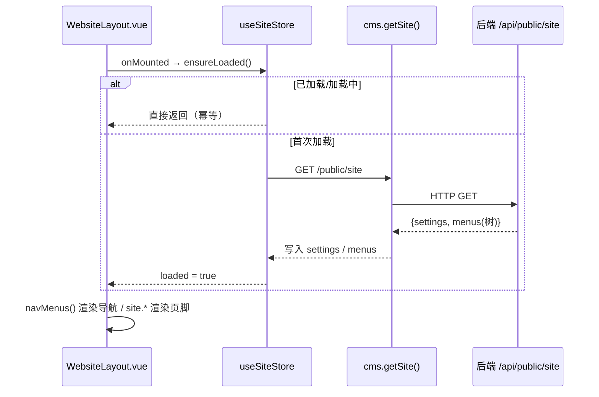
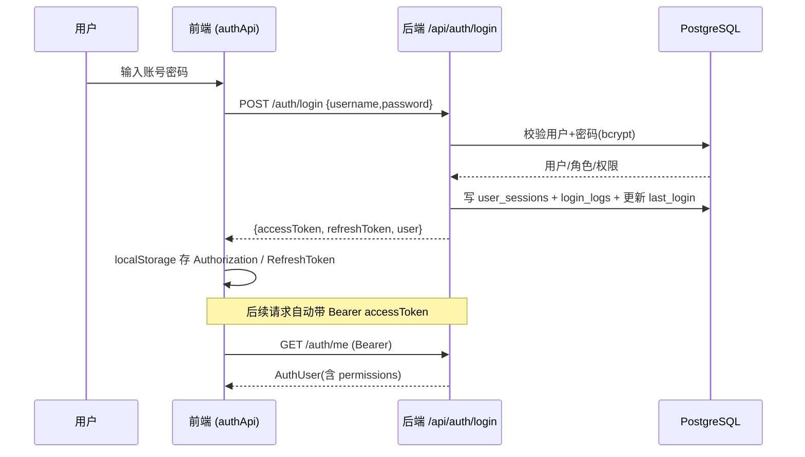
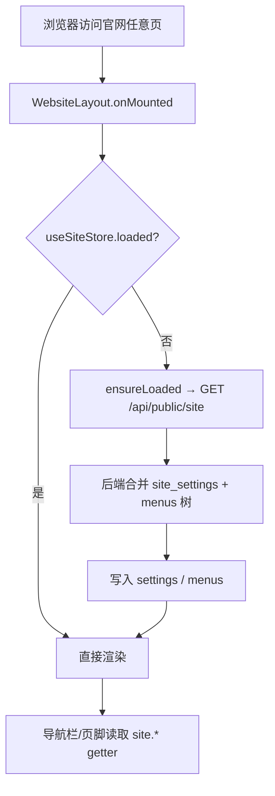
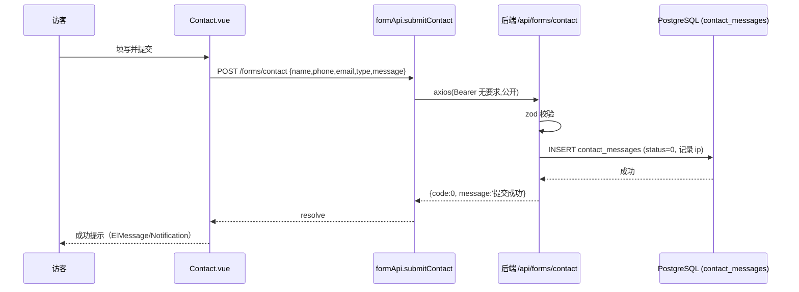
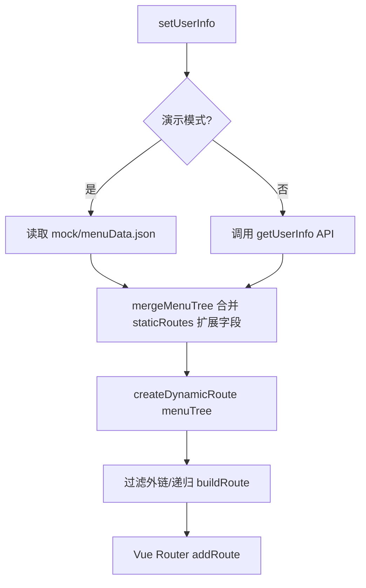
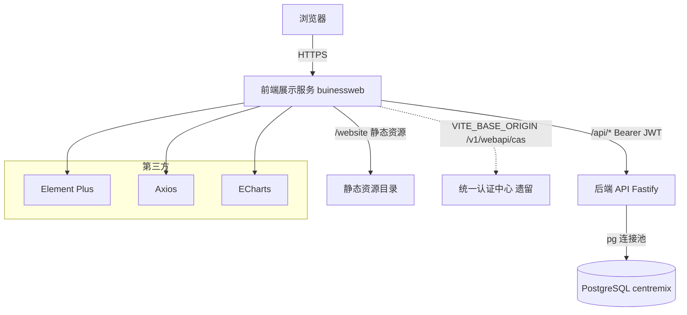
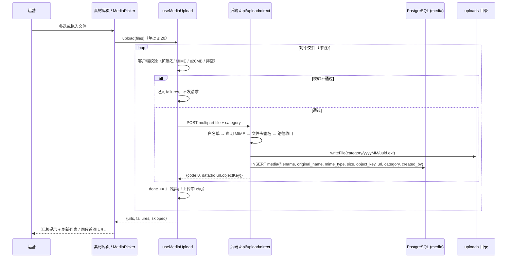
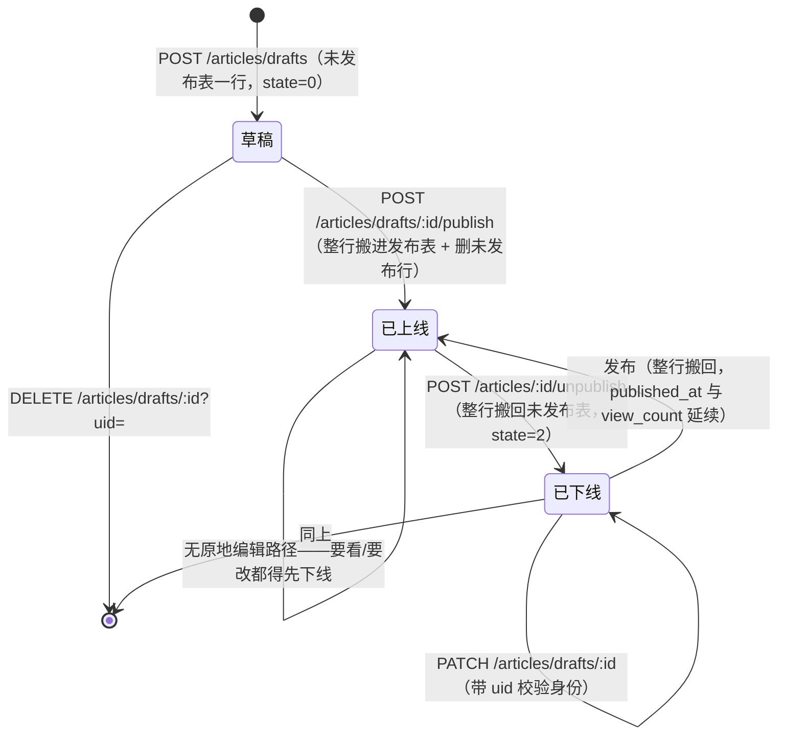
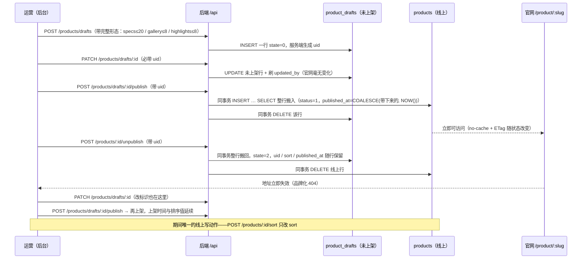

# 前端展示服务设计文档 · Centremix 芯联创官网

> 文档编号：`01-frontend-buinessweb-design`
> 所属项目：z-buiness（Centremix 芯联创企业官网）
> 配套文档：`02-backend-api-design.md`（后端 API 服务）、`03-database-centremix-design.md`（数据库服务）
> 文档性质：架构设计交付物（只读，不修改业务代码）

---

## 1. 服务概述

### 1.1 定位

前端展示服务（`buinessweb`）是 Centremix 芯联创企业官网的**唯一对客流量入口**，承担两大部分职责：

1. **企业营销官网（WebsiteLayout 体系）**：面向 C 端/经销商访客，展示品牌故事、产品中心、新闻资讯、售后服务与站内搜索，并通过表单收集销售线索（询价、合作、订阅、售后）。
2. **运营后台骨架（/admin 体系，沿用既有 admin 模板）**：作为未来 CMS 管理界面的容器外壳，目前仅含 `admin-home` 占位页，真实管理逻辑由后端 + 后续页面补齐。

### 1.2 技术栈

| 分类 | 选型 | 版本/说明 |
|------|------|-----------|
| 框架 | Vue 3（`vue`） | `^3.5.32`，Composition API + `<script setup>` |
| 构建 | Vite（`vite`） | `^6.0.7`，`createWebHistory` 路由模式 |
| 语言 | TypeScript | `~5.8.3`，`vue-tsc` 类型检查 |
| 状态管理 | Pinia（`pinia`） | `^3.0.4` |
| 路由 | Vue Router（`vue-router`） | `^5.0.4` |
| HTTP | Axios（`axios`） | `^1.15.1`，两套封装（`http.ts` / `cms.ts`） |
| UI 组件 | Element Plus（`element-plus`）+ 图标 | `^2.13.7`，自动按需引入 |
| 图表 | ECharts（`echarts`） | `^6.1.0`，用于首页/统计类可视化 |
| 工具 | lodash-es、animate.css、watermark-js-plus | 通用工具/动画/水印 |
| 包管理 | pnpm | `10.33.0`（`packageManager` 锁定） |

### 1.3 在整体架构中的角色

```
┌─────────────────────────────────────────────────────────────┐
│  浏览器 / 访客                                                 │
└───────────────┬─────────────────────────────────────────────┘
                │  HTTPS
                ▼
┌─────────────────────────────────────────────────────────────┐
│  前端展示服务 (buinessweb)  Vite + Vue3 + Pinia                │
│  - WebsiteLayout 营销站  - /admin CMS 骨架  - 静态资源 /website │
└───────────────┬─────────────────────────────────────────────┘
                │  /api/*  (Bearer JWT)
                ▼
┌─────────────────────────────────────────────────────────────┐
│  后端 API 服务 (Fastify + TS)  →  PostgreSQL 16 (centremix)   │
└─────────────────────────────────────────────────────────────┘
```

前端是**纯展示 + 状态编排层**：不直连数据库，所有数据均经后端 `/api` 暴露；富文本/内容的清洗与鉴权逻辑全部下沉到后端，前端只负责渲染与表单采集。

---

## 2. 核心职责

| 职责 | 说明 | 边界 |
|------|------|------|
| 营销页面渲染 | 首页、关于我们、产品中心/详情、新闻/详情、售后服务、搜索、404 | 页面数据全部来自后端 `/api/public/*` |
| 站点配置注入 | 通过 `useSiteStore` 拉取品牌色/导航/联系方式 | 配置来源是后端 `site_settings` + `menus`，前端只消费 |
| 表单线索采集 | 询价/合作/订阅/售后四类公开表单，提交到 `/api/forms/*` | 仅提交，不做业务校验落库（由后端 zod 校验） |
| 用户登录态管理 | 登录/登出/刷新令牌，存 `localStorage` | 鉴权判定与权限点（RBAC）由后端返回 |
| 运营后台骨架 | `/admin` 容器 + 动态路由（基于菜单树） | 当前仅为外壳，真实 CMS 页面后续补齐 |
| 素材库与图片上传 | 媒体浏览/检索/改名归类/删除，图片多选与拖拽直传（详见 §8） | 文件落库与类型校验由后端完成，前端只做前置拦截 |
| 静态资源托管 | `/website/*` logo、图片等 | 由 `public/website` 或部署静态目录提供 |

**职责边界**：前端**不**承担：
- 任何数据库访问（无 ORM / 直连）；
- 富文本 XSS 清洗（后端 `sanitize-html` 处理）；
- 业务权限判定（仅按后端返回的 `permissions` 数组做按钮级展示/隐藏）。

---

## 3. 接口设计

### 3.1 页面路由（来自 `src/router/index.ts` 与 `views/website`）

采用**静态主路由 + 动态子路由（/admin）**混合模式。官网部分用静态路由精确对应设计原型；后台部分由 `asyncRoutes.ts` 依据菜单树动态生成。

| 路径 | 名称 | 组件 | Layout | 数据来源 |
|------|------|------|--------|----------|
| `/` | home | `views/website/Home.vue` | WebsiteLayout | `cms.getBanners('home')` / `getProductsPaged` / `getArticles` |
| `/about` | about | `views/website/About.vue` | WebsiteLayout | `cms.getPage('about')` |
| `/products` | products | `views/website/Products.vue` | WebsiteLayout | `cms.getProducts` / `getProductCategories` |
| `/products/:slug` | product-detail | `views/website/ProductDetail.vue` | WebsiteLayout | `cms.getProduct(slug)` |
| `/news` | news | `views/website/news/index.vue` | WebsiteLayout | `cms.getArticles` / `getArticleCategories` |
| `/news/:slug` | article | `views/website/news/detail.vue` | WebsiteLayout | `cms.getArticle(slug)`（旧地址，移除归 C1 第 3 组） |
| `/article/:slug` | article-detail | `views/website/news/detail.vue` | WebsiteLayout | `cms.getArticle(slug)`（资讯详情正式地址，见 §9） |
| `/contact` | contact | `views/website/Contact.vue` | WebsiteLayout | `formApi.submitContact` |
| `/search` | search | `views/website/Search.vue` | WebsiteLayout | `cms.search` |
| `/admin` | admin-home | `views/home/index.vue` | `views/layout/index.vue` | 后台骨架（占位） |
| `/:pathMatch(.*)*` | notFound | `views/website/NotFound.vue` | WebsiteLayout | 品牌化 404 |

> `/admin` 下的其余菜单项（费用、货源、财务、统计等，见 `src/mock/menuData.json`）通过 `createDynamicRoute(menuTree)` 动态注册，组件按 `../views/<url段>/index.vue` 规则自动解析（见 `asyncRoutes.ts` 的 `getRouteComponent`）。

### 3.2 前端 API 封装

存在**两套 Axios 实例**，按用途区分：

#### A. `src/utils/http.ts`（通用/后台鉴权通道）
- `baseURL = import.meta.env.VITE_BASE_ORIGIN`（开发/生产均为 `http://172.16.192.251:31822`，对接既有 idaas/统一认证）
- 请求拦截：注入 `Authorization` 头（来自 `localStorage`）
- 响应拦截：成功直接返回 `response.data`；失败按 `401/403/404/500` 弹 `ElNotification`
- 备注：内部含 `v1/webapi/cas/client/*` 统一认证中心跳转逻辑（`dologin`/`logout`），属原有 admin 模板遗留，与官网 `/api/auth/*` 并非同一套鉴权。

#### B. `src/api/cms.ts`（官网数据通道，**核心**）
- `BASE_URL = import.meta.env.VITE_API_BASE || '/api'` —— 默认打向同源 `/api`，即后端 Fastify 服务
- 自建 `axios.create({ baseURL, timeout: 15000 })`
- 请求拦截：从 `localStorage('Authorization')` 注入 `Bearer <token>`
- 响应拦截：`401` 时清 `Authorization`
- `unwrap<T>()`：统一解包 `{ code, message, data }`，`code !== 0` 抛错
- **统一响应契约**：`ApiResult<T> = { code, message, data, meta? }`（见 `types/cms.ts`）

#### C. `src/api/api.ts`（遗留接口）
- `getUserInfo()` → `/v1/webapi/user/currentUserInfo`
- `logout()` → `/v1/webapi/cas/client/logout`
- 属后台模板遗留，官网未实际使用。

### 3.3 与后端接口的调用关系（公开 / 认证 / 表单通道）

| 前端方法 | 后端路由 | 方法 | 鉴权 | 类型 |
|----------|----------|------|------|------|
| `cms.getSite()` | `/api/public/site` | GET | 公开 | 站点配置 + 导航树 |
| `cms.getBanners(pos)` | `/api/public/banners` | GET | 公开 | Banner 列表 |
| `cms.getProductsPaged(p)` | `/api/public/products` | GET | 公开 | 产品列表（分页） |
| `cms.getProduct(slug)` | `/api/public/products/:slug` | GET | 公开 | 产品详情 |
| `cms.getProductCategories()` | `/api/public/product-categories` | GET | 公开 | 产品分类 |
| `cms.getArticles(p)` | `/api/public/articles` | GET | 公开 | 资讯列表 |
| `cms.getArticle(slug)` | `/api/public/articles/:slug` | GET | 公开 | 资讯详情 |
| `cms.getArticleCategories()` | `/api/public/article-categories` | GET | 公开 | 资讯分类 |
| `cms.getPage(slug)` | `/api/public/pages/:slug` | GET | 公开 | 单页内容 |
| `cms.getFaqs(cat?)` | `/api/public/faqs` | GET | 公开 | FAQ |
| `cms.search(q)` | `/api/public/search` | GET | 公开 | 全站搜索 |
| `authApi.login(p)` | `/api/auth/login` | POST | 公开 | 登录 |
| `authApi.logout()` | `/api/auth/logout` | POST | 公开（带 refreshToken） | 登出 |
| `authApi.me()` | `/api/auth/me` | GET | Bearer JWT | 当前用户 |
| `formApi.submitInquiry(p)` | `/api/forms/inquiry` | POST | 公开 | 询价线索 |
| `formApi.submitCooperation(p)` | `/api/forms/cooperation` | POST | 公开 | 合作线索 |
| `formApi.submitSubscription(p)` | `/api/forms/subscription` | POST | 公开 | 订阅 |
| `formApi.submitContact(p)` | `/api/forms/contact` | POST | 公开 | 售后表单 |

> 注：`getProductsPaged` 与 `getArticles` 同时返回 `ApiResult` 原始结构（含 `code/meta`），`Home.vue` 中已做兼容解析；其余均经 `unwrap` 解包为纯 `data`。
>
> 管理端 `cmsAdmin.*`（内容、装修、线索、系统）不在此表内；素材库与上传接口的完整契约见 §8.1，其余以 `02-backend-api-design.md` 为准。

### 3.4 Pinia Store 状态管理接口

#### `useSiteStore`（站点级全局配置，`stores/site.ts`）
| 类型 | 名称 | 说明 |
|------|------|------|
| state | `loaded / loading / settings / menus` | 站点配置与导航树 |
| getter | `brandColor / siteName / slogan / companyName / contactEmail / contactPhone / address / icp / social` | 从 `settings` 分组派生 |
| action | `ensureLoaded()` | 拉取 `/api/public/site`，幂等（已加载或加载中则跳过） |

- `settings` 结构：`{ general?, seo?, social?, contact? }`，每个分组再映射为 `{ key: value }`
- `menus` 结构：`MenuItem[]`（含 `children` 递归，由后端 `menus` 表组装为树）

#### `useUserInfoStore`（用户与动态菜单，`stores/userInfo.ts`）
| 类型 | 名称 | 说明 |
|------|------|------|
| state | `userInfo / menuTree` | 用户信息 + 菜单树 |
| action | `setUserInfo()` | **当前为演示模式**：用 `src/mock/menuData.json` 模拟；预留 `getUserInfo()` API 接入位 |
| 工具函数 | `mergeMenuTree()` | 将 `stores/staticRoutes.ts` 的前端扩展字段（`cached/activeMenu/filePath` 等）合并到后端菜单树 |

#### `useSiteStore` 调用链


---

## 4. 数据结构

### 4.1 核心 TS 类型（`src/types/cms.ts`）

| 类型 | 关键字段 | 用途 |
|------|----------|------|
| `ApiResult<T>` | `code / message / data / meta?` | 后端统一响应契约 |
| `Paginated<T>` | `list / page / pageSize / total` | 分页封装 |
| `MenuItem` | `id / parent_id / title / url / target / sort / status / children?` | 导航/动态路由节点 |
| `SiteSettings` | `general? / seo? / social? / contact?` | 站点配置分组 |
| `SiteConfig` | `settings / menus` | `getSite()` 返回体 |
| `Banner` | `id / title / image_url / link_url / position` | Banner |
| `ProductSummary` | `slug / name / series / cover_image / summary / price_text / category` | 产品列表项 |
| `ProductDetail` | 继承 Summary + `gallery / description / specs / highlights / buy_link / related` | 产品详情 |
| `ArticleSummary` | `slug / title / cover_image / summary / tags / author / published_at / category` | 资讯列表项 |
| `ArticleDetail` | 继承 Summary + `body / view_count / related` | 资讯详情 |
| `ArticleAdminRow` | `id / origin / uid / slug / title / state / state_text / view_count / published_at / updated_by / updated_by_name / updated_at` | 管理列表行：两表 `UNION ALL`，一条条目恰好一行；`origin` 标明行在哪张表（见 §9.2） |
| `ArticleEditable` | 8 个可编辑列 + `id / origin / uid / state / state_text / updated_by / updated_by_name / readonly?` | 单份取数：一次只读一张表的一行；读到发布行时 `readonly=true`，界面不给保存出口 |
| `AuditRow` / `AuditDiff` | `entity_type / entity_id / action / username / diff / created_at`，`diff = { fields[], from{}, to{} }` | 资讯编辑页「修改记录」时间线的数据源：`entity_id` 存资讯 `uid`，正文只记长度与摘要 |
| `Page` | `slug / title / meta_* / hero_image / content_json / status` | 单页 |
| `Faq` | `id / question / answer / category` | FAQ |
| `AuthUser` | `id / username / displayName / roleId / roleCode / permissions[]` | 登录用户 |
| `LoginPayload` | `username / password` | 登录入参 |
| `InquiryPayload` | `name / phone? / email? / company? / needType? / productId? / message?` | 询价表单 |
| `CooperationPayload` | `name / phone? / email? / company? / coopType? / message?` | 合作表单 |
| `SubscriptionPayload` | `email / type?` | 订阅表单 |
| `ContactPayload` | `name / phone? / email? / type? / message` | 售后表单 |

### 4.2 全局类型（`src/types/global.ts`）
- `MenuItem`（增强版，含 `filePath / filePathName / cached / activeMenu / hidden` 等前端路由扩展字段）
- `UserInfoResponse = { menuTree: MenuItem[]; buttonList: ButtonInfo[] }`
- `ButtonInfo / TagView / TableRow / ECOption`

### 4.3 Store 状态结构
```ts
// useSiteStore
interface SiteState {
  loaded: boolean; loading: boolean;
  settings: SiteConfig['settings'];   // { general?, seo?, social?, contact? }
  menus: MenuItem[];                  // 树形
}
// useUserInfoStore
{ userInfo: UserInfoResponse | null; menuTree: MenuItem[]; }
```

---

## 5. 关键流程

### 5.1 用户登录鉴权流程


### 5.2 站点配置读取流程（导航/品牌色/页脚）


### 5.3 表单线索提交流程（以售后为例）


### 5.4 动态路由生成流程（/admin 体系）


---

## 6. 依赖关系

### 6.1 服务依赖图


### 6.2 第三方依赖清单（前端）
| 依赖 | 用途 |
|------|------|
| `vue` / `vue-router` / `pinia` | 框架/路由/状态 |
| `axios` | HTTP 客户端 |
| `element-plus` + `@element-plus/icons-vue` | UI 组件与图标 |
| `echarts` | 数据可视化（首页/统计） |
| `lodash-es` / `animate.css` / `watermark-js-plus` | 工具/动画/水印 |

### 6.3 上下游与说明
- **上游**：浏览器访客、`idaas` 统一认证（遗留通道，仅 `/admin` 体系相关）
- **下游**：后端 API 服务（`/api/*`）
- **存储模式回退**：前端不直接接触对象存储；上传/媒体 URL 由后端 `STORAGE_DRIVER=local|s3` 决定并返回完整 URL（本地模式为 `/uploads/...`）。

---

## 7. 配置与部署要点

### 7.1 环境变量（`.env.development` / `.env.production`）
| 变量 | 值（当前） | 说明 |
|------|-----------|------|
| `VITE_BASE_ORIGIN` | `http://172.16.192.251:31822` | 通用 Axios（`http.ts`）+ idaas 认证域名 |
| `VITE_IDAAS_ORIGIN` | 开发 `http://paas-web-dev.chinacoal.com` / 生产 `http://paas-web.cloud.chinacoal.com` | 统一认证平台域名 |
| `VITE_API_BASE` | 未显式设置，默认 `/api` | `cms.ts` 官网数据通道基准路径 |

> ⚠️ 注意：`cms.ts` 使用 `VITE_API_BASE` 默认 `/api`，依赖反向代理将 `/api` 转发到后端（端口 3000）。若前后端分离部署，需在 `vite.config.ts` 的 `server.proxy` 或网关层配置 `/api` 转发。

### 7.2 常用命令
| 命令 | 说明 |
|------|------|
| `pnpm dev` | Vite 开发服务器（默认 5173） |
| `pnpm build` | 类型检查 + 生产构建（`run-p type-check "build-only"`） |
| `pnpm preview` | 预览构建产物 |
| `pnpm lint` | oxlint + eslint 修复 |

### 7.3 部署注意事项
1. **代理配置**：生产需将 `/api` 与 `/uploads` 反向代理到后端服务（同域或跨域需后端 `CORS` 放行 `FRONTEND_ORIGIN`）。
2. **静态资源**：`/website/*`（logo、产品场景图）需正确部署到站点根目录。
3. **双 Axios 通道**：确认 `http.ts`（后台/idaas）与 `cms.ts`（官网/后端）的目标域名，避免混用导致 401。
4. **演示数据**：`useUserInfoStore` 当前用 `mock/menuData.json`，接真实 CMS 时需打开 `getUserInfo()` 调用并移除 mock 依赖。
5. **包管理器**：锁定 `pnpm@10.33.0`（`onlyBuiltDependencies` 含 cypress/esbuild），CI 需使用 pnpm。

---

## 8. 素材库与图片上传

### 8.1 组件与调用面

素材能力由三层构成：页面/弹窗（交互）、`useMediaUpload`（校验与批量编排）、`cmsAdmin.media`（接口）。

| 位置 | 角色 | 说明 |
|------|------|------|
| `views/admin/media/index.vue` | 素材库页（`/admin/media`） | 网格浏览 + 分类/关键词筛选 + 分页 + 多选/拖拽上传 + 改名归类 + 复制地址 + 删除 |
| `views/admin/website/components/MediaPicker.vue` | 选图弹窗 | `v-model:visible` + `@select(url)`；浏览媒体库或直接上传后回传**单个** URL |
| `src/hooks/useMediaUpload.ts` | 上传 Hook | 两处共用：客户端校验 + 串行批量上传 + 进度/失败明细 |
| `src/api/cms.ts` → `cmsAdmin.media` | 接口封装 | `list / create / update / remove / uploadDirect` |

`MediaPicker` 当前有 4 个消费方：`BlockForm.vue`（装修区块 image 字段）、`banners.vue`、`product-edit.vue`、`article-edit.vue`。

接口契约（`media:write` 与 `content:*` 是两套权限点，见 `backend/sql/schema.sql` 角色种子）：

| 前端方法 | 后端路由 | 方法 | 鉴权 | 类型 |
|----------|----------|------|------|------|
| `cmsAdmin.media.list(params)` | `/api/media` | GET | `content:read` | 分页列表，`meta.categories` 供筛选下拉 |
| `cmsAdmin.media.create(body)` | `/api/media` | POST | `content:write` | 登记已直传到对象存储的素材（可带 width/height） |
| `cmsAdmin.media.update(id, body)` | `/api/media/:id` | PATCH | `content:write` | 仅 `originalName` / `category`，**不改访问 URL** |
| `cmsAdmin.media.remove(id)` | `/api/media/:id` | DELETE | `content:write` | 引用扫描通过后删记录并尽力删物理文件 |
| `cmsAdmin.media.uploadDirect(file, category)` | `/api/upload/direct?category=` | POST | `media:write` | 本地存储模式服务端 multipart 直传，返回 `{id,url,objectKey}` |
| （预留，前端未接入） | `/api/upload/presign` | POST | `media:write` | 云端模式下浏览器直传对象存储的预签名 PUT |

### 8.2 上传交互设计（多选 + 拖拽）

- **入口两个，链路一致**：`<input type="file" accept="image/*" multiple>` 选择，或将文件拖入网格区域的投放区（素材库页 `.md-drop`、选图弹窗 `.mp-drop`）。两者都汇入同一个 `handleFiles(files)`。
- **拖拽高亮用计数器而非布尔值**：`dragenter`/`dragleave` 会在缩略图子元素间反复触发，布尔值会出现「移入子元素即失去高亮」的抖动，因此用 `dragDepth` 自增/自减，归零才判定为真正离开。
- **串行上传**：后端 `req.file()` 一次请求只接收一个文件，批量即 N 次请求。故单批上限 `MAX_FILES_PER_BATCH = 20`（后端全局限流 300 次 / 60s，留出刷新列表等其余请求的余量），超出部分直接跳过并在结果里回报数量。
- **单文件失败不中断**：逐文件 `try/catch`，累计 `failures[{name, reason}]`，全部处理完再统一提示；按钮文案在上传中显示 `上传中 已处理/总数`。
- **失败原因取后端 message**：axios 默认的 `e.message` 只有 `Request failed with status code 400`，`reasonOf()` 优先读 `e.response.data.message`，让「文件内容与扩展名不符，已拒绝」这类细粒度原因直达运营。
- **两处反馈不同**：素材库页汇总「成功 x / 失败 y / 跳过 z」并回到第 1 页刷新；`MediaPicker` 对外只回传单张 URL，多选成功后取第一张并关闭弹窗。



### 8.3 后端校验与安全收口

上传物会由 `@fastify/static` 以**同源** `/uploads/` 直接吐给浏览器，因此「能上传什么」等同于「能在本域执行什么」，校验链是安全边界而非体验优化。

| 层 | 位置 | 规则 |
|----|------|------|
| 客户端前置 | `useMediaUpload.validate()` | 扩展名白名单、浏览器给出 `type` 时须以 `image/` 开头、≤20MB、非空 |
| 大小上限 | `backend/src/app.ts` | `@fastify/multipart` `limits.fileSize = 20MB`（同一常量同时用于 413 文案） |
| 类型白名单 | `backend/src/routes/upload.ts` | `IMAGE_EXTS = jpg/jpeg/png/webp/gif/bmp/avif`，**不含 svg**（可携带脚本，同源即存储型 XSS） |
| 内容签名 | 同上 `hasImageSignature()` | 按扩展名比对文件头魔数；扩展名与 MIME 都是客户端自报的，改名成 `.png` 的 HTML 会在此被拒 |
| 路径收口 | `backend/src/storage.ts` | `normalizeCategory()` 用 `^[a-z0-9][a-z0-9_-]{0,39}$` 收敛分类（模式排除 `.`，杜绝 `..`），非法值回退 `general`；写入前再断言 `isInsideLocalDir(objectKey)` |

对象键规则：`{category}/{yyyyMM}/{uuid}.{ext}`，`uuid` 命名保证不可枚举、不覆盖历史文件；`media.url` 由 `publicUrl()` 生成（本地 `/uploads/...`，云端 `STORAGE_PUBLIC_BASE` 拼接）。

错误码（统一响应 `{code,message,data}`，HTTP 状态表达传输语义）：

| HTTP | code | 常量 | 触发场景 |
|------|------|------|----------|
| 400 | 5001 | `NO_FILE` | 请求未携带 multipart 文件 |
| 400 | 5002 | `STORAGE_MODE_MISMATCH` | 云端存储模式调用服务端直传 |
| 409 | 5003 | `MEDIA_IN_USE` | 删除仍被内容引用的素材，`message` 列出引用位置 |
| 400 | 5004 | `UNSUPPORTED_MEDIA` | 扩展名不在白名单 / 声明 MIME 非图片 / 文件头与扩展名不符 |
| 413 | 5005 | `FILE_TOO_LARGE` | 超出 20MB（由全局错误处理器统一映射，不落 9xxx） |
| 400 | 1001 | `BAD_REQUEST` | 归一化后仍判定为非法对象键 |

### 8.4 数据结构

`media` 表由 `GET /media` 的 `SELECT *` 返回，前端按下表消费（响应还带 `bucket`、`created_by`，`MediaItem` 未声明故不展示）：

| 字段 | 类型 | 来源 | 备注 |
|------|------|------|------|
| `id` | number | 自增主键 | 改名/删除的路径参数 |
| `filename` | string | `objectKey` 末段 | 列表显示的实际文件名 |
| `original_name` | string \| null | 上传时的原始文件名 | 可经 PATCH 改写作备注名 |
| `mime_type` | string \| null | 客户端声明的 MIME | 已通过签名校验 |
| `size` | number \| null | 写入缓冲长度 | 前端格式化为 KB/M |
| `width` / `height` | number \| null | **仅 `POST /media` 可写** | 直传路径恒为 NULL，见 §8.5 |
| `url` | string | `publicUrl(object_key)` | 内容侧引用与列表缩略图都用它 |
| `object_key` | string | `genObjectKey()` | 删除时用于引用扫描与物理清除 |
| `category` | string | 归一化后的分类 | 素材库两处入口固定传 `website` |
| `created_at` | string | 库默认值 | 列表按倒序 |

`GET /media` 的 `meta` 额外返回 `categories: string[]`（`SELECT DISTINCT category`），驱动分类筛选下拉与「归类」弹窗的可选项。

删除流程：`findMediaRefs(objectKey)` 扫描 `pages / products / articles / banners` 四张表的整行文本 `LIKE`（每张最多 5 条命中即拼进 `message`），有引用则 409 中止；无引用先删库记录，再 `removeObject()` 尽力清除物理文件（`ENOENT` 被吞，清除失败不阻断，孤儿文件后台清理）。

### 8.5 已知约束

1. **尺寸不落库**：`/upload/direct` 不解析图片宽高，`width/height` 只能由 `POST /media` 登记；素材库模板用 `v-if="m.width"` 隐藏该栏，因此直传素材不显示尺寸。补齐需在写入前解析图片头或引入元数据解析依赖。
2. **预签名链路未接入**：前端只走 `/upload/direct`。切到 `STORAGE_DRIVER=s3` 后直传会返回 5002，必须改为 `presign → PUT 对象存储 → POST /media 登记` 三步。
3. **按钮级权限只接了资讯三个页面**：`stores/auth.ts` 的 `hasPerm()` 现在由 `views/admin/content/article/{index,edit,categories}.vue` 用 `content:write` 收掉写入口（只读账号仍看得到内容，但新增/发布/下线/删除/保存一律不渲染）。素材库与其余后台页尚未接入，无 `media:write` 的角色（如种子角色 `operator`）仍能看到上传入口，点击后收到 403。
4. **`MediaPicker` 只回传单图**：多选上传时其余图片仅入库，不返回 URL（组件契约如此）。
5. **分享图未接入选图**：装修编辑器「页面信息 → 分享图 URL」（`editor.vue`）仍是纯文本输入。
6. **引用扫描有边界**：仅覆盖上述 4 张表、按 `object_key` 子串匹配；新增会引用图片的内容表时必须同步 `MEDIA_REF_TARGETS`，否则删除会漏判引用。
7. **无去重/秒传**：同一图片重复上传生成新的 `uuid` 对象键与新的记录。

### 8.6 部署要点

- `backend/uploads/` 属运行时数据且已在 `.gitignore` 中；本地模式下 `storage.ts` 启动时 `mkdirSync(localDir, {recursive:true})` 兜底建目录，避免 `@fastify/static` 因 root 缺失报错。
- 反向代理需同时转发 `/api`（含 multipart，注意网关侧 `client_max_body_size` 与后端 20MB 对齐）与 `/uploads`；两者不同域会导致素材 URL 404。
- 容器化部署若挂载只读文件系统，上传会失败；需为 `uploads` 提供可写持久卷，或改用 S3 模式并接入预签名直传。

## 9. 资讯链与资讯两个功能目录

对应 OpenSpec change `article-content-flow`（D9 富文本、D10 双表、D12 级联、D13 线上只读与整行搬运、D14 修改留痕）。本节只回答「谁住在哪个目录、谁能写、一条内容此刻住在哪张表、搬运搬哪些列、清洗留什么、图片归谁、级联往哪走、改动留痕归谁」；出入参见《接口文档.md》，列定义参见《数据结构文档.md》。

### 9.1 目录归属

| 位置 | 文件 | 职责 | 写权限 |
|------|------|------|--------|
| `src/views/admin/content/article/` | `index.vue` | 管理列表：`articles` 与 `article_drafts` 做 `UNION ALL`，一条条目恰好一行，按钮形态按 `origin` + `state` 渲染 | `content:write` |
| | `edit.vue` | 编辑页：单 id 寻址（路径参数=发布表行 id，只读；`?draft=`=未发布表行 id）+ 保存 / 发布 / 下线 / 删除 / 修改记录 | `content:write` |
| | `categories.vue` | 资讯分类维护，跨两表的引用数量只读展示 | `content:write` |
| | `components/RichBodyEditor.vue` | Tiptap 3 正文编辑器，**本目录私有**，不被任何其它视图 import | — |
| `src/views/website/news/` | `index.vue` | 官网资讯列表（装修页 + `SecNewsFeed`） | 只读 |
| | `detail.vue` | 详情页 `/article/:slug` | 只读 |
| 共用件 | `src/api/cms.ts`、`src/types/cms.ts` | 方法分两组命名，前缀点明 id 归属：草稿组 `articleDrafts.*`、线上组 `articles.*` | 两条链都读 |
| 不属于本目录 | `src/website/sections/SecNewsFeed.vue`、`SecLatestNews.vue` | 装修区块渲染器，首页与资讯页共用 | — |

与 `product-content-flow` 的边界：`views/admin/content/article/**` 与 `views/website/news/**` 不 import 任何产品模块，反向亦然；跨目录只共用接口客户端、类型定义与装修区块渲染器。`news/detail.vue` 里指向 `/products` 的是 `<router-link>` 地址字面量，不是模块引用。

### 9.2 三形态状态机（一条内容同一时刻只在一张表里）

**判据是「在哪张表 + `article_drafts.state`」，不是任何标记列**。`articles.status` 恒为 1（012 把 CHECK 收窄成 `CHECK (status = 1)`），它只作「已上线」标记；未发布侧的 `state` 取 `0`（草稿）或 `2`（已下线）。没有 `published_id`、没有副本行，也就没有「是否存在未发布改动」这回事。



图上没有别的路径，由五条规则决定：

1. 所有编辑与删除只写未发布表；`articles` 的写路径只有**发布搬入**、**下线搬出**、以及一个不对外使用的运维兜底 `DELETE`。
2. 已上线是只读形态：`GET /articles/:id` 回 `readonly: true` 与提示语，界面对在线行只渲染「查看」与「下线」，编辑页进入在线条目时先提示「线上内容需先下线才能修改」，出口只有「去下线」与「查看」。
3. **下线既是状态也是位置**：`state=2` 的行住在未发布表，发布表没有它，所以官网立即取不到；重新上线靠发布动作把整行搬回，不新建身份。
4. `uid`（UUID，两表各 `UNIQUE`）是跨表稳定身份：搬运原样带过去、MUST NOT 走列默认值重新生成；三个写端点（PATCH / DELETE / publish）都必带 `uid`，服务端校验「路径里的行 id 与 `uid` 指向同一行」，不符返回 409 中文可读错误——两表主键各自递增，数字相同（实测 `articles.id=7` 与 `article_drafts.id=7` 同时存在）不会被视为同一条内容。
5. 官网只读发布表且只认 `status=1`，所以「草稿」与「已下线」在公开面没有可用地址（详情落品牌化 404），未发布内容永不下发。

### 9.3 搬运的列

`backend/src/routes/content.ts` 的 `PUBLISH_COLUMNS` 现在是**搬运清单**，不再是被「覆盖线上行」的 UPDATE 清单——发布与下线都是 `INSERT … SELECT` 显式列 + 同事务 `DELETE`：

| 方向 | 搬运的列 | 说明 |
|------|----------|------|
| 发布（未发布 → 发布表） | `slug` `title` `cover_image` `summary` `body` `category_id` `tags` `author` + `uid` `view_count` `published_at` `created_by` `created_at` | 8 个可编辑列一一对应；`body` 在搬运前清洗；`uid` 与累计浏览、首次发布时间随行延续 |
| 发布时新写 | `status=1`、`updated_by`=操作人、`updated_at=NOW()` | `published_at = COALESCE(带下来的值, NOW())`：首次发布写时间，之后再上线不改 |
| 下线（发布表 → 未发布表） | 整行，含 `uid` `view_count` `published_at` `created_by` `created_at` `updated_at` | 只把 `state` 置 2、`updated_by` 写当次操作人；其余逐列保留，实测正文搬运前后 sha256 一致 |
| 排除 | 任何「未发布改动」标记 | 副本机制已随 012 撤除，`article_drafts` 没有 `published_id` 列 |

未发布表因此需要 `view_count` 与 `published_at` 两列（011 建表时没有，012 第 1 段补上）——这是「下线要搬整行」的直接后果。正文下限在写任何一侧之前判定：清洗后无实际文字（空串、纯空白、只有 `<p></p>`）即 400，线上与未发布两侧都不变。

### 9.4 富文本能力边界 = 清洗白名单

编辑器只装下表第一列的能力，`TextAlign`/`TextStyle`/`Color`/`Highlight`/`Indent`/`Table` 一律不引入。白名单实测于 `backend/src/lib.ts:54-63`，本链未放宽。

| 能力 | 编辑器产出 | 清洗后保留 | 官网渲染 |
|------|-----------|-----------|---------|
| 段落 / `h2` `h3` `h4` | `<p>` `<h2>`… | 原样（`h1` 留给页面标题，不给入口） | ✓ |
| 加粗 / 斜体 / 下划线 / 删除线 | `<strong>` `<em>` `<u>` `<s>` | 原样 | ✓ |
| 行内代码 / 代码块 | `<code>` `<pre><code>` | 原样；`language-*` class 被剥 → 不做语法高亮 | ✓ |
| 有序 / 无序列表 | `<ol>` `<ul>` `<li>` | 原样 | ✓ |
| 引用 / 分隔线 | `<blockquote>` `<hr>` | 原样 | ✓ |
| 链接 | `<a href target rel>` | 只有 `href`/`target`/`rel`，`name` 被剥 | ✓ |
| 图片 | `` | `srcset`、`title` 被剥 | ✓ |
| 内联样式 | 粘贴带入的 `style=""` | **全剥** | — |
| `class` | 除 `img` 之外的标签 | **剥** | — |
| 表格 | 无入口 | 标签虽在白名单内，但 `colwidth` 会被剥 → 存下必失真 | — |
| 脚本 | ProseMirror schema 阶段即丢弃 | 不入库 | — |

`contenteditable`、`draggable`、`ProseMirror-trailingBreak` 是编辑器运行时属性，不出现在 `getHTML()` 里，因此不会入库。种子正文（011 建的那批加上 012 补的三形态样例 `example-012-%`，见 `backend/sql/migrations/012_article_online_readonly.sql` 第 5 段）只使用本表前六行的标签，所以种子行本身就是「编辑器产出 = 清洗后保留 = 官网渲染」三者一致的回归样本。

### 9.5 正文图片归属

图片**只能从素材库选取**，三条规则都在服务端：

- `isInternalMediaSrc()`（`backend/src/lib.ts:74-79`）认三类站内前缀：`/uploads/`、`/website/`（内置资产）、`config.storage.publicBase` 拼出的对象存储公共读前缀；`data:` 内联字节不算站内。
- `stripForeignImages()`（`backend/src/lib.ts:83`）在 `sanitize()` **之后**运行——只有清洗过的 HTML 属性值才被转义、标签形态固定，才可按标签边界匹配而不误伤正文——移除整颗 `img` 节点，保留其所在文字与结构，回传 `removed` 数量。
- 落点在 `cleanArticleBody()`（`backend/src/routes/content.ts:277-280`），草稿写入与发布两条路径共用同一实现；响应以 `stripped_images` 回传，编辑页据此提示「已移除粘贴内容中的 N 张站外图片，请从素材库选择后插入」。

编辑器侧没有「图片地址」输入框，也没有直传入口：`RichBodyEditor.vue` 唯一的图片动作是打开 `MediaPicker` 并取其回传 URL（素材库本身见 §8）。

### 9.6 两条级联方向

| 引用 | 定义 | 方向与后果 |
|------|------|-----------|
| `article_view_dedupe.article_id → articles(id)` | `ON DELETE CASCADE`（011 建，012 未动） | 删发布行 → 24 小时判重明细一并消失。只加外键不加 `CASCADE`，删一篇被人看过的资讯会直接报 500；两者都不加则留下持续被写入的孤儿行。**后果有界**：下线即清空判重窗口，重新上线后同一访客可再计一次（实测 `counted: true` 一次，第二次仍 `duplicate`），本链接受这条偏差（D6 其四） |
| `articles.category_id → article_categories(id)` | `ON DELETE SET NULL`（沿用，未改） | 分类删除改由应用层拦截：统计跨两表引用数，非 0 返回 409 并点名「线上 N 条、草稿 N 条」；`SET NULL` 只作绕过应用层直接改库时的兜底 |
| `articles.uid` / `article_drafts.uid` | 两表各 `UNIQUE`，无外键 | 不是引用关系而是身份：搬运按它对齐同一条内容，审计按它归属（见 §9.7） |

反向不存在：未发布行的删除从不触碰发布表（`DELETE FROM article_drafts WHERE id=$1` 删的是草稿或已下线内容，线上行没有可被它带走的副本关系——`published_id` 已随 012 撤除）。发布表侧的 `DELETE /articles/:id` 保留为运维兜底，界面不渲染任何指向它的按钮。

### 9.7 修改留痕：按 `uid` 聚合，正文只记摘要

改动明细复用既有 `audit_logs`（MUST NOT 新建正文快照表），资讯侧首次启用原先空置的 `diff jsonb` 列：

| 约定 | 取值 | 原因 |
|------|------|------|
| `entity_type` | 恒 `'article'` | 草稿与线上是同一件事的两处位置，不留 `article_draft` 两套口径，否则按内容查历史要跨两个类型名 |
| `entity_id` | 内容 `uid`（不是行主键） | 一条内容会因下线/发布两次换表、行 id 随之改变，只有 uid 能串出完整时间线 |
| `action` | `create` `update` `publish` `unpublish` `delete` | 与五个写端点一一对应 |
| `diff` | `{ fields: [列名…], from: {…}, to: {…} }` | 列表页与「修改记录」时间线只渲染字段名与状态迁移 |
| `body` 在 diff 里 | `{ length, summary }`（前 60 字） | 正文可能很大，整份入审计会把运维表变成第二份正文存储 |

`updated_by`（两表各一列，`REFERENCES users(id) ON DELETE SET NULL`）存「最后修改人」，与 `created_by` 分列——创建人不一定还在改这条内容；存量行按 `updated_by = created_by` 回填一次，`created_by` 为空的留 `NULL`，界面显示占位符而不猜人。管理列表因此新增「修改人 / 修改时间」两列，编辑页头部常驻「最后由 X 于 T 修改」并可展开时间线（`GET /audit?entityType=article&entityUid=`）。

## 10. 产品链与产品两个功能目录

对应 OpenSpec change `product-content-flow`（D1 详情独立路由、D2 目录布局、D3 双表、D4 三态命名、D5 标识可变、D6 线上只读与排序例外、D7 身份与留痕、D8 迁移 010、D9 描述编辑器私有、D10 公开接口缓存、D11 分类引用数、D12 线索按身份追溯、D13 页面态与列表态分层）。与 §9 的分工：那一节讲资讯链自己的形态，本节只讲产品链，两链同构但**表、常量、编辑器各自独立**，跨目录零 import。

### 10.1 目录归属

| 位置 | 文件 | 职责 | 写权限 |
|------|------|------|--------|
| `src/views/admin/content/product/` | `index.vue` | 列表：`products` 与 `product_drafts` 做 `UNION ALL`，一条产品恰好一行；按钮形态按 `origin` + `state` 渲染 | `content:write` |
| | `edit.vue` | 新建 / 编辑 / 查看三合一（路径参数=线上行 id 只读，`?draft=`=未上架行 id）+ 保存 / 保存并发布 / 去下架 / 删除 / 修改记录 | `content:write` |
| | `categories.vue` | 产品分类维护，跨两表引用数量只读展示 | `content:write` |
| | `components/DescriptionEditor.vue` | 详细描述富文本（Tiptap 3，**本目录私有**） | — |
| | `components/GalleryEditor.vue` | 图集（≤8，条目是可直接渲染的图片地址，不是 `object_key`） | — |
| | `components/SpecsEditor.vue` | 规格参数（≤20 的 `{label,value}` 有序数组，行序即展示序） | — |
| `src/views/website/products/` | `index.vue` | 产品中心列表：分类 / 关键词 / 排序 / 分页 | 只读 |
| | `detail.vue` | 详情页 `/product/:slug`（`/products/:slug` 旧地址并存待 C1 移除） | 只读 |
| 共用件 | `src/api/cms.ts`、`src/types/cms.ts` | 方法分两组命名，前缀点明 id 归属：`productDrafts.*`（未上架行 id）、`products.*`（线上行 id） | 两条链都读 |

资讯链的 `RichBodyEditor.vue` 与产品侧的 `DescriptionEditor.vue` 是两份互不复用的私有编辑器（共用的是已安装的 Tiptap 包与服务端同一份清洗白名单），产品页不 import 资讯目录，反向亦然。

### 10.2 三形态流转时序（一条产品同一时刻只在一张表里）

判据是「在哪张表 + `product_drafts.state`」；`products.status` 恒为 1（010 把 CHECK 收窄成 `CHECK (status = 1)`），只作已上架标记。没有 `published_id`、没有副本行，因此不存在「是否有未发布改动」。



### 10.3 线上只读与排序例外

已上架行**没有内容写路径**：`POST /products`、`PATCH /products/:id`（含 `status` 0/1 旁路）已随 010 移除且不留兼容别名；要改内容只能先下架。唯一的例外是 `POST /products/:id/sort`，它由 `PRODUCT_ONLINE_WRITABLE_COLUMNS = ['sort']` 显式钉住——单条 `UPDATE` 只写 `sort` 与 `updated_by` 两列，幂等，内容列与 `published_at` 逐字不动。这条例外的理由是运营调产品中心顺序不该把产品逐个从官网撤下；除此之外不给线上行开任何写口。

编辑页对在线行整页只读（`readOnly = !canWrite || isOnline`），保存与发布按钮不渲染，提示区只给「去下架」与「知道了」两个出口；列表对在线行只渲染「查看 / 下架 / 调整排序」。

### 10.4 搬运的列

`PRODUCT_PUBLISH_COLUMNS` 是搬运清单，不是 UPDATE 清单：

| 方向 | 列 | 说明 |
|------|----|------|
| 上架（未上架 → `products`） | `slug` `name` `category_id` `series` `cover_image` `gallery` `summary` `description` `specs` `highlights` `price_text` `buy_link` `sort` | 13 个可编辑列一一对应；`uid`、`created_by`、`created_at`、`published_at` 由搬运语句显式带过去，MUST NOT 交给列默认值重新生成 |
| 上架时新写 | `status=1`、`updated_by`=操作人、`updated_at=NOW()` | `published_at = COALESCE(带下来的, NOW())`：首次上架写时间，再上架不覆盖 |
| 下架（`products` → 未上架） | 整行 | 只把 `state` 置 2、`updated_by` 写当次操作人；`sort` 与 `published_at` 随行保留，不因换表重置 |

排序值随行搬运是刻意的：`sort` 既是线上列表的展示序也是草稿侧待上架的预定序，下架再上架不该把运营排好的顺序洗掉。

### 10.5 详细描述：清洗边界与「可为空」

`cleanProductDescription()`（`backend/src/routes/content.ts:827`）与资讯正文共用同一份判断与白名单：`sanitize()` 在前、`stripForeignImages()` 在后，站外图片整颗 `img` 节点移除、保留所在文字，数量以 `stripped_images` 回传并由编辑页提示。差别在**下限**：资讯正文清洗后无实际文字即 400，产品描述允许为空（`description: z.string().max(200000).optional()`），空描述可正常上架，官网详情页不渲染该区。表格节点在产品侧也没有编辑器入口（StarterKit 未开表格），仅粘贴可能带入，剥不剥由共用白名单决定，本链未擅自收紧。

### 10.6 级联与线索归属

| 引用 | 定义 | 后果 |
|------|------|------|
| `products.category_id` / `product_drafts.category_id → product_categories(id)` | `ON DELETE SET NULL`，实际由应用层拦截 | 删除分类前跨两表统计 `ref_count`，非 0 返回 409 并点名「已上架 N 个、未上架 N 个」；只有草稿在用的分类同样删不掉 |
| `inquiries.product_id → products(id)` | `ON DELETE SET NULL`（未改） | 下架删线上行时该列被置空——这是旧模型丢归属的原因 |
| `inquiries.product_uid` | 010 新增，提交询价时由服务端按 `product_id` 查 `products` 派生写入 | 线索追溯靠内容身份而非行主键：产品下架再上架换了 id，线索接口仍按 `product_uid` 跨两表解析出产品当前名称、标识与三态称谓（下架期间是「已下架」；字段已下发，线索列表页尚未渲染这一列）；`product_id` 表达「提交时指向哪一行」，两列各司其职 |

`product_drafts` 的行被删除（`DELETE /products/drafts/:id?uid=`）从不触碰线上表；线上行的删除只保留 `DELETE /products/:id` 这个运维兜底，界面不渲染入口，响应回传被置空的 `inquiries` 数量供判断影响面。

### 10.7 留痕与最后修改人

`audit_logs` 的产品侧约定与资讯侧同形：`entity_type` 恒 `'product'`、`entity_id` 写 `uid`、`action ∈ create/update/delete/publish/unpublish/sort`、`diff = {fields, from, to}`、`description` 只记 `{length, summary}`。两处产品侧特有的收紧：`update` 的 `fields` 只收**值真的变了**的列（整份表单回写时未动的列不进审计，归一化比较挡掉 `'12'` 与 `12`、jsonb 键序重排这类假改动）；`publish`/`unpublish` 记 `state` 迁移。历史按 `GET /audit?entityType=product&entityUid=` 取，跨两次换表仍是同一条时间线。`updated_by`（两表各一列，`REFERENCES users(id) ON DELETE SET NULL`）存「最后修改人」，与 `created_by` 分列；列表与编辑页头部显示的是管理列表 `UNION ALL` 时 JOIN `users` 附带的 `updated_by_name`，为空显示占位符「—」而不猜人。存量行按 `updated_by = created_by` 回填一次，`created_by` 为空的留 `NULL`。

---

> 文档基于仓库真实源码（`buinessweb/src/**`）整理，如有接口调整请以代码为准。
