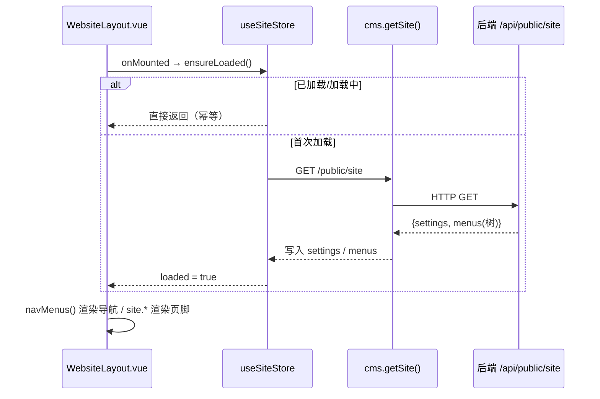
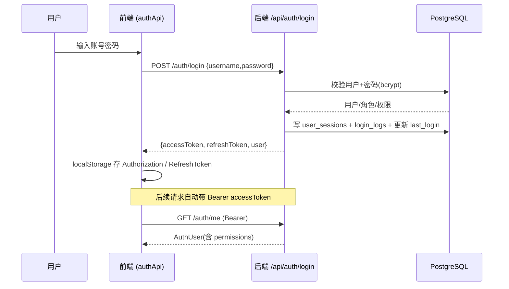
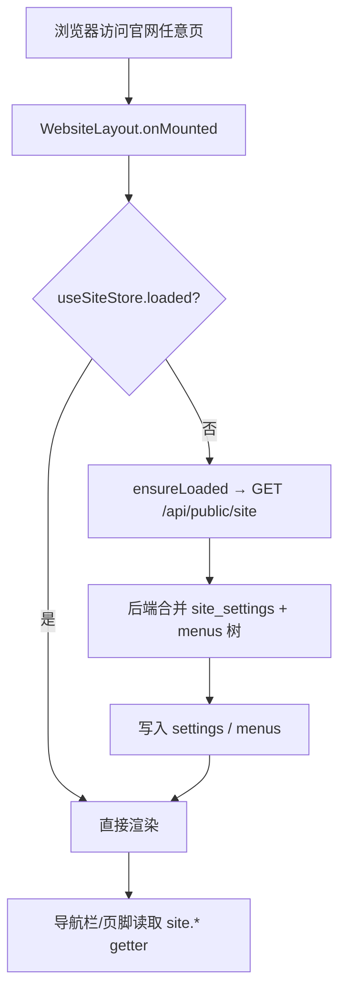
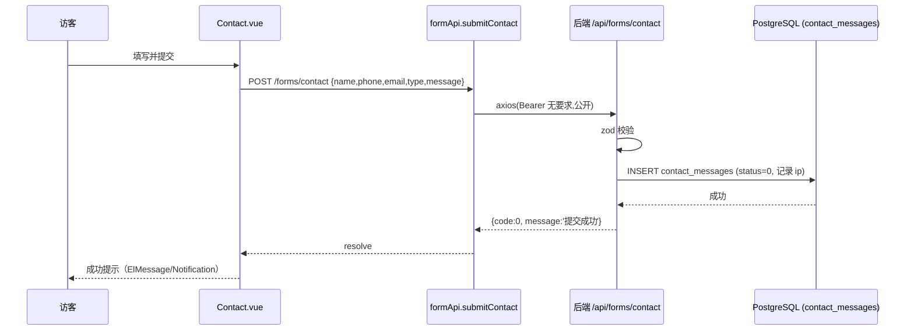
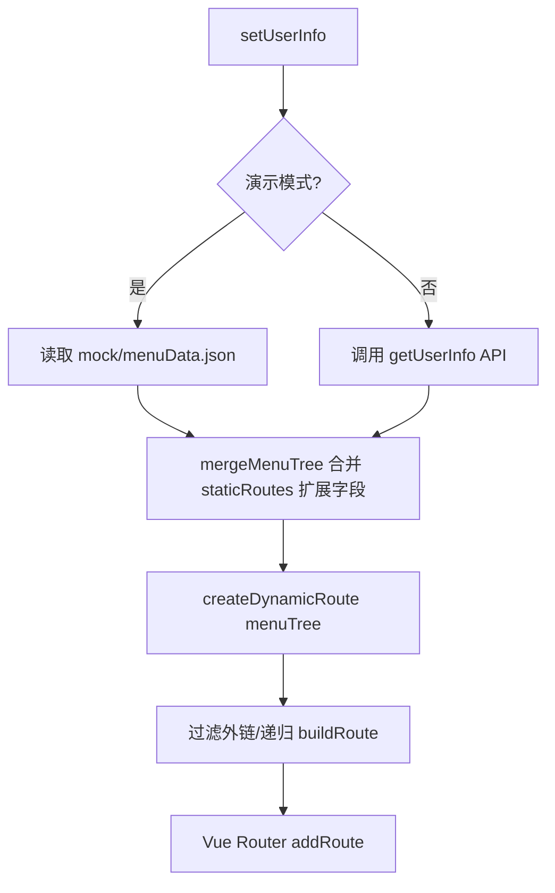
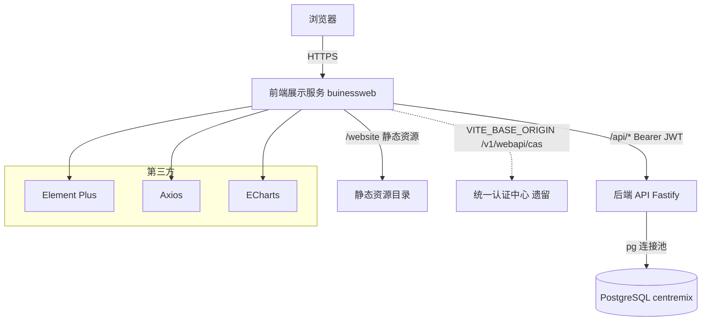

# 前端展示服务设计文档 · Centremix 芯联创官网

> 文档编号：`01-frontend-buinessweb-design`
> 所属项目：z-buiness（Centremix 芯联创企业官网）
> 配套文档：`02-backend-api-design.md`（后端 API 服务）、`03-database-centremix-design.md`（数据库服务）
> 文档性质：架构设计交付物（只读，不修改业务代码）

---

## 1. 服务概述

### 1.1 定位

前端展示服务（`buinessweb`）是 Centremix 芯联创企业官网的**唯一对客流量入口**，承担两大部分职责：

1. **企业营销官网（WebsiteLayout 体系）**：面向 C 端/经销商访客，展示品牌故事、产品中心、新闻资讯、售后服务与站内搜索，并通过表单收集销售线索（询价、合作、订阅、售后）。
2. **运营后台骨架（/admin 体系，沿用既有 admin 模板）**：作为未来 CMS 管理界面的容器外壳，目前仅含 `admin-home` 占位页，真实管理逻辑由后端 + 后续页面补齐。

### 1.2 技术栈

| 分类 | 选型 | 版本/说明 |
|------|------|-----------|
| 框架 | Vue 3（`vue`） | `^3.5.32`，Composition API + `<script setup>` |
| 构建 | Vite（`vite`） | `^6.0.7`，`createWebHistory` 路由模式 |
| 语言 | TypeScript | `~5.8.3`，`vue-tsc` 类型检查 |
| 状态管理 | Pinia（`pinia`） | `^3.0.4` |
| 路由 | Vue Router（`vue-router`） | `^5.0.4` |
| HTTP | Axios（`axios`） | `^1.15.1`，两套封装（`http.ts` / `cms.ts`） |
| UI 组件 | Element Plus（`element-plus`）+ 图标 | `^2.13.7`，自动按需引入 |
| 图表 | ECharts（`echarts`） | `^6.1.0`，用于首页/统计类可视化 |
| 工具 | lodash-es、animate.css、watermark-js-plus | 通用工具/动画/水印 |
| 包管理 | pnpm | `10.33.0`（`packageManager` 锁定） |

### 1.3 在整体架构中的角色

```
┌─────────────────────────────────────────────────────────────┐
│  浏览器 / 访客                                                 │
└───────────────┬─────────────────────────────────────────────┘
                │  HTTPS
                ▼
┌─────────────────────────────────────────────────────────────┐
│  前端展示服务 (buinessweb)  Vite + Vue3 + Pinia                │
│  - WebsiteLayout 营销站  - /admin CMS 骨架  - 静态资源 /website │
└───────────────┬─────────────────────────────────────────────┘
                │  /api/*  (Bearer JWT)
                ▼
┌─────────────────────────────────────────────────────────────┐
│  后端 API 服务 (Fastify + TS)  →  PostgreSQL 16 (centremix)   │
└─────────────────────────────────────────────────────────────┘
```

前端是**纯展示 + 状态编排层**：不直连数据库，所有数据均经后端 `/api` 暴露；富文本/内容的清洗与鉴权逻辑全部下沉到后端，前端只负责渲染与表单采集。

---

## 2. 核心职责

| 职责 | 说明 | 边界 |
|------|------|------|
| 营销页面渲染 | 首页、关于我们、产品中心/详情、新闻/详情、售后服务、搜索、404 | 页面数据全部来自后端 `/api/public/*` |
| 站点配置注入 | 通过 `useSiteStore` 拉取品牌色/导航/联系方式 | 配置来源是后端 `site_settings` + `menus`，前端只消费 |
| 表单线索采集 | 询价/合作/订阅/售后四类公开表单，提交到 `/api/forms/*` | 仅提交，不做业务校验落库（由后端 zod 校验） |
| 用户登录态管理 | 登录/登出/刷新令牌，存 `localStorage` | 鉴权判定与权限点（RBAC）由后端返回 |
| 运营后台骨架 | `/admin` 容器 + 动态路由（基于菜单树） | 当前仅为外壳，真实 CMS 页面后续补齐 |
| 静态资源托管 | `/website/*` logo、图片等 | 由 `public/website` 或部署静态目录提供 |

**职责边界**：前端**不**承担：
- 任何数据库访问（无 ORM / 直连）；
- 富文本 XSS 清洗（后端 `sanitize-html` 处理）；
- 业务权限判定（仅按后端返回的 `permissions` 数组做按钮级展示/隐藏）。

---

## 3. 接口设计

### 3.1 页面路由（来自 `src/router/index.ts` 与 `views/website`）

采用**静态主路由 + 动态子路由（/admin）**混合模式。官网部分用静态路由精确对应设计原型；后台部分由 `asyncRoutes.ts` 依据菜单树动态生成。

| 路径 | 名称 | 组件 | Layout | 数据来源 |
|------|------|------|--------|----------|
| `/` | home | `views/website/Home.vue` | WebsiteLayout | `cms.getBanners('home')` / `getProductsPaged` / `getArticles` |
| `/about` | about | `views/website/About.vue` | WebsiteLayout | `cms.getPage('about')` |
| `/products` | products | `views/website/Products.vue` | WebsiteLayout | `cms.getProducts` / `getProductCategories` |
| `/products/:slug` | product-detail | `views/website/ProductDetail.vue` | WebsiteLayout | `cms.getProduct(slug)` |
| `/news` | news | `views/website/News.vue` | WebsiteLayout | `cms.getArticles` / `getArticleCategories` |
| `/news/:slug` | article | `views/website/Article.vue` | WebsiteLayout | `cms.getArticle(slug)` |
| `/contact` | contact | `views/website/Contact.vue` | WebsiteLayout | `formApi.submitContact` |
| `/search` | search | `views/website/Search.vue` | WebsiteLayout | `cms.search` |
| `/admin` | admin-home | `views/home/index.vue` | `views/layout/index.vue` | 后台骨架（占位） |
| `/:pathMatch(.*)*` | notFound | `views/website/NotFound.vue` | WebsiteLayout | 品牌化 404 |

> `/admin` 下的其余菜单项（费用、货源、财务、统计等，见 `src/mock/menuData.json`）通过 `createDynamicRoute(menuTree)` 动态注册，组件按 `../views/<url段>/index.vue` 规则自动解析（见 `asyncRoutes.ts` 的 `getRouteComponent`）。

### 3.2 前端 API 封装

存在**两套 Axios 实例**，按用途区分：

#### A. `src/utils/http.ts`（通用/后台鉴权通道）
- `baseURL = import.meta.env.VITE_BASE_ORIGIN`（开发/生产均为 `http://172.16.192.251:31822`，对接既有 idaas/统一认证）
- 请求拦截：注入 `Authorization` 头（来自 `localStorage`）
- 响应拦截：成功直接返回 `response.data`；失败按 `401/403/404/500` 弹 `ElNotification`
- 备注：内部含 `v1/webapi/cas/client/*` 统一认证中心跳转逻辑（`dologin`/`logout`），属原有 admin 模板遗留，与官网 `/api/auth/*` 并非同一套鉴权。

#### B. `src/api/cms.ts`（官网数据通道，**核心**）
- `BASE_URL = import.meta.env.VITE_API_BASE || '/api'` —— 默认打向同源 `/api`，即后端 Fastify 服务
- 自建 `axios.create({ baseURL, timeout: 15000 })`
- 请求拦截：从 `localStorage('Authorization')` 注入 `Bearer <token>`
- 响应拦截：`401` 时清 `Authorization`
- `unwrap<T>()`：统一解包 `{ code, message, data }`，`code !== 0` 抛错
- **统一响应契约**：`ApiResult<T> = { code, message, data, meta? }`（见 `types/cms.ts`）

#### C. `src/api/api.ts`（遗留接口）
- `getUserInfo()` → `/v1/webapi/user/currentUserInfo`
- `logout()` → `/v1/webapi/cas/client/logout`
- 属后台模板遗留，官网未实际使用。

### 3.3 与后端接口的调用关系（`cms.ts` 全量）

| 前端方法 | 后端路由 | 方法 | 鉴权 | 类型 |
|----------|----------|------|------|------|
| `cms.getSite()` | `/api/public/site` | GET | 公开 | 站点配置 + 导航树 |
| `cms.getBanners(pos)` | `/api/public/banners` | GET | 公开 | Banner 列表 |
| `cms.getProductsPaged(p)` | `/api/public/products` | GET | 公开 | 产品列表（分页） |
| `cms.getProduct(slug)` | `/api/public/products/:slug` | GET | 公开 | 产品详情 |
| `cms.getProductCategories()` | `/api/public/product-categories` | GET | 公开 | 产品分类 |
| `cms.getArticles(p)` | `/api/public/articles` | GET | 公开 | 资讯列表 |
| `cms.getArticle(slug)` | `/api/public/articles/:slug` | GET | 公开 | 资讯详情 |
| `cms.getArticleCategories()` | `/api/public/article-categories` | GET | 公开 | 资讯分类 |
| `cms.getPage(slug)` | `/api/public/pages/:slug` | GET | 公开 | 单页内容 |
| `cms.getFaqs(cat?)` | `/api/public/faqs` | GET | 公开 | FAQ |
| `cms.search(q)` | `/api/public/search` | GET | 公开 | 全站搜索 |
| `authApi.login(p)` | `/api/auth/login` | POST | 公开 | 登录 |
| `authApi.logout()` | `/api/auth/logout` | POST | 公开（带 refreshToken） | 登出 |
| `authApi.me()` | `/api/auth/me` | GET | Bearer JWT | 当前用户 |
| `formApi.submitInquiry(p)` | `/api/forms/inquiry` | POST | 公开 | 询价线索 |
| `formApi.submitCooperation(p)` | `/api/forms/cooperation` | POST | 公开 | 合作线索 |
| `formApi.submitSubscription(p)` | `/api/forms/subscription` | POST | 公开 | 订阅 |
| `formApi.submitContact(p)` | `/api/forms/contact` | POST | 公开 | 售后表单 |

> 注：`getProductsPaged` 与 `getArticles` 同时返回 `ApiResult` 原始结构（含 `code/meta`），`Home.vue` 中已做兼容解析；其余均经 `unwrap` 解包为纯 `data`。

### 3.4 Pinia Store 状态管理接口

#### `useSiteStore`（站点级全局配置，`stores/site.ts`）
| 类型 | 名称 | 说明 |
|------|------|------|
| state | `loaded / loading / settings / menus` | 站点配置与导航树 |
| getter | `brandColor / siteName / slogan / companyName / contactEmail / contactPhone / address / icp / social` | 从 `settings` 分组派生 |
| action | `ensureLoaded()` | 拉取 `/api/public/site`，幂等（已加载或加载中则跳过） |

- `settings` 结构：`{ general?, seo?, social?, contact? }`，每个分组再映射为 `{ key: value }`
- `menus` 结构：`MenuItem[]`（含 `children` 递归，由后端 `menus` 表组装为树）

#### `useUserInfoStore`（用户与动态菜单，`stores/userInfo.ts`）
| 类型 | 名称 | 说明 |
|------|------|------|
| state | `userInfo / menuTree` | 用户信息 + 菜单树 |
| action | `setUserInfo()` | **当前为演示模式**：用 `src/mock/menuData.json` 模拟；预留 `getUserInfo()` API 接入位 |
| 工具函数 | `mergeMenuTree()` | 将 `stores/staticRoutes.ts` 的前端扩展字段（`cached/activeMenu/filePath` 等）合并到后端菜单树 |

#### `useSiteStore` 调用链


---

## 4. 数据结构

### 4.1 核心 TS 类型（`src/types/cms.ts`）

| 类型 | 关键字段 | 用途 |
|------|----------|------|
| `ApiResult<T>` | `code / message / data / meta?` | 后端统一响应契约 |
| `Paginated<T>` | `list / page / pageSize / total` | 分页封装 |
| `MenuItem` | `id / parent_id / title / url / target / sort / status / children?` | 导航/动态路由节点 |
| `SiteSettings` | `general? / seo? / social? / contact?` | 站点配置分组 |
| `SiteConfig` | `settings / menus` | `getSite()` 返回体 |
| `Banner` | `id / title / image_url / link_url / position` | Banner |
| `ProductSummary` | `slug / name / series / cover_image / summary / price_text / category` | 产品列表项 |
| `ProductDetail` | 继承 Summary + `gallery / description / specs / highlights / buy_link / related` | 产品详情 |
| `ArticleSummary` | `slug / title / cover_image / summary / tags / author / published_at / category` | 资讯列表项 |
| `ArticleDetail` | 继承 Summary + `body / view_count / related` | 资讯详情 |
| `Page` | `slug / title / meta_* / hero_image / content_json / status` | 单页 |
| `Faq` | `id / question / answer / category` | FAQ |
| `AuthUser` | `id / username / displayName / roleId / roleCode / permissions[]` | 登录用户 |
| `LoginPayload` | `username / password` | 登录入参 |
| `InquiryPayload` | `name / phone? / email? / company? / needType? / productId? / message?` | 询价表单 |
| `CooperationPayload` | `name / phone? / email? / company? / coopType? / message?` | 合作表单 |
| `SubscriptionPayload` | `email / type?` | 订阅表单 |
| `ContactPayload` | `name / phone? / email? / type? / message` | 售后表单 |

### 4.2 全局类型（`src/types/global.ts`）
- `MenuItem`（增强版，含 `filePath / filePathName / cached / activeMenu / hidden` 等前端路由扩展字段）
- `UserInfoResponse = { menuTree: MenuItem[]; buttonList: ButtonInfo[] }`
- `ButtonInfo / TagView / TableRow / ECOption`

### 4.3 Store 状态结构
```ts
// useSiteStore
interface SiteState {
  loaded: boolean; loading: boolean;
  settings: SiteConfig['settings'];   // { general?, seo?, social?, contact? }
  menus: MenuItem[];                  // 树形
}
// useUserInfoStore
{ userInfo: UserInfoResponse | null; menuTree: MenuItem[]; }
```

---

## 5. 关键流程

### 5.1 用户登录鉴权流程


### 5.2 站点配置读取流程（导航/品牌色/页脚）


### 5.3 表单线索提交流程（以售后为例）


### 5.4 动态路由生成流程（/admin 体系）


---

## 6. 依赖关系

### 6.1 服务依赖图


### 6.2 第三方依赖清单（前端）
| 依赖 | 用途 |
|------|------|
| `vue` / `vue-router` / `pinia` | 框架/路由/状态 |
| `axios` | HTTP 客户端 |
| `element-plus` + `@element-plus/icons-vue` | UI 组件与图标 |
| `echarts` | 数据可视化（首页/统计） |
| `lodash-es` / `animate.css` / `watermark-js-plus` | 工具/动画/水印 |

### 6.3 上下游与说明
- **上游**：浏览器访客、`idaas` 统一认证（遗留通道，仅 `/admin` 体系相关）
- **下游**：后端 API 服务（`/api/*`）
- **存储模式回退**：前端不直接接触对象存储；上传/媒体 URL 由后端 `STORAGE_DRIVER=local|s3` 决定并返回完整 URL（本地模式为 `/uploads/...`）。

---

## 7. 配置与部署要点

### 7.1 环境变量（`.env.development` / `.env.production`）
| 变量 | 值（当前） | 说明 |
|------|-----------|------|
| `VITE_BASE_ORIGIN` | `http://172.16.192.251:31822` | 通用 Axios（`http.ts`）+ idaas 认证域名 |
| `VITE_IDAAS_ORIGIN` | 开发 `http://paas-web-dev.chinacoal.com` / 生产 `http://paas-web.cloud.chinacoal.com` | 统一认证平台域名 |
| `VITE_API_BASE` | 未显式设置，默认 `/api` | `cms.ts` 官网数据通道基准路径 |

> ⚠️ 注意：`cms.ts` 使用 `VITE_API_BASE` 默认 `/api`，依赖反向代理将 `/api` 转发到后端（端口 3000）。若前后端分离部署，需在 `vite.config.ts` 的 `server.proxy` 或网关层配置 `/api` 转发。

### 7.2 常用命令
| 命令 | 说明 |
|------|------|
| `pnpm dev` | Vite 开发服务器（默认 5173） |
| `pnpm build` | 类型检查 + 生产构建（`run-p type-check "build-only"`） |
| `pnpm preview` | 预览构建产物 |
| `pnpm lint` | oxlint + eslint 修复 |

### 7.3 部署注意事项
1. **代理配置**：生产需将 `/api` 与 `/uploads` 反向代理到后端服务（同域或跨域需后端 `CORS` 放行 `FRONTEND_ORIGIN`）。
2. **静态资源**：`/website/*`（logo、产品场景图）需正确部署到站点根目录。
3. **双 Axios 通道**：确认 `http.ts`（后台/idaas）与 `cms.ts`（官网/后端）的目标域名，避免混用导致 401。
4. **演示数据**：`useUserInfoStore` 当前用 `mock/menuData.json`，接真实 CMS 时需打开 `getUserInfo()` 调用并移除 mock 依赖。
5. **包管理器**：锁定 `pnpm@10.33.0`（`onlyBuiltDependencies` 含 cypress/esbuild），CI 需使用 pnpm。

---

> 文档基于仓库真实源码（`buinessweb/src/**`）整理，如有接口调整请以代码为准。
